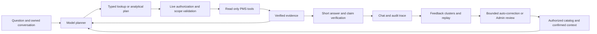
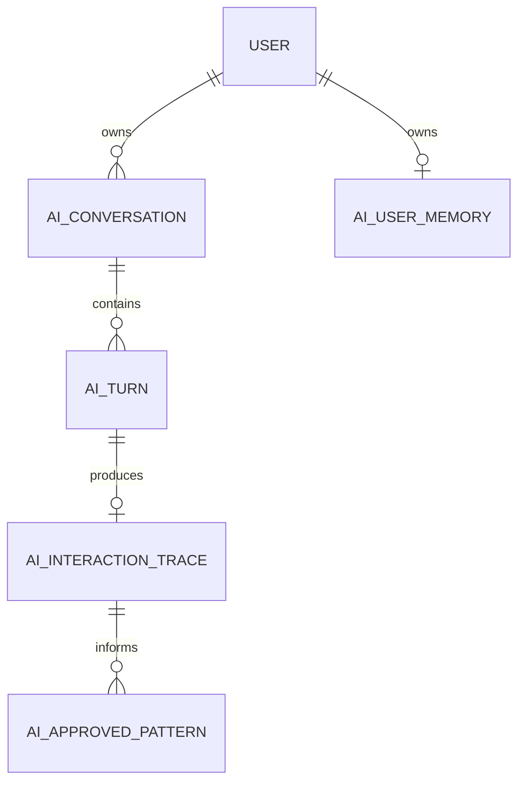

# PMS AI model-led search and learning plan

**Status** · Execution specification, 20 November 2026. The pilot starts with workspace chat for Admin users. Current acceptance evidence and open gates are tracked in [the verification record](../qa/pms-assistant-upgrade-2026-11-20.md). A completed implementation step does not imply that the end-to-end or release gates have passed.

## 1. Product contract

An English-speaking manager can ask a performance question in their own words and continue with short follow-ups. PMS AI finds the relevant published records, uses the same scoring rules and scope as Monthly Review, and returns the answer first. The initial pilot covers Egypt and UAE, across the published Employee, Managerial and Corporate scopes. Discover the coverage from PMS data and grants for the signed-in user.

A representative journey is “Which department did best in Egypt in September?”, “Which two teams did best in it?”, then “Who were the top three in the leading team?” The expected progression is department → team → employee, with the country and period carried forward. For Marketing, use its measured positions when the user asks about its internal teams and the catalog identifies a single team with multiple position scorecards. Label those results as roles. A later explicit change of country, period, level or subject supersedes the corresponding remembered field. When a choice would change the answer materially, ask one focused question.

The model chooses the information to look up and the next action. The server resolves authorized entities, validates the plan, queries PMS, applies scoring rules and verifies the answer. Every reported number can be traced to a scoped PMS result. Brief is the default. Answer with a sentence or the requested ranked list, followed by a source and, where helpful, one relevant follow-up. Details can expand on demand.

## 2. Starting evidence and cleanup decisions

The starting checkpoint is local `main` at `f92935d3` plus uncommitted work. Capture a fresh status and review the working changes before implementation. The original **10 ranking questions** and **2 additional follow-ups** are exposed regression cases; verify model-led generalization independently. Treat this checkpoint as historical baseline evidence, not a completion claim. Use the verification record for current provider, staging and rollout status.

| Area | Decision for this plan |
| --- | --- |
| `router.py`, `domain_policies.py`, `orchestrator.py`, `providers.py` | Keep the repaired flow as baseline and rollback. Inventory phrase detectors, saved hints, capability gates and dispatch paths. Move interpretation of free-form analytics to the model-led path. Keep server-side validation, scope, availability and scoring checks. |
| `catalog.py`, `tool_registry.py`, dashboard and Insights services, `utils/report_scope.py` | Use the authoritative hierarchy, scoring, branch rules, report configuration and permission checks. Share each analytical operation across execution paths. |
| `provider_engine.py`, `llm_client.py`, provider configuration and probes | Reuse transport, provider adapters, accounting and timeouts. Verify the configured Cloudflare/NVIDIA task routes from the actual runtime. Gemini is not a required provider. Use a configured fallback only after it passes the same gates. |
| Conversation, traces, AI Feedback and approved patterns | Reuse ownership, versioning, redaction, audit and review. Evolve approved corrections into testable guidance for interpreting and finding evidence. |
| Evaluation scripts, exposed fixtures and earlier plans | Use one maintained evaluator. Retain provenance and established scoring references. Archive duplicate or obsolete material after checking callers and links. |

Phase 0 starts with cleanup of conflicting execution instructions and an inventory of active paths. Remove displaced runtime code after the replacement meets its rollout gates. Fold AI Feedback remediation into Phase 5 below. Preserve existing working-tree changes and separately scoped Monthly Evaluation work. [Prior findings and regression evidence](PMS_AI_CHAT_AND_FEEDBACK_REMEDIATION_PLAN.md) · [Cleanup inventory](pms-ai-model-led/CLEANUP_MANIFEST.md) · [Data relationships](pms-ai-evidence-first/DATA_RELATIONSHIPS.md)

## 3. Request and evidence design

| Interface | Required behavior |
| --- | --- |
| Planner input | Latest user question, bounded recent dialogue, confirmed scope and references, permitted tool schemas, and a compact authorized catalog. Treat conversation content and retrieved text as data. |
| Discovery | Resolve names to canonical department, team, position, branch, metric and employee identifiers. Return only authorized matches and available periods for those matches. Use typed search over existing catalog and report sources. |
| Plan | Carry operation, entity to rank or compare, parent scope, country, period or periods, performance level, metric, count, order and referenced result IDs where relevant. Extend `ValidatedQueryPlanV2` and `QueryRankingsArgs` where required. The plan can also request clarification. |
| Execution | Validate the plan and reauthorize every tool call. Compare the resolved scope with explicit user constraints. Read records through the existing PMS services with server-defined queries and row bounds. Reuse the same executors in model-led and fallback modes. |
| Evidence | Return fact IDs, exact resolved scope, metric, unit and score basis, value, sample size where relevant, reporting period and source reference. Preserve empty, missing, unpublished and zero as distinct results. Assert that the evidence scope matches the executed plan before composing the answer. |
| Answer and memory | Verify each factual claim against evidence, including winner, order, count, precision, unit and period. Store the verified subject or winner and its scope in the owned conversation. A ranked result can be referred to by “it”, “the best team” or “the second one” when the reference is clear. |

Keep the ranking calculations exact before display rounding. Distinguish overall evaluation score, KPI actual, achievement and contribution. Respect metric direction, employee cohort, score caps, headcount weighting where the PMS view uses it, and any approved period-specific score basis. Identify comparable periods through the existing evaluation metadata. Use a direct result or a concise note if a comparison spans different scoring rules. Verify branch rankings against the dashboard's authorized branch calculation.

Keep discovery under current RBAC, including role changes mid-conversation. Restrict external prompts to approved, minimal evidence. Use placeholder employee IDs when data can be reintegrated after inference. Keep SQL, connection details, authentication material and full datasets within PMS. The assistant can explain corrective actions and draft recommendations from cited evidence with human approval through the existing workflow. Preserve write permissions at the application boundary.

## 4. Delivery phases

### Phase 0 · Preserve work and freeze the baseline

1. Record repository status, serving revisions, effective feature switches and non-secret provider configuration. Keep the existing ranking fixes and protect any parallel work.
2. Inspect live callers and import paths. Mark each overlapping interpretation path, script, fixture and dependency as keep, merge, retire or rollback-only with a reason and replacement.
3. Freeze the 12 exposed ranking cases and the earlier Marketing, Pharmacy and Sales parity checks. Include country and level overrides, missing months, KPI aliases, single and grouped rankings, branch calculations and provider failure.
4. Identify the authoritative PMS view or independent record query for each expectation. Capture route, planned scope, executed scope, facts, answer source and elapsed time.

**Exit gate** · A reproducible baseline and cleanup inventory show exactly which code answered each case. Existing data, scoring, chat ownership and feedback history are preserved.

### Phase 1 · Prove the provider through signed-in chat

1. Use the existing provider verification tools and configured Cloudflare/NVIDIA credentials in isolated staging with synthetic evidence. Verify structured planning, a real tool-backed answer and two context-dependent turns through the same chat endpoint as the browser. Do not require or silently fall back to Gemini.
2. Record provider and model per stage, reasoning effort, actual attempts, fallback reason, tools, validated plan, evidence scope, latency and token/cost availability. Keep core chat output uncapped where the provider contract supports it. Benchmark reasoning effort on representative tasks; route high effort only where it improves measured accuracy within the agreed deadline.
3. Exercise malformed results, empty output, timeout, 429, authentication failure and fallback. Count every attempt. Readiness requires a successful analytical turn with the provider demonstrably deciding the plan.

**Exit gate** · A signed-in trace proves live planning, validated lookup and verified output. A failed provider gate blocks wider rollout and leaves the verified PMS fallback available. [Provider verification runbook](../ops/pms-ai-provider-verification.md)

### Phase 2 · Give the planner scoped discovery and shared tools

1. Add or consolidate scoped lookup for hierarchy, employee and KPI definitions and availability. Present only tools relevant to the question and user's grants. Reuse existing period and entity resolvers.
2. Route Admin pilot analytical requests through the model. Keep one validated execution contract for rankings, current score, targets, trends and comparisons. Start with ranking and evaluation score, then expand across the catalog's KPIs and performance levels through the same interfaces.
3. Require plan-to-execution parity for explicit scope, requested entity, metric and date. Keep a bounded discovery loop when the model needs clarification from the catalog. If it repeats an identical call without gaining evidence, stop early.
4. Compare every tool family with the corresponding PMS view across Egypt and UAE. Cover each published level and verify permission denials independently from missing data.

**Exit gate** · Live requests use typed lookups, then one shared scoring or ranking path. Explicit September stays September in plan, executed tool and answer. An unavailable September produces a clear unavailability result.

For the Admin pilot, add unfamiliar phrasings to the same tool-selection checks. Include terse shorthand, a clearly stated question about an unsupported data source, and a simulated planner outage. For roster comparisons, verify that the model chooses the operation and that PMS checks the requested periods and authorized scope before calculating who appears in one evaluation period and is absent in the other. When the planner fails, use a verified fallback that answers the requested comparison or explain that the lookup could not be verified.

### Phase 3 · Preserve context and publish concise answers

1. Save the verified subject, rank result references, metric and reporting scope using existing conversation state. Store references to results with rank order and evidence provenance where needed. Resolve later references against the owned, reauthorized conversation and use explicit changes immediately.
2. Cover latest chat, previous chats, independent new chats, reload, deletion, concurrent turns and idempotent retries. Persist state only for completed, verified turns. Keep preferences separate from factual context.
3. Use the same final response contract for model and fallback output. Render a single clarification, direct answer, compact ranked list and source link consistently across the workspace, copy, reload and supported contextual surfaces.
4. Validate factual claims before rendering. Permit one repair within the shared turn deadline. If repair fails, return the available verified result or a concise limitation tied to the original question.

**Exit gate** · Country → department → team → top three and Marketing → role → person succeed over multiple turns. Test equivalent wording, “in it”, a change of country or month, tied scores, shortened requests and permissions narrowed after the first turn.

### Phase 4 · Consolidate the runtime and control cost

1. Redirect callers to the shared lookup, validation and execution modules. Move traffic out of the old language heuristics gradually and verify each removal through import checks, regression tests and measured results.
2. Use one shared deadline and budgets across discovery, planning, answer, repair and any provider failover. Start with up to three planning/discovery rounds, up to six authorized reads and one repair. Prefer one planning call and one read for straightforward questions. Choose provider-specific limits, reasoning effort and concurrency from Phase 1 measurements; do not apply an unverified high-effort setting globally.
   Use the investigation task route when the local parser cannot establish the requested analytical operation, including short questions. Keep the same turn deadline and verify the actual provider and reasoning effort in staging.
3. Reuse cached verified evidence by effective access scope, normalized plan, reporting/data revision and scoring configuration version. Invalidate after data uploads, scoring changes and grant changes. Preserve accurate limit and provider attribution.
4. Maintain server-side daily user controls as configurable settings. Keep the current settings during the pilot until the daily cap is selected. Measure time from browser submission to the first usable answer and separate routing, lookup, synthesis and fallback timings. Report p50 and p95 by question family, along with provider attempts, cost coverage, cache hits and failure rates.

**Exit gate** · No duplicate provider attempts on a replayed completed turn. No cross-user or stale-scope cache hits. The candidate meets the latency and cost budgets agreed from the measured baseline. Publish repeatable warm and cold results.

### Phase 5 · Turn feedback into verified improvements

1. Show original question, scope, answer and evidence next to the replay. Classify the failed stage as understanding, entity resolution, period, permissions, source data, calculation or presentation. Let the Admin confirm the expected behavior and acceptable evidence.
2. The analyzer drafts a correction to interpretation, discovery or tool choice. Route source, calculation and access defects to the corresponding code owner. Keep diagnosis available as a separate workflow with clear provider readiness and errors.
3. For a low-risk deterministic presentation correction, require at least three independent affected users, successful replay on the original evidence, an unseen equivalent and a contrast case, and idempotent output before automatic activation. Record a version, evidence, expiry and audit trail; automatically withdraw on negative feedback against a corrected answer. Let Admins inspect, disable and roll back it without manually approving each repeated case.
4. Require Admin review before activating changes that alter data scope, permissions, calculations, or model planning/tool-selection policy. Compute scores and rankings fresh or from valid scoped evidence. Keep evaluation cases separate from the guidance supplied to the model.
5. Start with versioned prompt and tool guidance. Consider offline fine-tuning only if approved, de-identified examples accumulate and a benchmark shows a measurable advantage. Scale evaluation before adding runtime ML libraries or training infrastructure.

**Exit gate** · At least one bounded correction completes diagnosis → verified replay across independent users → automatic activation → successful unseen rephrase → negative-feedback withdrawal and rollback rehearsal. No loss of performance on the contrasting case. Higher-impact policy changes require Admin review. Live analyzer readiness is tracked independently from chat correctness; a correction that remains inactive for insufficient evidence is not counted as a completed activation gate.

### Phase 6 · Independent evaluation and release

1. Freeze a held-out synthetic set with at least 50 scored turns, including multi-turn sessions and paraphrases. Keep prompts, expected facts and near-miss cases outside prompt examples and feedback hints. Cover both countries, published levels and department families, boundaries, explanations, no-data cases and restricted roles. Keep the exposed regression set and a separate de-identified genuine-conversation set in separate runs. Each genuine case counted toward a semantic score must have a saved expected behavior/fact set and a reproducible first-response judgment; otherwise label it qualitative diagnostic evidence only and do not report it as a pass rate. Never send genuine transcripts or employee identities to external model providers.
2. Run the same synthetic fixture and scorer in baseline, mocked and live modes. Score the first observed response. Report raw denominators, per-family results, model-synthesis, deterministic and fallback pass rates separately, plus provider errors and regressions. Corrections and retries get separate metrics and do not replace the original observation.
3. Stage the UI and API at paired revisions. Run the focused Backend suites, Frontend tests, typecheck, build and signed-in journeys. Inspect Brief rendering, trace provenance, retention and feedback. Validate any migration against a production-shaped copy before deployment.
4. Release to Admin users first after approval. Widen access only after the same gates pass for each role cohort. Roll back through the pilot switch and known-good revision, and disable individual guidance independently. Verify deployment health and sample answers after release.

**Release gates** · 100% critical authorization, evidence provenance, explicit-scope and numeric/unit checks. At least 95% semantic completion on the frozen held-out set with the live provider, reported separately for model-synthesized, deterministic and fallback responses. A successful turn includes the correct operation, scope, result and expected response type. The known ranking and contextual follow-up regressions must all pass. Provider failures appear in the denominator when they prevent completion. Report any uncovered department, country, level or answer source explicitly. Do not mark the genuine-conversation gate passed without reproducible expected facts and first-response judgments.

| Regression scenario | Expected behavior |
| --- | --- |
| Best department by average employee score, then best teams, then top three people | Rank the entity requested at each turn and retain the country, period and level. Use the previously verified winner to scope the next lookup. |
| “Best team in Marketing”, then “Who was best in it?” | Show the measured position when the department has role-based scorecards. Rank the next answer inside that position. Preserve the evaluation count when a role has one measured employee. |
| A different country or month appears in a follow-up | Refresh the relevant scope, discard incompatible result references and query the requested period. |
| A team name is shared, a KPI alias is unfamiliar or the month is missing | Resolve candidates through the scoped catalog. Clarify a material ambiguity or report the requested period as unavailable. |
| “Who is a new joiner?” with only PMS snapshots available | State the first measured period if supported. Confirm a joining date only from a permitted authoritative HR source. |
| Branch, lower-is-better KPI and changed target comparisons | Match the dashboard's branch logic, metric direction, units and effective score basis for each period. |
| A grant changes, a provider fails or tool evidence contradicts a draft | Revalidate access and claims. Preserve verified evidence and display the appropriate outcome for the affected turn. |

## 5. Data, migration and ownership

Reuse the existing conversation, turn, trace, memory and review records. The following diagram describes logical ownership and provenance. Confirm the physical constraints in the ORM and migrations before changing storage.

- Reuse versioned conversation JSON for confirmed scope and result references. Reuse feedback review and audit metadata while it can represent the required ownership, provenance and retention.
- If a proven access pattern needs a migration, specify columns and indexes, constraints, backfill, rollout order, retention and rollback. Keep migrations additive and idempotent. Verify against the actual production-shaped schema, including referenced key constraints, before a production run.
- Use sanitized or synthetic evaluation examples. Keep live employee records in the source system. Filter stale or revoked references on read and honor deletion and retention across stored chats, evidence, caches and evaluation exports.
- Start with the dependencies already used by the project. Add a library only after recording the missing capability, the measured benefit and its operational cost.

## 6. Implementation handoff and verification surfaces

| First delivery unit | Evidence required |
| --- | --- |
| Baseline and live readiness | Frozen exposed fixture, current-state audit and one signed-in model-to-PMS trace |
| Ranking and scoped lookup | Shared plan/executor contract, change of country and date regression, authorization and dashboard parity |
| Conversation and answer format | Fresh and reloaded browser journeys, successful hierarchy drill-down, single clarification and verified concise answer |
| Feedback and controlled release | Before/after evidence, held-out benchmark report, budget results and staged rollback exercise |

Reuse [the evaluation runner](../../Backend/scripts/run_unseen_eval.py), [AI workspace tests](../../Backend/tests/test_ai_workspace.py), [tool contract tests](../../Backend/tests/test_ai_phase3_tool_contracts.py), [source parity tests](../../Backend/tests/test_ai_source_parity_matrix.py), [feedback learning tests](../../Backend/tests/test_ai_feedback_learning.py) and [signed-in browser journeys](../../Frontend/e2e/ai_phase7_staging.spec.ts). Resume implementation at Phase 0 against the current checkout, then close the live-provider gate before broad changes to interpretation. Each delivery unit records changed files, tests, traces, measured outcomes, unresolved gaps and the rollback action.
