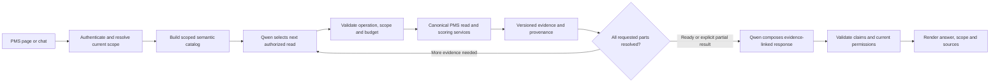

# PMS AI full coverage plan for Egypt and the UAE

**Plan date:** 7 November 2026  
**Status:** Proposed execution and acceptance baseline  
**Product language:** English  
**Scope:** Egypt (`EGY`), the UAE (`UAE`), and explicitly authorized shared data used by either country  
**Primary model:** Existing local Qwen3 4B runtime

Use this plan to implement and review the next PMS AI release. It extends the [contextual assistant plan](IMPLEMENTATION_PLAN.md) and the [conversation contracts](../pms-ai-conversation-v2/IMPLEMENTATION_BLUEPRINT.md). Apply its coverage and acceptance rules to the new exploration path. Preserve business rules and permissions from the authoritative PMS services. Record any conflict with an existing approved rule before changing it.

## 1. Required product behavior

- A user can ask about any applicable function, team, subteam, position, person, or scorecard level in their authorized scope in either country. Monthly Review supplies the navigation vocabulary. The backend supplies the authorized hierarchy and facts.
- Qwen can look up available concepts and their relationships, resolve approved aliases, select reporting periods, and request more than one authorized evidence read. It then composes a brief answer from the returned evidence. The server validates each request and every displayed claim.
- PMS supplies scorecard calculations, population, direction, units, effective targets and weights, publication status, and source links. A user asking for a booking count gets the count for the exact requested group, branch and period. A user asking two questions gets both supported answers or an explicit status for each unavailable part.
- The same engine serves PMS AI, Monthly Review, Team Dashboard, Executive and Function Summary, employee profiles, and the applicable BSC view. Each entry point uses the same permission and evidence rules. Page context, conversation history and request text are inputs to those rules.
- Give the requested answer first, show the effective scope and period, and link to the source. Default to one or two sentences for a single part, one short item per part for a compound question, and at most one relevant follow-up. Explanations, trends and detailed evidence are available when requested.
- Keep the assistant's analytics tools read-only. A corrective-action suggestion is a proposed draft grounded in the answer's evidence. The existing confirmation flow validates who can save, requires explicit confirmation, and writes through the existing action service.

## 2. Starting evidence and inventory

The reviewed working tree was based on `b470ef6` and included uncommitted assistant changes. The live Qwen exploration review used ten selected synthetic cases. All ten missed an expected fact or outcome, with median elapsed time of 11.3 seconds. The examples include an Inbound question answered for the broader Call Center, a branch booking count answered as performance percentages, and compound questions with missing parts. The eight exploratory tests passed, including a live smoke test. Several mock responses supplied arguments that the live response schema could never produce, and the live test did not assert every requested fact.

The current AI registry lists 18 team labels and marks only Inbound, Outbound and Support Positions Employee scopes as fully verified under its existing criteria. Treat those entries as prior evidence to recheck. They do not certify the new explorer or enumerate the full PMS population.

Phase 0 should preserve the prior reviewer harness and JSON output from the local workstation (`tmp/review_local_explorer.py` and `D:/PMS_AI/local_explorer_review_sample.json`). Reproduce with the same synthetic records and model before expanding the frozen cases. Version the cases and the independent expectations with the acceptance suite so the release check can run on another authorized host.

Read-only grouping of the local PostgreSQL snapshot found the following stored coverage. These counts describe local rows, including multiple months per employee or KPI. Establish current publication, source eligibility and parity separately.

| Area | Observed local evidence | Required inventory work |
| --- | --- | --- |
| Egypt Employee | 429 performance records across 11 stored teams. Call Center, Inbound, Outbound, Coding EGY, Submission EGY, Resubmission, Pre-Approvals IP, Marketing, Human Resources, IT, and Offshore Admin & Management. | Resolve Call Center Support Positions and each role from its source records. Reconcile the distinct stored Pre-Approvals IP and Pre-Approvals IP Offshore teams. Retain active teams with zero performance rows. |
| UAE Employee | 987 performance records across 11 stored teams. Coding, CSR, Pharmacy, Sales, Submission, Re-Submission, IP Elective Dubai, IP Final Dubai, IP Final SHJAJM, OP Dubai, and OP Final SHJAJM. | Record canonical RCM membership, variant IDs, exact branch attribution and role-specific KPIs. Preserve Pharmacy as a function with its approved roles. |
| Egypt Managerial | Seven performance records for Pre-Approvals IP across seven stored periods. | Identify the applicable Managerial source and scoring profile for each team and period, including configured scopes with no local sample. |
| Corporate | The management BSC snapshot table contains three Corporate KPI rows tied to one Egypt team and 462 rows tied to six UAE teams. | Reconcile the Corporate teams, periods, perspectives and effective targets through the management BSC service. The active management catalog includes Egypt Marketing and UAE CRM, Finance, Nursing, Pharmacy, PMO and RCM. Verify applicability at each level. |
| Shared | Finance and RCM have 49 Employee records tagged `All`. | Assign an explicit shared-data policy per dataset and metric. Require verified attribution before including a value in a country total. Count shared evidence once in a permitted combined rollup. |
| Historical and empty | The local team catalog has 32 active and six inactive rows. Performance records span stored months from January through September 2026. | Reconcile the catalog, historical identities, imported scorecards, readiness settings, published periods and any additional scopes in the release dataset. Carry inactive history when authorized and available. |

The inventory must use the database, configuration and canonical read services at a named data revision. The table above seeds that audit. Discover additional teams, archived names, importer-specific roles and position definitions through the same inventory process whenever a release dataset adds them.

## 3. Define coverage before changing the engine

Create a versioned, machine-readable coverage manifest. Build it from authoritative teams, assignments, position profiles, evaluation scope readiness and eligible scorecard data. Reconcile against Monthly Review, team and function views, employee scorecards, and management BSC. Require an owner and a disposition for every discovered scope, including active empty teams, inactive history, shared rows, aliases, and source conflicts.

The manifest identifies each applicable leaf by country or shared classification, canonical function and team IDs, subteam or position/profile when it changes eligibility or calculation, level, data source, and branch attribution mode. Attach relevant periods, scoring revisions, metrics, operations, permission tests and eligible destinations to that leaf. Generate combinations from facts and policy. Test each supported branch where data exists, and prove why an inapplicable combination is excluded. A broad function or country rollup has its own coverage and reconciliation record.

| State | Required evidence | Release effect |
| --- | --- | --- |
| `CERTIFIED` | Correct source mapping, metric meaning and calculation parity, period/revision coverage, access isolation, grounded answers from real Qwen, and working authorized links. Include test IDs and reviewer. | Eligible for activation only for the certified capabilities, scope and revision. |
| `VERIFIED_NO_DATA` | Source owner and read-service checks confirm absence for the exact team, level and period. End-to-end test returns the correct unavailable result. | Covers the absence case. Reevaluate when records publish. |
| `NOT_APPLICABLE` | Approved business rule and a passing boundary test. Example of a rule to verify is a BSC without a branch partition. | Exclude only the specific inapplicable operation or slice. |
| `BLOCKED_SOURCE` | Source workbook or signed expected results missing, unresolved identity mapping, incompatible schema, or unverified calculation. Record owner, reason and exit condition. | Numeric answers for the blocked capability stay gated. A required blocked cell prevents declaring full coverage. |
| `FAILED` or `PENDING` | Failing evidence, or required checks not yet run. Record the actual result or missing check. | Prevent activation for that capability. |

Track authorization outcomes separately from coverage. A denied user is the expected outcome for a negative test. A denied result cannot count as proof that the corresponding authorized workflow works. Report catalog coverage, data parity, actual answer coverage and denied-test results with separate denominators for Egypt, UAE and shared data. A team label in a menu or allowlist contributes only to inventory.

## 4. Architecture and trust boundaries

### Semantic catalog and source reconciliation

- Reuse canonical PMS identifiers and hierarchy. Keep IDs, display labels, aliases, function membership, position profiles, and effective dates separate. Resolve aliases against the active country and level. Require explicit resolution for collisions such as Coding versus Coding EGY, Re-Submission versus Resubmission, shared RCM versus an RCM rollup, and the stored OP Dubai variants. Check both grants and selection membership when legacy and new Pre-Approvals hierarchies differ.
- Build the approved metadata from a schema audit and the canonical adapters. Follow `performance_records.team_id` and `employee_id` to their respective IDs. Join `kpi_values` to the parent by record ID **and** year. Account for partitions, uniqueness, missing links, versions and legacy rows before any query or migration change. Use `DashboardRecordService` and the scoped dashboard read path for employee-style evidence, and `ManagementBSCService` and the published management configuration/snapshots for BSC evidence where those services are authoritative.
- Inventory country of the evaluation record, employee or team attribution, and branch/destination attribution as separate dimensions. Offshore Call Center workload for a UAE branch does not transfer the employee to the UAE team or grant a Branch Director access to the underlying offshore roster. Each branch calculation needs explicit branch-level source evidence or an approved projection, correct access rules and a reconciliation test.
- Project the minimum authorized metadata to the model per request. The catalog can expose display labels, allowed handles, supported operations, units, data availability and semantic relationships. Keep database credentials, raw SQL, unrestricted schema reflection and unapproved record exports outside the runtime contract. Validate changes to that metadata against the actual schema and representative source records before publishing a new catalog revision.

### Qwen exploration and answer contracts

1. Resolve an explicit user country, function, team, branch, level, position, person, metric and period ahead of page and confirmed conversation defaults. Preserve all explicit requests across tool calls. Infer a default only when the governing scope or requested operation permits one, and include it in the answer. Clarify genuine ambiguity. Enforce access on every explicitly requested item before any scoped data read.
2. Give Qwen a schema that matches the real production-shaped payload. It can request `find_concepts`, `describe_metric` or `list_available_periods`, then issue typed reads for a metric, target, trend, comparison, ranking, employee history or scorecard drivers. Validate every argument against authorized handles and operation constraints. Reuse the existing typed query and evidence contracts where they fit. A mock must pass the identical schema and parser used by the live endpoint.
3. Maintain required question parts and a ledger of validated reads, resolved facts, and failure reasons. Metadata inspection can lead to a data read. Finish only when each requested part has evidence or a precise missing, restricted, ambiguous or unsupported outcome. For requests that exceed the budget, return the verified parts with the exact unresolved part, or ask a focused clarification. Keep an explicit denial for a denied comparison rather than substituting another country, branch or team.
4. Validate each tool's output against the exact country, team or population, level, period, metric, and evidence revision. A tool limited to Employee records is ineligible for Managerial and Corporate requests. Read BSC perspectives, person results and history only through the relevant verified capability.
5. Qwen receives the minimal fact set and drafts short statements tied to allowed fact IDs and requested parts. Fact IDs bind subject, value, unit, direction, period, population, comparisons and provenance. The server renders those values and checks the claim relation, the referenced fact set and completeness. Reject invented figures, conflicting comparisons and unsupported causal claims. Where validation or the model fails, return an exact evidence summary or a clear unavailable result. Record planning, synthesis, validation and fallback separately so an answer generated by server rules cannot count as Qwen synthesis.
6. Bound exploration by time, tool calls, model calls, payload and result size. Start with at most three model decisions plus one synthesis request and four logical reads per turn. Batch related reads and stop on duplicate or incompatible requests. Set tighter limits for large history, rankings and multi-scope requests. Tune these budgets on held-out cases and the intended host.

### Live authorization and data isolation

Use the authenticated account and current server-side grants. Reuse the same enforcement as the owning dashboard and service for role, account state, country, function, team, branch, level, position and self-only constraints. Evaluate the effective intersection for the exact requested operation and rows. Client-provided filters and broad names such as `All` never confer access.

- Perform policy and row checks before resolving protected metadata, before each tool read, before sending retrieved evidence to Qwen, after slow operations, and before response, trace, link or action persistence. Stop an in-flight turn on scope revocation or evidence revision change. Use a fresh scoped version and restart within budget when data changed and the user still has access. Check final derived facts and identity as well as the requested scope.
- Use parameterized scoped reads with SQL predicates and bounded columns/periods where supported. Validate the returned evidence too. Replace assistant paths that load an unscoped roster and depend solely on filtering it later. Retain only fields needed for the current operation and use turn-local identity handles where possible.
- Enforce separate boundaries for catalog, metadata, facts, rankings, details, source links, conversation replay, cache, feedback and action confirmation. Scope fingerprints include current owner and grants, requested operations and filters, data/evaluation/config and catalog revisions. Recheck live access on cache and replay. Invalidate affected entries after uploads, apply/rollback, assignment changes and publication changes. Avoid holding a database transaction or pooled connection during a model request.
- Treat prompts, stored labels, Excel-derived fields and tool content as untrusted instructions. Allowlist tools, typed arguments and destination routes. Keep model calls on the configured private local service and reject outbound redirects, proxy escape and arbitrary URLs. Use de-identified fixtures and redact traces, review exports, telemetry labels and errors. Model access to employee data is limited to the evidence a caller may view.

Use authenticated test accounts with real grant records to exercise these boundaries. Verify exact entitlements against current PMS policy and include combinations of grants that narrow the same request.

| Account assignment | Required positive and negative cases |
| --- | --- |
| Regional Manager | EGY account reads approved EGY records and refuses UAE. UAE account reads approved UAE records and refuses EGY. Shared rows follow their explicit ownership rule. |
| Branch Director | Assigned UAE branch reads its eligible team data. Another branch and an offshore roster are unavailable. A branch comparison with a denied operand returns the correct denial. |
| Function Director or Function Viewer | Assigned function sees eligible teams and subteams in permitted regions and levels. An adjacent function, ungranted subteam or disallowed source link stays inaccessible. Verify both broad RCM and narrower legacy Pre-Approvals grants. |
| Team-scoped Manager and self-scoped user | Authorized team and level work. Other team/level, peer employee, or ambiguous name outside the account's scope cannot disclose facts. Recheck ranked subjects and prior turn replays. |
| Organization-wide and read-only roles | Verify actual authorized country coverage and existing navigation rules. Exercise a permitted action confirmation and a read-only denial with the same evidence. Dataset export and review are independently checked against the Admin policy. |

## 5. Calculation and experience requirements

| Capability | Required behavior |
| --- | --- |
| Current value and target | Use the exact published record version and approved aggregation. Report actual, target and gap only when supported. Distinguish bookings from conversion, attendance count from rate, and a real zero from a missing value or zero denominator. |
| Trend and comparisons | Bind explicit periods and reference the latest **published and authorized** period only for a relative request. Preserve gaps and indicate changed target, weights, direction or scoring basis where relevant. Compare only compatible units and populations. Keep record-level and rollup methods consistent with the dashboard. |
| Ranking and employee history | Rank by the requested metric with approved direction and unrounded comparisons. Expose ties and scope. Use the correct level and person in history. Separate first visible evaluation from employment or join date. Ask when names or references are ambiguous. |
| RCM and other special profiles | Validate count-based metrics, branch and position variants, uploaded scores, and historical source changes against approved source evidence. Apply the effective scoring policy for each month. Include supported tracking-only KPIs with their recorded values and keep their effect on score as defined by the published weights. |
| BSC | Use the correct level, perspective, scope and effective configuration for Managerial and Corporate data. Link a Corporate employee scorecard to the authorized BSC. Preserve the authorized person/position, period and country in all profile and team links. |
| Drivers and proposals | Show measured contributions and observed gaps with source links. Label hypotheses as hypotheses. Exclude sample/fallback data from factual answers and action proposals. Route saving an action through existing permissions, evidence freshness, idempotency, audit and user confirmation. |
| Unknown or out of scope | Use distinct outcomes for clarification, unavailable data, restricted access, unsupported requests and partial answers. Keep a user-facing answer direct and actionable. Reject silent period, person, scope or metric substitution. |
| Help, navigation and feedback | Use curated in-app guidance and verified destinations for the current user. Separate own-answer feedback from Admin review and de-identified approved evaluation examples. Any future model training or promotion requires a separately reviewed offline run and locked holdout. |

When a metric changes between months, preserve the approved published historical values and version references. The assistant consumes PMS outputs from current and previous revisions through the same authoritative service. Reconcile versioned targets, weights, direction, rounding, grouping and aggregation to the owning page before certifying an answer. Display percentages clearly and label changes with the compared values and period.

## 6. Implementation sequence and phase gates

Use one reviewable change set per phase or country/data family when a phase needs several changes. A reviewer records the exact candidate and the relevant passing gates before the next dependent phase. Work on independent fixtures and source mappings can proceed in parallel with separate ownership.

| Phase | Work and deliverable | Exit gate |
| --- | --- | --- |
| **0. Freeze and reproduce** | Preserve the current working tree, record commit/diff, model/checksum and configuration, pin the local fixture and ten failed cases. Capture current role policies, paths, source shape and expected results independently. | Reproducible baseline and locked expectations. Existing exploration is isolated while the gaps are addressed. |
| **1. Inventory and catalog** | Generate coverage and reconciliation manifests from Egypt/UAE teams, archived aliases, both record families, positions, branches, shared data and published periods. Build authorized concept and metric lookup. | Full inventory reconciliation with source owners. Schema, joins and variants checked against read-only local and approved staging-shaped data. No missing scope row, ambiguous alias or unexplained duplicate. |
| **2. Permission and data-read foundation** | Bind current scope and data version, add pre/post checks per step, use bounded scoped queries, validate replay/cache, strip forbidden tool arguments and preserve tenant/role boundaries. | Mandatory positive and negative tests for both countries, every relevant role, combined grants, changed assignments, disabled users, and denial before protected reads. Zero scope leaks across evidence, links, stored turns or model inputs. |
| **3. Canonical analytics by data family** | Wire metrics, score, targets, ranking, comparison, trend and history to canonical services. Use the same contracts for Call Center and Support, RCM and Pre-Approvals variants, other functions, then Managerial and Corporate sources. Migrate by verified evidence, including each country's actual teams. | Independent source parity for each applicable leaf, level, period and revision. Published version/rollback, track-only metrics and missing inputs pass. Each blocker has a reproducible reason. |
| **4. Qwen selection and synthesis** | Implement the real multi-step tool and response contracts. Fix explicit filter binding, later-step access rechecks, complete compound answers and validation of statements against evidence. | Pass all locked regressions through the actual local model, including scope binding, two-part answers and a model tool call following metadata inspection. Verify planner and synthesis attribution independently. |
| **5. Shared UI and governed workflows** | Wire the assistant into the named surfaces and existing full workspace. Present effective scope, direct answers, detail on demand, links, clarifications and feedback. Integrate verified proposals and confirmation where the user can act. | Browser tests for Egypt and UAE, each supported level, scoped users, page and filter changes, role switching, history restore, actions and keyboard/mobile flows. Correct destination and visible scope on every tested route. |
| **6. Independent verification** | Run frozen goldens, expanded per-cell parity and authorization suites, blinded held-out real-Qwen cases, adversarial runs, resource and fault tests. Review feedback as an evaluation input. | Every mandatory gate in section 7 passes on the exact candidate. Independent reviewer signs test evidence and reports any uncovered matrix cells. |
| **7. Staging and release** | Rehearse on the intended host profile and production-shaped schema, verify migration preflight and rollback if needed, certify cohorts, and produce a release manifest. | Business reviewer for each country, technical/access reviewer and product owner approve the measured scope. Full coverage requires all applicable cells certified or independently verified absent/inapplicable. |
| **8. Ongoing coverage** | Regenerate inventory on a new team, level, period, importer, mapping or scoring revision. Re-run affected parity, access and model tests and update the manifest. | New or changed capabilities pass the same gates before activation. Owners and evidence remain current for both countries. |

Start with an authorized Egypt and UAE staging slice to expose country-specific behavior early. Expand through **all** applicable source families, roles and levels in the manifest. A staging slice passes its own gates and carries its actual coverage label until the full-release gate passes.

Break Phase 3 into reviewable data waves. Each wave runs positive, negative and source-parity cases in both countries wherever applicable.

| Data wave | Required focus |
| --- | --- |
| A. Operational scorecards | Egypt Inbound, Outbound and Support Positions, plus UAE Sales, CSR and Pharmacy. Prove volume versus rate, branch versus employee country, tracking-only indicators, and role/position eligibility. |
| B. RCM | Egypt and UAE Coding, Submission, Re-Submission, and every Pre-Approvals variant. Prove aliases, subteam/grant relationships, branch partitions, approved aggregation, and precomputed or versioned scores. |
| C. Other teams and shared | Marketing, HR, IT, Offshore Admin & Management, Finance, shared RCM, and every additional discovered team. Prove role-specific metrics and units, shared attribution and rollup deduplication, historic aliases, and active scopes without records. |
| D. Managerial and Corporate | Reconcile both countries' level-specific and BSC data sources, positions, perspectives and published configuration. Prove exact period/version parity, role isolation and scorecard links. |

## 7. Mandatory verification and release thresholds

Freeze fixtures, expected structured facts and outcomes before implementation. Store synthetic IDs in tracked tests and keep approved real-source evidence in a restricted review location. Each case includes country/team/role, exact filters and requested parts, expected operation and evidence IDs or independent derivation, source/period/revision, expected numeric value and unit, permission outcome, link target, and acceptance rule. Preserve the original checks when repairing a failure. Record any independently approved correction to a defective expected value with before/after evidence.

| Gate | Minimum acceptance criterion |
| --- | --- |
| Inventory completeness | 100% of discovered team/source/level/position scopes have a disposition. Every applicable period and basis revision has deterministic data coverage. Require a direct end-to-end case for each applicable leaf and a compound case for each source family and country where supported. Cover every supported operation and branch in the matrix. |
| Exact source parity | 100% of mandatory independently reviewed fixtures match the canonical values, units, direction, period, rank/ties, contributors and source identity. Compare at source precision with published display rounding. Reconcile subgroup and combined rollups, including country/branch distinctions and shared rows. |
| Authorization and privacy | Zero unauthorized rows, identities, aggregates, tool reads, metadata, links, cached turns, model inputs or writes across the mandatory negative suite. Test the matching allowed query for each important denial. Include cross-country, same name in two regions, allowed-versus-denied branch, Managerial/Corporate isolation, self-only, stale replay and grant revocation mid-turn. |
| Known regressions | 100% of mandatory cases pass. Re-run the ten reviewed failures and the prior locked assistant suite on the new entry point with the flag enabled. Require all explicit parts, metrics, scopes and dates to match. Verify at least one valid multi-step exploration and one validated Qwen-authored synthesis for each country. A fallback response can pass the safety test and is counted separately for the Qwen gate. |
| Unseen real-model quality | At least 60 independently graded eligible holdout turns per country, including at least 10 per applicable operation family and all represented levels. Include unseen phrasings, role/scope changes, compound and multi-turn cases. Require at least 95% complete correct answers per country and each applicable family with its minimum sample, with zero confident material errors or wrong-scope answers. Count unexplained abstentions, missing parts and fallbacks separately, and as misses for model-owned eligible cases. Report denominators for small groups and certify them through mandatory exact cases. |
| Failure and safety handling | All mandatory tests pass for model down, malformed or repeated tool calls, timeouts, missing targets/denominators, prompt injection from user or stored data, scope changes, stale evidence, and Redis/DB failure. No unsupported claims or duplicate writes. Exercise the rollback and safe fallback paths separately. |
| Latency and capacity | Proposed staging launch budgets on the intended host are p95 at most 8 seconds for direct analytics and 16 seconds for compound, with p95 scoped data reads at most 500 ms at 200 employees per team. Include queue time on the real-model path. Measure warm and cold separately, fallback rate, RSS, CPU, database work and concurrent normal PMS traffic. Use the same workload across revisions and report timeouts/errors. Capacity changes require measured evidence and a recorded product decision. |
| UI, build and release | Existing and added relevant backend, frontend typecheck/lint/build, browser flows, role cases, links and rollback pass. Evidence is tied to the exact candidate, model and data revision. Every P0/P1 defect is resolved before activation. |

Run the live path with the actual Qwen endpoint and feature configuration in an isolated test environment. Assert facts and outcome, not keyword presence or HTTP success alone. Test mocks against the live schema. Keep test fixtures and holdouts separate by semantic family and conversation, and keep the final holdout out of prompt tuning. Repeat the mandatory live cases on the release candidate and report unstable results.

Minimum replay cases from the prior review use synthetic data with independent answers.

| Regression | Expected result |
| --- | --- |
| Inbound score in September and in August 2026 as separate questions | Inbound 85.0% and 82.5% respectively, with each exact period. |
| Outbound score in September | Outbound 60.0%, with no Inbound data mixed in. |
| Lowest Inbound employee in September | Alice Example at 80.0%, with authorized identity and exact scope. |
| Which branch had the most Inbound bookings, and compare Dubai with Sharjah | Both formulations use Dubai 180 and Sharjah 70 bookings for September. A winner claim follows those counts. |
| Inbound score plus lowest or best employee | Inbound 85.0%, plus Alice Example at 80.0% or Bob Example at 90.0% respectively. |
| Inbound trend plus best performer | August 82.5% to September 85.0%, plus Bob Example at 90.0% for September. |
| “Which one is doing better?” without resolved context | Ask which entities and measure to compare. |

Add country and level cases outside that synthetic set. At minimum include EGY RCM versus UAE RCM aliases, UAE branch comparison with a denied branch, a destination-versus-workforce-region case, a shared Finance/RCM case, lowest Support member with position, a best period with ties, a hire-date question with only evaluation history, a target revision between two months, both countries' Corporate BSC and an EGY Managerial scorecard, and an active team without published evidence. Test a multi-turn change of country, team, metric or period and an access revocation between evidence reads. Source owners provide independent expected values for real-data cases.

## 8. Release, monitoring and rollback

- Reuse existing tables and read services first. If a schema change is necessary, produce a logical ERD, inspect keys, foreign keys, types, nullability, partitions and production drift in an approved copy, and rehearse upgrade, compatibility and rollback with retained historical data. Run migration preflight and backup under the existing deployment process. Runtime requests must not create or alter schema.
- Activate certified scopes and capabilities through reviewed configuration, with independent controls for exploration, model synthesis, proposals and UI exposure. The current explorer is disabled in production. Production activation requires an explicitly reviewed release change after staging, permission and capacity evidence on the exact target profile.
- Record the candidate commit and diff identity, model checksum/runtime, source and scope manifests, schema revision, data and config versions, feature flags, test commands and reports, known limits, reviewers, and rollback procedure. Business reviewers approve country/level and calculation truth. A separate reviewer verifies authorization, real-model outcomes and release gates.
- Monitor completeness, safe abstentions, provider failures and fallbacks, scope denials, latency, resource pressure and evidence freshness without exposing personal data in logs. An observed access leak, wrong-scope answer, incorrect certified fact or sustained capacity failure disables the affected capability and starts a regression review. Rehearse disabling the explorer and restoring the verified dashboard or prior safe answer route without losing valid history.

## 9. Execution contract for Gemini and the reviewer

1. Work on the current phase and its documented dependencies. Start by reproducing baseline failures and identifying authoritative sources. Reuse existing PMS behavior. Take unresolved business mappings and permissions to the owner with the exact failing case, then continue independent work.
2. Implement the general rule that fixes the defect. Reject per-question exceptions, generated sample facts in live answers, hardcoded countries/periods/team lists, substituted metrics, and unverified formulas. Keep test expectations fixed and test the actual user-facing route.
3. Record each gate as `PASS`, `FAIL`, `BLOCKED` or `NOT RUN`. A gate with missing evidence, a skipped case, a mock-only result for a live requirement or a wrong answer is incomplete. When a result disagrees with the plan, preserve it, identify the failing layer and fix it or leave the phase explicitly open. A green suite with insufficient assertions does not pass the gate.
4. At each handoff include phase, exact candidate, scopes and capabilities exercised, changed files, reproducible commands, expected versus observed facts, model/fallback counts, privacy-safe evidence, open defects and rollback. Separate the implementer's report from independent verification. Seek a documented decision for a material scope, threshold or policy change before altering the acceptance baseline.
5. Mark full coverage only when the complete Egypt, UAE and shared manifest has the required evidence and approval. Until then, state the exact certified subset, verified absences and blockers.

### Code starting points

| Concern | Existing path |
| --- | --- |
| Authorized lookup and coverage | [AI catalog](../../../Backend/services/ai/catalog.py), [scope rules](../../../Backend/utils/report_scope.py), [branch attribution](../../../Backend/utils/branch_scope.py), [evaluation catalog](../../../Backend/services/evaluation/catalog.py) |
| Canonical evidence and BSC | [Dashboard record service](../../../Backend/services/dashboard_record_service.py), [scoped read service](../../../Backend/services/performance_dashboard_read_service.py), [management BSC service](../../../Backend/services/management_bsc_service.py), [data models](../../../Backend/models/models.py) |
| Planner, tools, synthesis and state | [Orchestrator](../../../Backend/services/ai/orchestrator.py), [explorer](../../../Backend/services/ai/local_data_explorer.py), [tool registry](../../../Backend/services/ai/tool_registry.py), [local synthesis](../../../Backend/services/ai/local_evidence_synthesis.py), [conversation service](../../../Backend/services/ai/conversation_service.py) |
| API, UI and acceptance tests | [AI API](../../../Backend/api/routers/ai_workspace.py), [Monthly Review](../../../Frontend/src/features/monthlyPresentation/MonthlyPresentationView.tsx), [contextual assistant](../../../Frontend/src/components/ai/ContextualAssistantPanel.tsx), [existing exploration tests](../../../Backend/tests/test_local_assistant_exploration.py), [prior release manifest](../pms-ai-conversation-v2/RELEASE_MANIFEST.md) |
