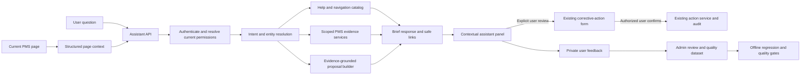
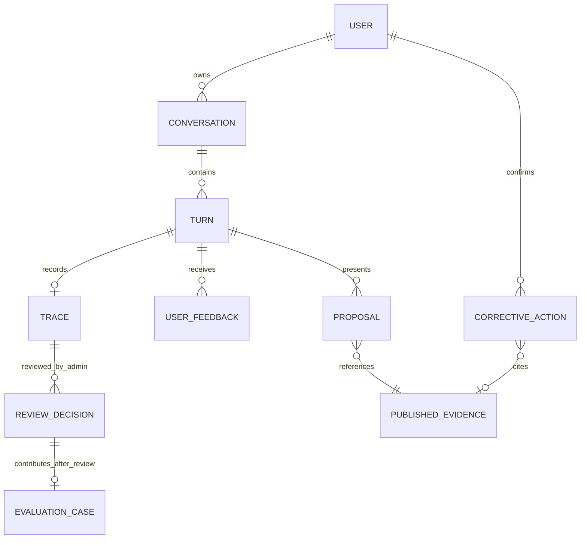

# PMS Contextual AI Assistant and Answer Quality Plan

**Status:** implementation plan; no functionality, migration or release is implied complete.  
**Language:** English product experience.  
**Initial surfaces:** Monthly Presentation and Team Dashboard.  
**Model decision:** Qwen3 4B is the current local pilot candidate; no new model downloads are needed. Gemini remains optional and disabled unless explicitly configured and cleared for the intended data. Bonsai is excluded.  
**Reference:** extends [PMS AI conversational analytics v2](../pms-ai-conversation-v2/IMPLEMENTATION_BLUEPRINT.md). Resolve overlap with that plan before coding; preserve existing approved business rules and the current uncommitted work.

## 1. Product objective

Provide one contextual assistant across PMS rather than requiring a user to leave their task for a separate chatbot. It should explain the current page, answer performance questions in concise English, navigate to authorized destinations, and propose evidence-based corrective-action drafts for user review.

The assistant uses the current page, selected entity and filters as context, but an explicit user request takes precedence when authorized. It must not silently broaden or substitute scope. Qwen helps interpret the request and, where appropriate, phrase an answer. PMS remains authoritative for permissions, published values, calculations, record selection, links and action writes.

### Agreed data-access and learning policy

The AI engine may be technically capable of accessing all PMS data through the appropriate existing services when required. This is a service capability, not a grant to individual users. Each interactive query must be constrained by the current authenticated user's effective role, team, function, region, branch, performance level and employee access before data retrieval, aggregation, caching or display. An Admin can query their authorized organization-wide scope; a branch manager sees only the data assigned to that branch. A request outside scope must be denied or clarified, never answered with another scope's data.

Separate organization-wide evaluation and dataset preparation from user conversations. Only an active Admin may initiate and manage these workflows. Use approved, access-controlled data, minimize and de-identify it where feasible, record provenance and reviewer decisions, and audit access. Full service capability does not imply exporting unrestricted records to model providers or training artifacts. Follow the separate provider/privacy controls in section 6.

Database access does not train the model by itself. User feedback is not a training label until reviewed by an Admin; no automatic training or unattended model promotion. The assistant has no independent authority to write records or approve decisions: action creation remains subject to the existing permission checks and explicit user confirmation.

### Examples

| User and surface | Desired response |
| --- | --- |
| Team Dashboard: `What does this page show?` | Explain the selected team, reporting period and visible metrics in one or two sentences. Offer one relevant next question. |
| Monthly Presentation, a booking KPI selected: `Why is this below target?` | State actual, target and measured gap for the selected scope and period. Distinguish verified contribution from an unproven cause. Offer details only if available. |
| Monthly Presentation: `What should we do?` | Offer a concise, evidence-linked action idea. If the evidence supports only a hypothesis, say so. |
| Employee asks `How do I find my scorecard?` | Give the authorized steps and a validated in-app link where available. |
| Manager asks `Create a corrective action for this` | Open an editable draft with context and evidence; save only after an authorized user reviews and explicitly confirms. |
| User asks `Who is lowest in Support and what is their position?` | Return the authorized person, position, score and reporting month directly; ask when identity or metric is ambiguous. |

### Scope boundaries

- One reusable engine and UI surface; all pages call the same validated backend services.
- Launch page-by-page and capability-by-capability. The design covers all teams and levels; availability is granted only after evidence and permission certification.
- Maintain the existing full AI workspace as a route/entry point during migration. It can share the same engine and components; do not create a second analytical engine.
- User-initiated guidance and proposal generation are read-only. The assistant cannot autonomously create, approve, assign, message or execute actions.
- No automatic training on user feedback. Fine-tuning is an optional later experiment, not an initial dependency.

## 2. Existing assets and known gaps to audit

The working tree is actively developed and contains uncommitted changes; the following is a starting map, not a certification of the current code or its safety.

| Area | Existing implementation | Planning implication |
| --- | --- | --- |
| Chat orchestration | `Backend/services/ai/orchestrator.py`, `router.py`, `tool_registry.py` | Extract or compose reusable boundaries without duplicating calculations. Verify prior review fixes on a fixed snapshot. |
| Local model | `Backend/services/ai/local_model_router.py` | Local intent support exists but is narrow and has produced invalid JSON. Keep experimental behind a local feature flag; fix/measure before expanding its role. |
| Types and conversation | `Backend/models/ai_schemas.py`, `conversation_service.py`, `repositories/ai_conversation_repository.py` | Reuse typed plans and owned conversations. Review state, concurrency, replay and authorization with current tests. |
| Feedback and review | `Backend/api/routers/ai_workspace.py`, `services/ai/trace_logger.py` | Reuse trace and feedback paths only after verifying review ownership, redaction and training-export boundaries. |
| Corrective actions | `Backend/services/corrective_action_service.py`, `Backend/models/models.py` (`Action`) | Use existing validation, owner/employee/team scope, permissions and audit trail. An `Action` currently defaults to `Open`; do not label an immediate persisted action as a draft. |
| AI workspace | `Frontend/src/pages/PmsAiWorkspaceView.tsx`, `components/ai/*`, `features/ai/types.ts` | Build shared presentation and state where justified; preserve existing route until replacement is verified. |
| Monthly Presentation | `Frontend/src/features/monthlyPresentation/MonthlyPresentationView.tsx`, `callCenterDeepDiveData.ts` | Use hierarchy and experience as reference. Some components use fixed fallback data; fallback or mock values are not authorized evidence for explanations or proposals. |
| Evidence and score rules | `Backend/services/performance_dashboard_read_service.py`, `services/scoring_basis_comparison.py`, evaluation revisions | Reuse published records and current versioning. Distinguish missing/zero and score movement/rule change. |
| Access | `Backend/api/dependencies.py`, existing team/function/region/branch/level checks | Apply the same current scope server-side on every request, candidate, cache, feedback, context restoration and action confirmation. |

Audit the current schema, running feature flags, actual migrations and existing release blockers before adding database changes. Prior 15-question model comparisons and successful synthetic smoke tests are useful baselines, not proof of readiness.

## 3. One engine, contextual entry points

### Engine responsibilities

1. **Context adapter:** accept a compact versioned page-context object; do not trust it as proof of access or as evidence.
2. **Capability router:** distinguish `page_help`, `navigation`, `performance_query`, `clarification`, `proposal` and `unsupported`. Handle greetings without querying performance.
3. **Knowledge catalog:** reviewed, versioned descriptions of pages, controls, terms, allowed destinations and relevant role visibility. Guidance is tied to current application version.
4. **Evidence gateway:** authorize and read published facts, actual definitions and historical revisions through existing PMS services.
5. **Proposal builder:** return a structured suggestion with evidence references, scope, limitations and editable fields; it has no write permission.
6. **Answer composer:** direct response first; facts, source, effective period and material limitations visible. At most one relevant next step.
7. **Feedback and evaluation:** capture user signals separately from reviewed truth and run representative regression suites before promotion.

### Context contract

Proposed `PageContextV1`: `page_id`, `route_id`, `function_id`, `team_id`, `position_id`, `employee_id`, `performance_level`, `region`, `branch`, `period`, `selected_entity_type`, `selected_entity_id`, `selected_metric_id`, `selected_visual_id`, `client_context_version`. All optional except validated page/route ID. Use existing identifiers where they exist; never place raw page HTML, all rows, workbook data, or permissions in the client context.

Resolve scope on the server: authenticated user -> explicit authorized request -> compatible confirmed context -> authorized page selection -> disclosed default. Revalidate on every turn and before displaying prior results, replaying a cached result, resolving links, or saving an action. Clear incompatible person, metric or period context after navigation/filter/account changes. On missing or ambiguous context, ask one short question.

`PageContextV1` is a proposal: add fields to existing request contracts only after compatibility analysis. Current `/api/ai/chat` should remain compatible for older clients. A validated plan must never accept an arbitrary tool name or SQL from the model.

## 4. Product modes and expected behavior

### 4.1 Page help and navigation

- Write a curated guide entry for each enabled page/section, in English, including purpose, common questions, steps, required permissions, verified internal route IDs and version/owner.
- Resolve page content from the approved catalog, not arbitrary page text or training-memory guesses. If help is missing, say so and offer a known next step.
- Navigation returns a safe internal link or user-triggered navigation action. It never opens an external site or crosses into a destination the user cannot access.
- If a button is hidden by role, do not tell the user they can click it. Offer an authorized alternative or describe that they lack access without revealing restricted data.

### 4.2 Performance analysis

- Use the existing source and calculation rules for the selected team, position, level, branch and month. Prefer IDs and published revision identities to free text.
- Clearly distinguish count vs rate, target vs actual, best vs highest where lower is better, missing vs zero and unscored vs scored employees. Preserve precision for calculations; round only in presentation.
- Respect Call Center hierarchy: function -> Inbound / Outbound / Support Positions -> individual positions, without treating Support Positions as a separate source team.
- Use dynamic published periods, not fixed month/year defaults. For trends with gaps show limitations; do not infer a hire date from the first performance record.
- Never derive a performance fact or action evidence from Monthly Presentation fallback/sample content. Where a presentation uses fallback data, explicitly mark it and use a verified backend source or respond that data is unavailable.
- Offer one optional deeper analysis only when it is relevant and can actually be executed under the user's scope.

### 4.3 Evidence-backed corrective action

1. The user selects or asks about a supported metric. The backend resolves published evidence, scope, period, source link and scoring basis.
2. Generate a **proposal**, clearly distinguished from an existing action: short title, observed facts, suggested steps, success measure and editable fields. Do not invent a cause, owner, deadline or measurable effect. If a cause is not verified, label it as a hypothesis or omit it.
3. A user with appropriate create access chooses **Create draft**. Open a prefilled review form; no database action exists yet unless a separately designed persisted-draft capability is approved and implemented.
4. The form rechecks the actor's current permissions and the subject/team/employee scope. The user selects an eligible owner, due date and any required fields.
5. On the user's explicit **Save** confirmation, call the existing `CorrectiveActionService` and normal validation/audit path. Recheck evidence version and permissions; if the data changed, refresh the evidence and require review again.
6. Display the actual saved status returned by PMS. Do not claim `Draft` if the existing `Action` record is created as `Open`. If a durable draft status is required, design a separate migration and workflow; do not silently change all action semantics.

Existing read-only roles may see explanations or suggestions within their scope, but only a user with the existing appropriate write permission may submit an action. Admin-only authority for evaluation settings remains unchanged; do not infer that every corrective action must be Admin-only without checking the existing role policy.

## 5. Frontend experience

### Shared assistant panel

- Provide a consistent entry point on Monthly Presentation and Team Dashboard, initially behind separate page flags and the existing role checks. The chat workspace remains accessible and uses shared contracts.
- Desktop: compact anchored panel that does not obscure the selected metric. Tablet/mobile: accessible drawer/sheet with safe keyboard and navigation-bar spacing.
- Header states the current effective context in plain English, for example `Inbound · August 2026 · Booking Rate`. The user can see when a filter or selected card changes.
- Start with page-specific questions drawn from approved capabilities, not a long generic dashboard. When no data exists, explain the page without fabricating an analysis.
- Results show a short answer, effective scope/period, a source link and a material warning when required. Detail expansion is optional; no automatic long charts or large result lists.
- A proposal shows `Review action` only when the user can create actions. Its form visibly identifies editable title, scope, owner, due date and evidence. `Cancel` must produce no write.
- Provide `Useful` / `Not useful` with an optional bounded reason, plus a way to indicate incorrect answer, incorrect scope, incomplete response or poor suggestion. Avoid suggesting that thumbs-up is verified truth.
- `New conversation`, page switch, filter change, logout and account switch clear or revalidate the appropriate state. Abort or ignore late responses; preserve no data across accounts.
- Test keyboard operation, focus management, screen readers, contrast, mobile keyboard overlap and 360/390/640/746/768/1024/1440 widths. Honor existing theme and accessibility patterns.

## 6. Model and provider strategy

### Initial local pilot

- Use the currently available Qwen3 4B locally only; no further model installation or model switching is required for this phase.
- Fix structured output between Qwen and the router. Test a supported JSON Schema response or grammar with the installed `llama.cpp` build; validate strict schema and allowed operation/field combinations server-side. Grammar guarantees syntax, not meaning or authorization.
- Model suggestions are untrusted. The server owns routing policy and can reject unsupported, incomplete, contradictory or unauthorized plans. Do not send employee records or full dashboards merely to help the model select an intent.
- Keep a deterministic route for social/help and cases that are better answered from known rules. If Qwen is unavailable, slow, or returns invalid output, fall back to a safe supported route or ask a concise clarification. Never produce an unrelated summary as an answer to a different question.
- The local router currently handles only a narrow subset of questions. Do not claim general conversation understanding until extended behavior is measured.
- Keep context size, maximum output tokens and concurrency bounded. Measure actual CPU/latency and enforce a queue limit and timeout. Compare cold/warm paths and fallback rates.

### Optional cloud fallback

Gemini remains a separately controlled option, off by default for the initial pilot. Consider enabling only after a documented privacy review, payload minimization, server-owned controls, cost and latency measurements, and a user-approved deployment policy. Never use it to calculate PMS facts, authorize users, generate SQL, or create actions.

Do not add Ollama, vector databases, agent frameworks, new model runtimes or new ML dependencies just because they exist. Evaluate additional components only against a measured failure and a reproducible baseline.

## 7. Answer quality and correction loop

Evaluate every response across independent dimensions. A correct-sounding sentence is not sufficient.

| Dimension | Required check | Example failure |
| --- | --- | --- |
| Intent and completeness | Correct request and all requested parts | Answers a trend but omits the best employee. |
| Context | Correct current page, subject, function/team/position, region/branch, level and period | Uses an old Inbound filter after switching to Outbound. |
| Facts and calculations | Exact published data and correct metric, direction, units, ranking and evidence | Uses booking rate when asked for count. |
| Permissions and privacy | No unauthorized facts or identity; no scope substitution | Replays an employee answer after access removal. |
| Interaction | Appropriate greeting, follow-up, clarification and honest unavailable outcome | Treats first performance record as hire date. |
| Answer usefulness | Direct, concise, readable and covers the question | Returns a page of unrelated diagnostics. |
| Proposal quality | Evidence relevance, feasible action, no invented cause or owner, user control | Recommends a disciplinary action without supporting facts. |
| Guidance and navigation | Correct, current steps and authorized destination | Sends a read-only user to an admin-only control. |

### Feedback lifecycle

1. A signed-in user submits feedback on their own answer or proposal. Capture rating, optional categorized reason and a bounded optional note. Feedback is not a verified label.
2. Store only the minimum necessary trace metadata according to an explicit retention policy. Encrypt/protect data using the existing infrastructure; avoid secrets, full workbook rows and unnecessary employee names in logs or training exports.
3. Admin reviews a de-identified case, the evidence and expected answer. Reviewer decisions are versioned and audited. Admin alone manages review and training promotion; ordinary users cannot self-certify examples.
4. Categorize the root issue: intent, context, entity match, date, calculation, access, evidence, response quality, guidance or proposal. Record the responsible layer and remediation.
5. Fix the underlying layer. A wrong KPI formula belongs to PMS scoring; a wrong scope belongs to authorization; an interpretation failure may belong to routing/prompt/model.
6. Add the reviewed scenario to regression tests. Compare new and previous system versions on the same locked held-out set; reopen regressions instead of accepting a higher aggregate score.
7. Promote only after the gates below pass. Do not make live changes automatically from feedback.

### Evaluation dataset

Store versioned, reviewed cases with: scenario ID, page, synthetic or explicitly authorized evidence fixture, user role and scope, conversation context, question, expected normalized plan/outcome, expected evidence IDs and numeric values, expected answer facts, permissible action/link, and reviewer metadata. Use fake employee names/IDs in committed fixtures.

Start with at least **100 distinct scenario families**, **300 English utterances** and **50 multi-turn conversations** across the initial pages and roles. These are coverage targets, not evidence of accuracy. Cover common and uncommon phrasing, abbreviations, typos, corrections, ambiguity, data gaps, manipulation attempts and off-topic questions.

Split by semantic family, entity template and entire conversation, so paraphrases and follow-ups do not leak between train, validation and held-out tests. Keep a locked holdout with unseen employees, periods, roles, phrasings and scoped datasets. A separate adversarial set tests invalid operations, prompt injection, stale evidence and unauthorized access. Refresh evaluation sets through review, not by silently changing expected answers to match output.

### Measurements and promotion gates

Report counts and denominators by page, role, operation and data scope; include confidence intervals where sample sizes permit. Measure correctness, not just presence of words or JSON validity.

- **Authorization:** zero out-of-scope disclosures or unauthorized writes in the mandatory role, cache, replay, navigation and action tests. Any confirmed violation blocks release.
- **Numerical/provenance parity:** 100% on reviewed golden fixtures for supported calculations, including target/weight revisions, score direction, missing values and published period. Test independently calculated expected facts.
- **Supported request understanding:** proposed >=95% exact complete-plan/outcome on a separately reviewed held-out set, with per-category results and no known critical confident wrong answer. A small sample cannot establish a production accuracy guarantee.
- **Clarification/unknown:** measure ambiguous and unsupported cases separately. Reward appropriate abstention; reject misleading confident answers.
- **Conciseness:** reviewed routine answers usually one or two sentences, cover all requested parts and show relevant scope/limitations. Separate concise formatting from factual correctness.
- **Suggestions:** reviewed for evidence grounding, relevance, feasibility, no unsupported causal claims, no unauthorized actor/owner, and explicit user confirmation. Report pass rate and reasons, never mark unreviewed suggestions safe.
- **Regression:** require all critical user examples to pass; track failure changes by commit, data revision, model version and page.
- **Operational:** track successful/failed/abstained calls, p50/p95 total and model latency, CPU, RAM, cache freshness, provider calls and actual cost where applicable. Do not log prompts, identities or scores as metric labels.

### Training decision

First improve catalog, prompts, context, output validation and deterministic queries. When a sufficiently large and diverse **Admin-reviewed, de-identified** dataset exists, evaluate supervised fine-tuning or a small intent classifier offline against the unchanged baseline and holdout. Include training/validation/test leakage checks, model/version manifest, reproducibility, CPU/RAM cost and rollback. Do not train or download a new model as a dependency of this plan.

## 8. Security, data and migration strategy

### Policy

- Restrict operations to approved server-owned tools, typed plans and parameterized queries. A model cannot issue SQL, choose a broader scope or control a write.
- Treat user input, retrieved records and tool output as untrusted for instructions. Page help is curated data, not executable instructions.
- Recheck live authorization and account status at query, replay, context restore, source-link resolution and action confirmation. Include team-specific performance levels and complete scope in cache identities.
- A proposed action may contain sensitive context; display and persist only what the authorized user can see. Minimize identities and retention; verify Unicode and partial-name redaction before any export.
- Normal users can submit feedback on their own interactions; only Admin can verify training examples and manage release gates. Audited export remains access-controlled.

### Data design and ERD (logical, reuse first)

This is a conceptual relationship diagram, **not a mandate to add seven new tables**. Inventory current `AiConversation`, `AiTurn`, `AiInteractionTrace`, review fields, evidence references and `Action` first. For each missing requirement, document why existing structures are insufficient. Prefer a versioned file-backed help catalog and test corpus initially. Keep proposals ephemeral in the review form unless persistence is demonstrably required; use the existing action service for confirmed writes.

If schema changes are necessary, specify columns, types, nullability, owner, provenance, retention, uniqueness, indexes, authorization, foreign keys and rollback before writing a migration. Preserve `(performance_records.id, year)` when linking partitioned records. Do not create a foreign key until the real production-shaped schema proves the referenced key is unique.

### Migration and rollback gates

1. Inspect actual migration heads and production-shaped PostgreSQL schema, including pre-existing runtime-created AI tables and constraints.
2. Test fresh database, production-shaped copy, legacy AI tables, missing/incompatible constraints, interrupted upgrades and rollback behavior. Fail with a useful diagnostic on drift rather than silently adopting an incompatible table.
3. Preserve existing action records, employee data, scores, audit history and review data. No automatic historical recalculation.
4. Use additive/compatible migrations and feature flags. Application rollback should normally leave new data intact. A destructive downgrade requires its own reviewed backup/restore procedure.
5. Do not run production migrations as part of local testing; the previously stated production-run approval remains applicable.

## 9. Performance, caching and deployment

- Baseline actual local request and full user-visible latency before optimizing. Report p50/p95, cold/warm, errors, queue time and local inference time separately.
- Target routine deterministic help below 1 second p95 in the measured pilot; model-assisted questions have a separately measured target and explicit timeout. Targets are acceptance goals, not existing results.
- Cache only authorized, validated evidence and curated help. Key evidence by full effective access scope including team-level grants, requested entities/metrics, period, data version, configuration/evaluation revision and catalog version. Recheck access at lookup and response time.
- Test upload, publish, evaluation apply/rollback, deletion, access revocation, context changes and Redis failure; stale or unverified evidence must not become an action proposal.
- Keep model request concurrency bounded. One model should not be loaded per user. Do not run fine-tuning inside the API process.
- Assess KVM 2 separately using measured free RAM, CPU, baseline PMS traffic and concurrency. The prior laptop benchmark is not a VPS benchmark; no deployment decision until isolated staging results show headroom.
- Independent switches: assistant UI by page, analytics capabilities by scope, local model, optional Gemini, feedback capture, reviewed dataset export and corrective-action proposal entry point. Each must have a tested safe rollback.
- Keep the existing chatbot route while the embedded panel is piloted. Do not silently remove working features or deploy an unverified migration.

## 10. Implementation phases and reviewable PRs

Each phase produces a brief change summary, tests, known limitations and a rollback path. One writer owns shared files at a time. Phases may be merged only after their stated dependencies and gates pass.

| Phase | Deliverables | Completion evidence |
| --- | --- | --- |
| **0. Baseline and decisions** | Pin current code/diff, preserve uncommitted work, inventory existing action lifecycle, authorization, schema, flags and prior review findings. Confirm source-of-truth mapping for two pilot pages. | Fixed commit snapshot, gap matrix, migration inventory and reproducible local test baseline; unresolved issues marked explicitly. |
| **1. Shared assistant contracts** | Define page context, typed capability plan, evidence/response and safe navigation contracts. Adapt existing engine rather than duplicating it. | Contract and authorization tests including page/filter/account transitions and old-client compatibility. |
| **2. Qwen reliability and conversation** | Correct JSON output handling; implement safe validation, fallback, context inheritance, current-scope revalidation and race protection. | Unseen paraphrases, compound questions, person/date ambiguity, invalid JSON, timeouts and permission changes pass. Report real-model latency and fallback rate. |
| **3. Page knowledge and help** | Curated versioned guidance for Team Dashboard and Monthly Presentation, role-aware page descriptions and safe links. | Human review of instructions; correct routes/permissions and no fabricated page content; tests for stale/missing guidance. |
| **4. Contextual panel** | Shared panel embedded on the two pages; scope chips, direct answers, clarifications, one relevant follow-up, feedback controls and responsive accessibility. | Local browser tests across desktop/tablet/mobile, keyboard, delayed responses, role switch, context reset and separate chat route compatibility. |
| **5. Evidence and corrective-action proposal** | Verified evidence adapter, structured suggestions, review form and explicit save via existing action service. | Golden calculations, fallback-data rejection, source links, stale evidence, role/write permissions, no write before confirmation, audit and duplicate-submission tests. |
| **6. Quality and feedback workspace** | Own-answer feedback, Admin-reviewed evaluation cases, de-identification, dataset versioning, exact evaluation dashboards/reports. | Tests cover feedback ownership, reviewer permissions, reviewed-only export, Unicode redaction and independent expected facts. No automatic training. |
| **7. Pilot and performance** | Freeze a candidate, run held-out and adversarial suites, resource/load tests and staging deployment rehearsal. | All mandatory gates pass, defects triaged, rollback and model-down behavior verified; user acceptance on the two pages. |
| **8. Incremental expansion** | Add Executive Summary, Function Summary, employee/BSC pages, navigation/settings help and remaining teams/levels in reviewed batches. | Each surface/scope has approved guidance, semantic mappings, permissions, golden data and source links; unverified operations stay unavailable. |
| **9. Optional model improvement** | If measured gaps justify it, compare reviewed-data classifier/fine-tune or optional Gemini fallback against the same locked holdout. | Accuracy, privacy, cost, latency and reproducibility prove benefit; explicit promotion and rollback. This does not gate phases 0–8. |

Recommended sequencing: phases 0–2 first; phase 3 may proceed in parallel with the frontend shell after contracts stabilize. Phase 5 follows authoritative evidence and role-policy review. Phase 6 starts dataset curation early but promotion requires independent evaluation. Phase 8 is gradual, not a promise that every team automatically works on day one.

## 11. Acceptance scenarios

Minimum pilot suite includes:

1. Page help on each initial surface for Admin, function director, branch director and read-only user; links and available controls match permissions.
2. A greeting and `What does this page show?` cause no unnecessary roster reads or model-generated performance claims.
3. KPI selection -> `Why below target?` -> `What about last month?`; exact metric, period and scoring basis retained.
4. User changes team/branch while a response is in flight; no prior-scope answer or context is displayed under the new scope.
5. `Who is lowest in Support and their position?` returns correct authorized person, period and ties; no disclosure of inaccessible people.
6. Best/worst month corrections and missing month; no score borrowed from another period and no rounded-away winner.
7. Booking count vs conversion rate, tracking-only AHT, zero denominator and missing published data; no fabricated facts.
8. Published KPI revision and rollback followed by the same question and action proposal; cache and evidence revision reflect the actual state.
9. A proposed action is reviewed and cancelled: no persisted action. A permitted confirmed save uses existing validation and creates exactly one audited action.
10. Read-only user, revoked owner access, stale evidence, duplicate submission and tampered subject: no unauthorized write or information leak.
11. User marks an answer useful; it does not become a verified training example until Admin review. Another user cannot modify its feedback or conversation.
12. Model unavailable, invalid JSON, timeout, prompt injection, Redis unavailable and role change mid-turn produce safe behavior.
13. Fallback/sample presentation content never becomes factual assistant evidence or a basis for an action.
14. Model comparison uses identical held-out questions, meaningful semantic answer checks, separate format compliance and actual resource/cost measurements.

## 12. Release and ownership checklist

- Record precise application commit, UI/backend versions, model checksum, runtime flags, enabled scopes, data/configuration revision and tests in a release manifest.
- Review current outstanding AI security and migration findings on the actual candidate; do not inherit earlier reports as proof they were fixed.
- Run focused backend tests, frontend typecheck/lint/tests/build, local browser workflows, PostgreSQL migration rehearsals if applicable, and load/role tests. State which were not run.
- Test fallback to existing UI and verified deterministic paths. Confirm no user-created action is lost during rollback.
- Require the established release approvals. A plan or a local success is not authorization to push, deploy or run a production migration.
- After pilot feedback, prioritize defects by safety, factual accuracy, context, usability and performance. Re-run the locked regression suite for every change.

**Definition of success:** a user can ask from the page they are using, receive a short and accurate answer grounded in their authorized data, inspect the source, and decide whether to review a proposed action. The quality process detects and corrects errors without automatically learning from unverified feedback.
