# Implementation Plan: Direct NVIDIA NIM Feedback Analyzer
## Nemotron 3.5 Super VL (`nvidia/nemotron-3.5-super-vl-120b-a12b`) for AI Feedback Analysis & Answer Enhancement

> **Status**: Ready for Approval  
> **Scope**: Admin-Only Offline Feedback Governance (`Settings → Administration → AI feedback`)  
> **Live Chat Impact**: Zero (live chat stays isolated on Cloudflare primary → Gemini fallback)  
> **API Provider**: **NVIDIA NIM Direct** (`https://integrate.api.nvidia.com/v1/chat/completions`)  
> **API Key**: `NVIDIA_API_KEY` (`nvapi-...` from `build.nvidia.com`)  
> **Model ID**: `nvidia/nemotron-3.5-super-vl-120b-a12b` *(configurable via env var)*

---

## Executive Summary

Right now, Admins reviewing flagged AI answers in [AiFeedbackLearningPanel.tsx](file:///d:/Projects/PMS_Dashboard/Frontend/src/components/settings/AiFeedbackLearningPanel.tsx) must manually inspect each redacted trace, figure out why the answer failed, and fill in the **Approve & save pattern** form by hand.

This plan integrates **NVIDIA Nemotron 3.5 Super VL** directly via **NVIDIA NIM** (`https://integrate.api.nvidia.com/v1/chat/completions`) into an **isolated, Admin-only Feedback Analysis Engine** that:

1. **Diagnoses root causes** of flagged feedback traces and clusters (`intent_misclassification`, `wrong_tool`, `missing_kpi_alias`, `scope_confusion`, `prompt_ambiguity`, `synthesis_hallucination`, `formatting_issue`, or `data_gap`).
2. **Pre-fills verified pattern fixes** (`corrected_pattern_prompt`, `intent`, `operation_kind`, `metric_hint`, `persona_tier`) directly into the Admin review form — while keeping **mandatory human PMS verification** (`verified_against_pms = true`) before anything affects live routing.
3. **Generates actionable engineering & DPO improvements** so future answers continuously improve both immediately (via `AiApprovedPattern`) and long-term (via verified DPO/SFT export bundles).
4. **Supports optional redacted screenshot analysis** (leveraging Nemotron 3.5 Super VL's native multimodal vision capability when an Admin attaches a redacted screenshot of a confusing chart or AI card).

---

## Direct NVIDIA NIM Configuration

> [!NOTE]
> The `:free` suffix only exists on OpenRouter. Calling NVIDIA directly via `https://integrate.api.nvidia.com/v1/chat/completions` with your `NVIDIA_API_KEY` (`nvapi-...`) uses the official NVIDIA NIM model ID **`nvidia/nemotron-3.5-super-vl-120b-a12b`** (with no third-party proxy).

Add to `DevOps/.env.example`, `DevOps/.env.hostinger.example`, and `docker-compose.yml` (safe default: **disabled** until key + flag are set):

```env
# Admin-only offline AI Feedback Analyzer (Direct NVIDIA NIM)
PMS_AI_FEEDBACK_ANALYZER_ENABLED=false
NVIDIA_API_KEY=
NVIDIA_API_BASE_URL=https://integrate.api.nvidia.com/v1
NVIDIA_FEEDBACK_MODEL=nvidia/nemotron-3.5-super-vl-120b-a12b
PMS_AI_FEEDBACK_ANALYZER_TIMEOUT_SECONDS=20
PMS_AI_FEEDBACK_ANALYZER_DAILY_LIMIT=50
```

- Uses Python stdlib `urllib.request` (zero new dependencies, matching `provider_engine.py`).
- Sends `Authorization: Bearer $NVIDIA_API_KEY` to `${NVIDIA_API_BASE_URL}/chat/completions`.

---

## Architecture & Data Flow

```mermaid
flowchart LR
    Admin["Admin clicks\n'Analyze Root Cause'\n(AI Feedback Panel)"] --> Gate["Admin RBAC +\nRedis Daily Budget"]
    Gate --> Privacy["4-Stage Privacy Gate\n1. redact_nested_payload\n2. sanitize_prompt_for_router_training\n3. assess_pii_quarantine (BLOCK residual PII)\n4. fence_untrusted_evidence"]
    Privacy -->|Clean Redacted Payload Only| NIM["NVIDIA NIM Direct\nintegrate.api.nvidia.com/v1\nnvidia/nemotron-3.5-super-vl-120b-a12b"]
    NIM --> Validator["Strict Pydantic JSON\nSchema Validator"]
    Validator --> Store["Persist in\nAiInteractionTrace.structured_response\n['nemotron_analysis']"]
    Store --> UI["Admin Review Panel\n• Root Cause & Confidence\n• One-Click 'Apply to Pattern Form'\n• Recommended Alias / Prompt Fix"]
    UI -->|Admin checks 'Verified against live PMS'| Pattern["AiApprovedPattern\n(Immediate routing improvement)"]
    UI -->|Admin approves trace| Export["De-identified DPO / SFT\nExport Bundle"]
```



### Hard Guardrails (Non-Negotiable)
1. **Strict Isolation from Live Chat**: `Backend/services/ai/provider_engine.py` (`SUPPORTED_PROVIDERS = ("cloudflare", "gemini")`) is **NOT modified** for user chat. Live chat latency, fallback policy, and `test_ai_admin_pilot.py` remain 100% untouched.
2. **Zero PII Outbound Leakage**:
   - Raw `AiInteractionTrace.prompt`, employee names/IDs, and unredacted DB rows are **NEVER** sent to NVIDIA NIM.
   - Every trace MUST pass `redact_nested_payload` + `sanitize_prompt_for_router_training` + `assess_pii_quarantine`.
   - If `assess_pii_quarantine` detects **any** `residual_*` PII token, the analyzer **blocks** the outbound HTTP call and returns `outcome = "blocked_pii_quarantine"` with exact reasons.
3. **Human-in-the-Loop Only (No Auto-Mutation)**:
   - Nemotron **never** auto-writes to `AiApprovedPattern`, **never** auto-approves traces (`reviewer_verified` stays `False`), and **never** edits `domain_policies.py`.
   - Admin must verify against live PMS data and explicitly click **Approve & save pattern**.
4. **Secret Protection**:
   - Extend `redact_secrets()` in [Backend/services/ai/config.py](file:///d:/Projects/PMS_Dashboard/Backend/services/ai/config.py) to scrub `nvapi-[A-Za-z0-9_-]+` tokens so `NVIDIA_API_KEY` can never leak into logs or `ErrorLog`.
5. **No End-User Vendor Exposure**:
   - End users never see any mention of NVIDIA or Nemotron anywhere in the UI. This capability exists strictly inside the Admin-only Feedback Governance view.

---

## Detailed Design

### 1. Strict Structured Output Schema (`Backend/models/ai_schemas.py`)

```python
class NemotronSuggestedPattern(BaseModel):
    corrected_pattern_prompt: str = Field(..., max_length=300)
    intent: Literal[
        "current_value", "actual_vs_target", "score_drivers", "trend",
        "compare_periods", "compare_branches", "compare_teams",
        "ranking", "scorecard_structure", "corrective_actions",
    ]
    operation_kind: str | None = Field(default=None, max_length=64)
    metric_hint: str | None = Field(default=None, max_length=120)
    persona_tier: Literal["self_only", "scoped_manager", "global_exec"] | None = None

class NemotronFeedbackAnalysisResult(BaseModel):
    trace_id: str
    outcome: Literal["analyzed", "blocked_pii_quarantine", "disabled", "rate_limited", "provider_error"]
    root_cause_category: Literal[
        "intent_misclassification",
        "wrong_tool",
        "missing_kpi_alias",
        "scope_confusion",
        "prompt_ambiguity",
        "synthesis_hallucination",
        "formatting_issue",
        "data_gap",
    ] | None = None
    root_cause_summary: str | None = Field(default=None, max_length=600)
    why_answer_failed: list[str] = Field(default_factory=list, max_length=4)
    recommended_system_fix: str | None = Field(default=None, max_length=500)
    suggested_pattern: NemotronSuggestedPattern | None = None
    suggested_dpo_chosen_outline: str | None = Field(default=None, max_length=600)
    confidence: float = Field(default=0.0, ge=0.0, le=1.0)
    analyzed_at: str | None = None
    cached: bool = False
    quarantine_reasons: list[str] = Field(default_factory=list)
```

---

### 2. Backend Components

#### A. New Module: `Backend/services/ai/nemotron_analyzer.py`
1. **`is_feedback_analyzer_configured()`**: True only when `PMS_AI_FEEDBACK_ANALYZER_ENABLED=true` and `NVIDIA_API_KEY` is non-empty.
2. **`build_redacted_analysis_input(db, trace)`**:
   - Runs `redact_nested_payload`, `sanitize_prompt_for_router_training`, and `assess_pii_quarantine`.
   - Hard-blocks if any `residual_*` PII token is detected.
   - Fences untrusted text via `fence_untrusted_evidence(...)`.
   - Passes only clean redacted fields: redacted prompt, intent/operation_kind, redacted `tool_calls`, feedback category/reason, guardrail flags, and persisted `dpo_pair_record` (if present).
3. **`call_nvidia_nim(payload, screenshot_data_url=None)`**:
   - Direct `POST https://integrate.api.nvidia.com/v1/chat/completions` with `model=NVIDIA_FEEDBACK_MODEL`, `temperature=0.1`, `max_tokens=900`, `response_format={"type": "json_object"}`.
   - Optional multimodal `image_url` content block (≤ 1.5 MB PNG/JPEG/WEBP, explicit Admin PII-free confirmation).
   - Enforces 20s timeout, max 1 retry on transient 5xx, never logs auth headers or raw response bodies.
   - Strictly validates returned JSON against `NemotronFeedbackAnalysisResult`.
4. **Redis Daily Budget Cap**:
   - Atomic Lua counter `pms:ai:feedback_analyzer:budget:{YYYY-MM-DD}` capped at `PMS_AI_FEEDBACK_ANALYZER_DAILY_LIMIT` (default `50/day`); returns `HTTP 429` if exceeded.
5. **Caching & Persistence (Zero DB Migration Needed)**:
   - Stores validated analysis in `trace.structured_response["nemotron_analysis"]` and writes an `AuditLog` entry (`"ai_feedback_analysis"`).
   - Subsequent requests return `cached=True` immediately (0 API calls) unless `force_refresh=True`.

#### B. Admin Governance Endpoints (`Backend/api/routers/ai_workspace.py` on `admin_governance_router`)
Strictly behind `Depends(require_ai_enabled)` + `Depends(require_ai_admin)` + `Depends(require_role(["Admin"]))`:

| Endpoint | Method | Purpose |
|----------|--------|---------|
| `/api/ai/traces/{trace_id}/analyze` | `POST` | Run (or return cached) root-cause analysis + pattern fix suggestion for one redacted trace |
| `/api/ai/feedback/clusters/analyze` | `POST` | Batch-analyze up to **5** flagged redacted traces in a cluster → consolidated root-cause summary + recommended system fix |
| `/api/ai/feedback/analyzer/status` | `GET` | Returns `{ enabled, configured, daily_used, daily_limit }` (never exposes API key or vendor internals) |

---

### 3. Frontend Admin UI (`Frontend/src/components/settings/AiFeedbackLearningPanel.tsx`)

Inside the **Trace Inspection & Pattern Approval** right pane:

1. **"Analyze Root Cause" Button** (Admin-only, visible when configured; shows subtle disabled status when off).
2. **Structured Diagnosis Card**:
   - **Root Cause Category** badge, **Confidence** pill, **Why the answer failed** bullets, and **Recommended System Fix**.
   - **Cached** indicator + **Re-analyze** button, loading skeleton, error + Retry state, and explicit **Blocked by PII Quarantine** warning if a trace contains residual PII.
3. **One-Click "Apply Suggestion to Form"**:
   - Pre-fills `Redacted Pattern Example`, `Target Intent`, `Metric Hint`, and `Review Notes`.
   - Leaves **`I verified this behavior against live PMS data`** **unchecked** so Admin sign-off stays mandatory.
4. **Cluster Batch Summary ("Summarize Cluster Failures")**:
   - Analyzes top 5 redacted traces in the selected cluster and offers a **"Copy Engineering Fix Brief"** action.

---

## Closed Loop: How Future Answers Improve

| Horizon | Mechanism | Result |
|---------|-----------|--------|
| **Immediate** | Admin clicks **Apply Suggestion → Form** → verifies live PMS → saves `AiApprovedPattern` (persona-scoped) | `ApprovedPatternMatcher` immediately routes future similar prompts accurately |
| **Weekly** | Cluster root-cause summaries highlight top `missing_kpi_alias` / `prompt_ambiguity` gaps | Fast, evidence-backed updates to `domain_policies.py` aliases & `router.py` rules |
| **Long-Term** | Verified `suggested_dpo_chosen_outline` + `dpo_pair_record` included in de-identified exports (`N ≥ 5`) | High-quality DPO/SFT dataset for future model fine-tuning |

---

## Rollout Phases

1. **Phase 1 — Direct NVIDIA NIM Client, `nvapi-*` Secret Scrubbing & 4-Stage Privacy Gate**
   - `Backend/services/ai/nemotron_analyzer.py`, `Backend/services/ai/config.py`, unit tests (`Backend/tests/test_nemotron_feedback_analyzer.py`).
2. **Phase 2 — Admin Governance Endpoints & Zero-Migration Persistence**
   - `Backend/models/ai_schemas.py`, `Backend/api/routers/ai_workspace.py`, `Backend/tests/test_ai_admin_pilot.py`.
3. **Phase 3 — Admin Feedback UI & One-Click Form Prefill**
   - `Frontend/src/features/ai/types.ts`, `Frontend/src/components/settings/AiFeedbackLearningPanel.tsx` & `.test.tsx`.
4. **Phase 4 — Cluster Batch Summary, Optional Multimodal Screenshot & DPO Export Hook**
   - Cluster batch endpoint + UI, `FeedbackGovernanceService.build_deidentified_export_bundle` enrichment, env templates (`DevOps/.env.example`, `DevOps/.env.hostinger.example`, `docker-compose.yml`), and CI manifest refresh.

---

## Files to Create & Modify

| Action | File | Purpose |
|--------|------|---------|
| **Create** | `Backend/services/ai/nemotron_analyzer.py` | Direct NVIDIA NIM client, 4-stage privacy gate, JSON validation, Redis daily cap |
| **Create** | `Backend/tests/test_nemotron_feedback_analyzer.py` | PII quarantine block, RBAC, caching, budget, and mocked NIM API tests |
| **Modify** | `Backend/services/ai/config.py` | Scrub `nvapi-*` keys in `redact_secrets()` |
| **Modify** | `Backend/models/ai_schemas.py` | Add Nemotron analysis request/response/status Pydantic models |
| **Modify** | `Backend/api/routers/ai_workspace.py` | Add 3 Admin-only endpoints on `admin_governance_router` |
| **Modify** | `Backend/tests/test_ai_admin_pilot.py` | Verify all 3 new routes stay strictly Admin-only |
| **Modify** | `Frontend/src/features/ai/types.ts` | Add TypeScript interfaces for analysis responses |
| **Modify** | `Frontend/src/components/settings/AiFeedbackLearningPanel.tsx` | Add Analyze button, Diagnosis card, Apply-to-form prefill, cluster summary |
| **Modify** | `Frontend/src/components/settings/AiFeedbackLearningPanel.test.tsx` | Add UI tests for analyze, prefill, quarantine block, and manual verification gate |
| **Modify** | `DevOps/.env.example`, `DevOps/.env.hostinger.example`, `docker-compose.yml` | Add optional NVIDIA NIM analyzer env vars (disabled by default) |
