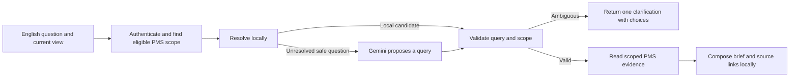

# PMS AI chatbot implementation plan

**Product goal** — Let managers ask a performance question in ordinary English and get a short answer they can verify against PMS. Answer common questions locally. Use Gemini for questions that need help with interpretation, and evaluate scikit-learn as a way to reduce those calls.

**First release** — A read-only Call Center pilot covering published Employee data for eligible Inbound and Outbound scopes. Default senior managers to a brief answer. Expand to every team, position, and performance level in batches that pass the same data and access checks.

## 1. Scope and implementation decisions

- Use English for the chat interface, starter questions, clarifications, answers, provider instructions, and new question fixtures. Display names as stored in PMS.
- Start with current value, actual versus target, comparison by period or branch, trend, ranking, and score drivers. Enable cross-team comparisons, other scorecards, and read-only governance summaries as their data and access checks pass.
- Read published PMS results. The chat uses the same organization hierarchy, authorized record selection, and scoring evidence as the dashboards. Route source links to the corresponding team or position sheet, employee profile, or authorized Corporate BSC.
- Reuse the same data and query contract in Brief and Details. The format is a presentation preference. Authentication and scope checks apply independently of answer length.
- Ship local answers and Gemini routing first. Make scikit-learn an independently gated experiment. Use reviewed question patterns and measured provider savings to decide whether to add it to the runtime.

## 2. Starting point and files to reuse

The checked-out AI prototype includes typed request and evidence models. The turn handler still extracts signals and selects tools before provider synthesis. The frontend sends recent messages, and the handler currently routes from the prompt and page filters. The deterministic renderer is available for a first release with local composition. Some tools load records broadly before applying scope. [Turn handler](../../Backend/services/ai/orchestrator.py) · [Chat schemas](../../Backend/models/ai_schemas.py) · [Answer providers](../../Backend/services/ai/providers.py) · [Tool registry](../../Backend/services/ai/tool_registry.py)

| Concern | Starting point |
| --- | --- |
| API and scope | [AI router](../../Backend/api/routers/ai_workspace.py), [scope dependencies](../../Backend/api/dependencies.py), and existing destination access checks |
| Teams, KPI definitions, and scoring scope | [PMS data models](../../Backend/models/models.py), current team and KPI registries, and published evaluation evidence |
| Data retrieval and versioned caching | [Dashboard read service](../../Backend/services/performance_dashboard_read_service.py), [scoring-basis comparison](../../Backend/services/scoring_basis_comparison.py), and existing data and configuration invalidation |
| English chat and response layout | [Workspace](../../Frontend/src/pages/PmsAiWorkspaceView.tsx), [response card](../../Frontend/src/components/ai/AiResponseCard.tsx), and [frontend types](../../Frontend/src/features/ai/types.ts) |
| Traces and current tests | [Trace logger](../../Backend/services/ai/trace_logger.py), [backend chatbot tests](../../Backend/tests/test_ai_workspace.py), and [frontend chatbot tests](../../Frontend/src/pages/PmsAiWorkspaceView.test.tsx) |

Previous local checks passed all five backend chatbot tests. The existing parser measured 0.18 ms at p95 across 4,000 warm calls on eight synthetic English questions. That measured parsing alone. A synthetic Gemini test authenticated successfully with `gemini-2.5-flash`, resolved three comparisons, and asked for clarification on an ambiguous question. The clarification label missed the exact expected value, so the routing contract uses fixed codes. Full request latency, accuracy on representative questions, and provider cost still need baselines.

Several AI prototype files were untracked when this plan was written. Establish the implementation branch from the intended prototype before opening PR 1. Identify and preserve work in progress, and reuse the typed scaffolding already present.

## 3. Request flow and contracts



### 3.1 Input and context

1. Keep `POST /api/ai/chat` as the entry point. Add an optional `answer_detail` value of `auto`, `brief`, or `details` to the existing request. Default to `auto`.
2. Treat page filters, last confirmed context, and any client-provided IDs as hints. Derive authority from the authenticated user. Revalidate every requested team, region, branch, position, level, person, and period before a read.
3. Use explicit wording first. For a follow-up, inherit compatible fields from `ConfirmedQueryContext` and resolve the rest from the current view. When a filter changes, clear incompatible context and show the new scope. Resolve an unspecified period to the latest accessible published month for the effective scope, and display that month. A specifically requested unavailable month returns an availability message.
4. Return the resolved context with a successful answer. Keep it in the active conversation and clear it when the user switches accounts or starts a new chat. Preserve the previous confirmed query while awaiting clarification. Treat selected clarification choices as fresh input and revalidate them. Send the model a compact context projection instead of conversation transcripts.

### 3.2 Router output and outcomes

Reuse `StructuredQueryPlan` and the existing intent and clarification enums. Require an explicit intent at the provider boundary. Normalize candidate references to PMS IDs, validate the required fields for the intent, and cap the date range and result size. Use one period for a value or target, two explicit sides for a comparison, a bounded period list for a trend, and a bounded limit for ranking. For the pilot, use up to six months and ten ranked rows unless the existing PMS view applies a tighter limit.

Example using illustrative catalog IDs:

```json
{
  "intent": "compare_periods",
  "team": "inbound",
  "branch": "dubai",
  "metric": "abandon_rate",
  "performance_level": "Employee",
  "periods": ["2026-07", "2026-08"]
}
```

| Outcome | Contract |
| --- | --- |
| `answer` | Return verified evidence, resolved scope, brief text, and an authorized source link. |
| `clarification` | Ask one English question with a fixed code and eligible choices. Resolve a count versus a rate or patient attendance versus shift compliance explicitly when needed. |
| `restricted_access` | Explain the user's available scope without exposing details about the restricted entity. A request for a different branch must never silently return the assigned branch's results. |
| `unavailable_data` | State which requested scope or period has no published evidence, and offer eligible alternatives where they exist. Keep a genuine zero distinct from missing evidence. |
| `unsupported_request` | Describe the supported read-only action or metric types. |

If the provider is unavailable, use a validated local route or return a clarification when eligible choices are available. Otherwise return a recoverable HTTP 503 and let the workspace offer Retry.

Routing order is typed starter actions and follow-ups, exact catalog and date resolution, the optional accepted classifier prediction, then one Gemini call for unresolved eligible requests. All routes share the same validation and tool execution. If the question is already known to be ambiguous or outside scope, return the applicable outcome locally. Use fixed, bounded tool inputs and server-selected actions. [Gemini structured outputs](https://ai.google.dev/gemini-api/docs/structured-output)

### 3.3 Catalog, data, and evidence

- Build a catalog projection from actual PMS team and position identities and the published scorecard metadata. For each eligible KPI, expose its stable ID, display name, English aliases, unit, direction, aggregation, source, and contribution status. Use scoped KPI IDs when raw keys such as `Other` collide. Map a new workbook column after its business meaning is reviewed.
- Resolve the published target, weight, rule, and actual for each requested month. A tracking-only KPI such as AHT can be shown when supported by the source. Include it in score contribution only when the published rules do. Apply the dashboard's aggregation, exclusions, and rounding.
- Extend `TypedMetricEvidence` only where needed for a stable evidence identity or provenance. Include actual, target, unit, sample size or coverage where meaningful, scoring-basis status, period, and source link. Compare actual performance and scoring-rule changes separately. For unlike metric definitions or incomparable scoring bases, display the available results with the applicable caveat.
- Compute measured KPI contributions through PMS. A driver describes a contribution supported by the evidence. Display a suggested next step only when it follows from the evidence. Use safe internal source URLs built from validated IDs and filters.

## 4. Executive answer experience

Use Brief by default for Executive, General Manager, Regional Manager, Branch Director, and Function Director roles. Honor the selected detail preference and explicit requests for a breakdown. Display the effective period and scope adjacent to the answer.

| Request | Brief format |
| --- | --- |
| Current performance or target | State the actual, target when applicable, and status in one sentence. |
| Comparison or trend | Lead with what moved and the two values or key trend points. Surface any material scoring-basis or coverage caveat. |
| Score drivers | Lead with the change and the largest measured driver. Add a second driver only when it changes the interpretation. |
| Priorities | Name one priority with its scorecard link. Add one next step when supported. |
| Missing evidence or ambiguity | Lead with the limitation or the question the user needs to answer. |

Example with illustrative values:

> **Dubai Outbound scored 86% in August, down from 90% in July and below its 100% target.** Attendance was the largest measured contributor to the decline.
>
> Dubai · Outbound · Employee · August 2026 · **Open scorecard** · **Show details**

Reuse the deterministic renderer and existing response fields. Build the headline and any short supporting line from typed evidence. Return the brief, relevant caveat, and primary source as the first visible content. Expand supporting evidence already in the response immediately. Fetch larger drill-downs through existing scoped PMS reads with the same validated filters, using zero additional model calls. Keep details collapsed by default for Brief. Derive suggestions and eligible clarification buttons from the catalog and current access.

## 5. Provider, privacy, and performance

### Provider controls

- Put cloud routing behind a server-owned switch with a pilot scope allowlist. Use `GEMINI_API_KEY` in the `x-goog-api-key` header. Reuse `PMS_GEMINI_MODEL` for the model ID. Use the tested Flash model as the baseline and run the same accuracy, latency, and cost checks before changing the pinned model.
- Use a bounded request timeout and one provider call per turn. Resolve authorized candidates locally before requesting a structured plan. Release the database read transaction before waiting for the network, and recheck effective authorization before querying evidence.
- Limit external input to approved, minimized metadata and sanitized English phrasing. Resolve people inside PMS. Use a local clarification or supported local path when a prompt cannot be safely projected. Keep workbook contents, employee records, private KPI evidence, and API keys out of external payloads and logs. Confirm the project and retention settings before allowing live traffic. [Gemini data retention](https://ai.google.dev/gemini-api/docs/zdr)
- Record low-cardinality outcome and timing metadata. The current trace writer persists raw prompts and digests. Restrict feedback to the trace owner, restrict and audit exports, and apply the agreed retention and redaction rules. Use a reviewed, anonymized export for evaluation examples. Move trace schema checks out of the chat request path if persistence is required. [Trace implementation](../../Backend/services/ai/trace_logger.py)

Proposed routing controls are `PMS_AI_ROUTER_MODE=legacy|shadow|hybrid`, `PMS_AI_GEMINI_ROUTING_ENABLED=false|true`, and `PMS_AI_CLASSIFIER_MODE=off|shadow|enabled`. Defaults are local deterministic routing, cloud disabled, and classifier off. Shadow mode records route decisions on approved inputs while the active path serves the answer. It skips shadow tool execution. Use a separate `PMS_AI_BRIEF_DEFAULT_ENABLED` switch for the role-based Brief default so the presentation can roll back independently. Keep compatibility with existing request clients while enforcing provider choice on the server.

### Performance work

1. Measure send-to-visible-answer time and split it into resolution, provider, database, trace, and render time. Track p50 and p95 by route and intent, cold and warm results, provider call count, token cost per 100 questions, and fallback outcomes. Record the actual response completion time, including trace work.
2. Start with the common summary and comparison reads. Push scope and period filtering into existing repositories and reuse dashboard aggregates. Replace broad record loads on those paths while keeping employee-level drills behind explicit requests and scoped queries.
3. Cache verified evidence by normalized query, effective access scope, data version, configuration version, and evaluation identity. Recheck access on every request and before rendering cached evidence. Verify freshness after upload, evaluation apply and rollback, and reassignment of permissions. Reuse the existing invalidation strategy. [Dashboard cache design](../../Backend/services/performance_dashboard_read_service.py)
4. Keep Brief fast to render. Compose it locally from the same evidence used by Details. Defer large charts and long lists until the user opens them.

## 6. Optional scikit-learn evaluation

Compare three paths on the same English question set: the existing router, the new local rules with Gemini fallback, and the same new rules with a classifier before fallback. The useful gain is the number of additional questions answered correctly inside PMS.

- Start with TF-IDF over word and short character sequences and logistic regression for a small set of intents. Train on reviewed, anonymized questions with intent labels. Group paraphrases of the same question into the same data split. Keep a separate validation set for threshold selection and a held-out set with unfamiliar wording and teams. [scikit-learn text classification](https://scikit-learn.org/stable/auto_examples/text/plot_document_classification_20newsgroups.html)
- Predict intent only. PMS resolves entity and period fields from the catalog and checks scope. Accept a prediction only when it meets the measured confidence policy and the complete query resolves to one valid interpretation. Evaluate ambiguity and unfamiliar requests before enabling the model. [Probability calibration](https://scikit-learn.org/stable/modules/calibration.html)
- Measure correct local coverage and provider calls and cost per 100 questions. Require the release gates below before adding the runtime dependency. If the candidate passes, version the trained artifact with the catalog and training recipe, load it once from a trusted build, and shadow it before turning it on. Review failed cases before using them as training examples. [Model persistence](https://scikit-learn.org/stable/model_persistence)

## 7. Implementation sequence

Open one reviewable PR per row. Keep cross-team expansion behind per-scope eligibility until its test evidence is reviewed.

| PR | Implementation | Merge evidence |
| --- | --- | --- |
| **1. Baseline and provider controls** | Confirm the prototype baseline. Create an English intent and evidence fixture set. Add timing and cost measurement, server provider control, and trace ownership and export boundaries. | Existing workflows pass. Synthetic provider checks and tests verify outbound payloads, redaction, ownership, timeout, and local fallback. |
| **2. Executive brief** | Add Brief and Details to the existing response flow and workspace. Build the brief locally and expose scope, caveats, and source. Keep initial cards compact. | A routine answer fits one or two sentences. Detail expansion keeps the same evidence and access. A senior manager and a director can review representative answers on desktop and mobile. |
| **3. Call Center catalog and scoped reads** | Map Inbound and Outbound, including applicable branch and offshore scopes, to KPI and period evidence. Add filtered reads, versioned cache behavior, and scoring-basis notices for the pilot metrics. | Golden answers match dashboard values. Published-month revisions, tracking-only KPIs, branch filters, missing values, and access changes pass. |
| **4. Structured routing and follow-ups** | Wire local resolution and Gemini routing to the shared validator. Use confirmed context for follow-ups, render eligible clarification choices, and make the workspace catalog-driven. Start in shadow mode. | Equivalent English phrasing produces the same plan. Filters, confirmations, and all outcomes pass role and browser scenarios. Explicit restricted requests get a restricted outcome. |
| **5. Pilot and performance gate** | Enable hybrid routing for approved Call Center pilot users. Measure user-visible latency, dashboard parity, cache behavior, and cost under realistic data and concurrent use. | Pilot meets the release gates. The team tests a switch back to local routing and records the known coverage limits. |
| **6. Classifier experiment** | Run the held-out offline comparison. Enable an optional classifier only if it meets the accuracy and cost gates. | Save the split methodology, coverage and cost comparison, error cases, and promotion decision with the PR. |
| **7+. Team coverage** | Certify RCM with Pre-Approvals and its teams, then Marketing positions, then Pharmacy as a function, CSR, Sales, and remaining teams. Certify Managerial and Corporate scopes as their evidence and permissions pass. | Each scope has catalog mappings, verified published-period fixtures, role tests, and a working source link. Record which intents, periods, and levels the scope supports. |

PRs 2 and 3 can proceed in parallel after PR 1 and agreement on the evidence fields. PR 4 depends on the catalog and shared validation. The classifier experiment can run after there is a reviewed question set and a measured rules-plus-fallback baseline. It does not gate the Call Center pilot.

## 8. Verification and release gates

Start with about 100–150 reviewed English questions. Include the exact expected intent, filters, outcome, and dashboard evidence where applicable. Add verified fixtures as each team is enabled. Include paraphrases, abbreviations, typos, ambiguous wording, unavailable periods, history and filter transitions, and requests outside scope.

| Scenario | Required result |
| --- | --- |
| Two English phrasings of the same Inbound comparison | Same normalized query and verified values. |
| “Show me Call Center attendance” | Ask for the applicable definition when ambiguous. Choices reflect the caller's access. |
| “And July?” or a changed page filter | Reuse compatible confirmed fields, or clear stale context and display the newly applied scope. |
| Dubai branch director asks for Sharjah | Restricted outcome without substituting Dubai or disclosing Sharjah results. Repeat equivalent cases for regional and function roles, including RCM and Pre-Approvals. |
| Media Buyer CPL and Corporate scorecard | Use the correct position or level. Open the authorized position sheet or BSC. |
| Outbound diagnostic KPI, zero denominator, and missing month | Match PMS tracking-only status and display behavior. Distinguish missing from zero. |
| Changed target or weight, followed by rollback | Values, explanations, and caches reflect the published rules at each step. |
| Provider timeout, invalid response, or unfamiliar request | A bounded local fallback or clear clarification. No unvalidated tool action. |
| Access removed or another user's trace or context reused | Deny access, including through cached answers, details, suggestions, links, feedback, and export. |

Run the focused backend checks from `Backend` with the isolated test configuration and the frontend checks from `Frontend`:

```powershell
# Backend
rtk proxy python -m pytest -q tests/test_ai_workspace.py tests/test_function_access_scope.py tests/test_scoring_basis_comparison.py

# Frontend
rtk npm test -- src/pages/PmsAiWorkspaceView.test.tsx
rtk npm run typecheck
rtk npm run lint
rtk npm run build
```

Add targeted browser coverage for Brief and Details, follow-ups, source links, and role-restricted scopes as those paths ship. Run browser and load checks in an authorized test environment. If trace persistence requires a migration, verify upgrade and rollback against a production-like schema before release.

| Gate | Proposed target |
| --- | --- |
| English routing | At least **95%** exact intent and resolved filter matches on held-out supported questions. Report by team and intent. |
| Numeric parity | **100%** on verified dashboard fixtures, including revised scoring rules and period comparisons. |
| Access | **Zero** out-of-scope disclosures in role and cache tests. |
| Executive readability | Most routine answers fit **one or two sentences**. The relevant scope, caveat, and source are visible. |
| Performance | **Under 1 second at p95** for routine local questions under pilot load. Aim for **under 3 seconds at p95** for a typical single-KPI question and **under 5 seconds at p95** for a standard comparison across the pilot. Measure with about **200 employees per team**, representative concurrent use, and separate warm and cold results. |
| Classifier promotion | At least **99%** exact intent and filter matches among accepted local requests and **20% fewer provider calls** relative to rules plus Gemini fallback on the same workload. Maintain overall accuracy, access guarantees, and answer quality. |

Move from local verification to staging, shadow routing, a limited Call Center pilot, then scope-by-scope expansion. Keep the Brief presentation, cloud routing, and classifier independently reversible. Disable the affected route when a release gate fails and use the verified local path where it can answer safely. Record the fixture run, timings, cloud call rates, and enabled scopes for each release.
