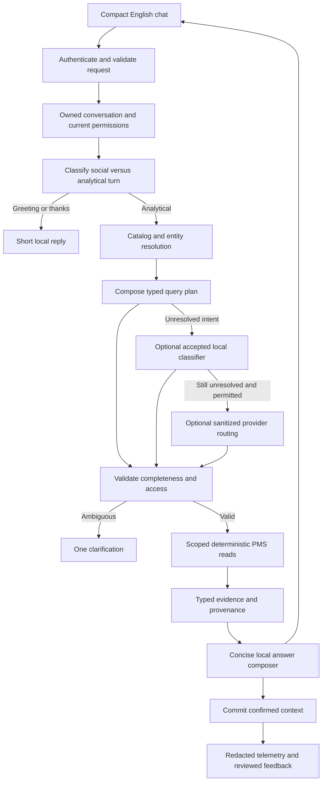
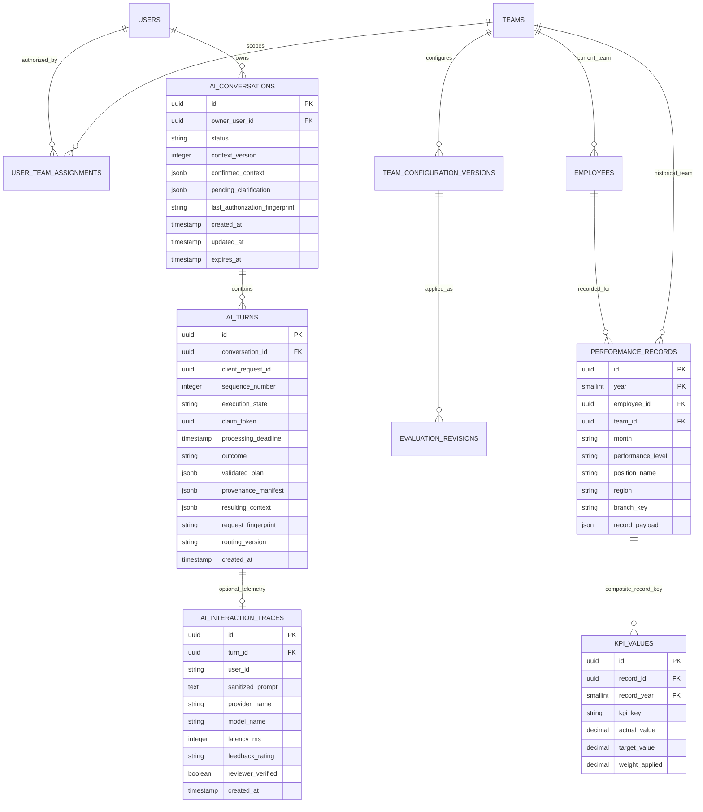

# PMS AI: conversational analytics implementation blueprint

**Status:** implementation specification; not a completion or production-readiness claim.  
**Prepared:** 6 November 2026.  
**Implementation owner:** Gemini Argon. **Planning and independent review:** Codex.  
**Environment constraint:** Hostinger KVM 2, reported as 2 vCPU / 8 GB RAM; confirm actual free resources before load testing. No Ollama or GPU prerequisite.  
**Language:** English UI, questions, clarification and answers; retain employee names as stored.  
**Pilot:** Call Center function, Inbound, Outbound and Support Positions, initially certified Employee scopes. Other teams and levels follow the same architecture, with explicit certification.

## 1. Product outcome and boundaries

A manager asks an ordinary question and receives the relevant fact immediately, with the person, position, period and metric needed to interpret it. The assistant remembers compatible conversation context, asks one focused clarification when necessary, and offers at most one useful next step.

The product is a **grounded analytical conversation service**. Search, dialogue state and optional intent classification select bounded queries. Existing PMS services supply the facts. A concise composer presents the answer. Installing a classifier does not create general language understanding; confidence and completeness checks must allow it to abstain.

This blueprint consolidates the earlier [implementation plan](../pms-ai-chatbot-implementation-plan.md) and subsequent conversation requirements. Where they differ, this document defines the proposed v2 implementation sequence. Preserve valid existing work; classify each item as already verified, needs adjustment, missing or blocked before implementing it. Do not rewrite working modules merely to match proposed filenames.

### Required behavior

| User request | Required response behavior |
| --- | --- |
| `Hi` | A short welcome and invitation; no performance queries, charts or provider call. |
| `Is Mariam a new joiner in Inbound?` | Resolve within authorized Inbound candidates. Ask which Mariam if ambiguous. State a confirmed hire date only if an authoritative source exists; otherwise explain the earliest available performance record is not proof of joining. |
| `Who is lowest in Support and what is his position?` | Return the person, position, overall score and effective month; include ties if applicable. Support means Support Positions inside Call Center in this pilot. |
| `Was September Adham's best month?` | Compare all accessible published months in the stated/default comparison window. State the score, window and ties. Do not compare only August and September unless that is the requested window. |
| `Which has more bookings: Dubai, Ajman or Sharjah?` | Rank booking counts, give the winning branch and compact values for the other two. Do not substitute booking conversion rate or employee home branch. |
| `Show booking trend and who is best` | Resolve the ranking metric from the booking question when unambiguous; otherwise ask one question. Answer both parts, compactly. |
| `What about August?` | Retain the confirmed person/scope/metric and change the period; do not repeat an unrelated executive summary. |
| `No, I mean the lowest` | Correct the prior ranking direction while preserving compatible context. |
| `Thanks` | A short acknowledgement without analytics. |

Numeric examples in tests must come from deterministic synthetic fixtures or an explicitly captured, authorized dataset snapshot. Never hard-code current employee results as conversational answers.

### Explicit non-goals for the first release

- No new KPI formulas, workbook headers, import transformations, scoring policy or automatic historical recalculation.
- No natural-language SQL execution, arbitrary tools, automatic corrective actions or evaluation approvals.
- No local generative model download, vector database, neural training service or full transcript-based fine-tuning.
- No automatic learning from unreviewed feedback; no retraining whenever a month is uploaded.
- No dependency on a functioning evaluation background worker for ordinary published-data questions. A failed/pending apply must remain visibly uncommitted.

## 2. Verified starting point and remaining audit

This is a read-only snapshot of an actively edited working tree, not a frozen release review.

| Existing area | Reuse and review responsibility |
| --- | --- |
| `Backend/models/ai_schemas.py` | Extend typed plans, context and evidence. Existing intent enum, confirmed context, Brief/Details and outcome envelope are useful foundations. |
| `Backend/api/routers/ai_workspace.py` | Preserve `/api/ai/chat`, `/watching` and `/feedback` compatibility. Review server-owned provider controls, feedback verification privileges and export access. |
| `Backend/services/ai/router.py` and `domain_policies.py` | Extract focused normalization/resolution steps; avoid growing one large keyword switch. |
| `Backend/services/ai/orchestrator.py` | Coordinate conversation, validation, tools and answer composition; keep scoring out. |
| `Backend/services/ai/catalog.py` | Reuse metric metadata and cache hooks; consolidate hierarchy and explicit capability states. |
| `Backend/services/ai/tool_registry.py` | Replace broad evidence reads with bounded authorized queries; retain proven scoring logic through existing services. |
| `Backend/services/ai/classifier.py` | Existing optional TF-IDF classifier is experimental. A successful import or intent prediction is not an answer-quality gate. |
| `Backend/services/ai/trace_logger.py` | Separate conversation state, telemetry and reviewed training examples. Remove runtime schema creation through a tested migration. |
| `Backend/services/performance_dashboard_read_service.py` | Reuse filtered reads, scope identity and data/configuration revision behavior where verified. |
| `Backend/services/scoring_basis_comparison.py` | Reuse comparability checks; target/weight changes must not be described as an unexplained performance movement. |
| `Backend/services/cache_invalidation_service.py`, `services/evaluation/cache_identity.py` | Reuse publication and revision invalidation; verify behavior across processes and failed jobs. |
| `Backend/models/models.py` | Reuse teams, employees, performance records, KPI values, access assignments, configuration versions and evaluation revisions. |
| `Frontend/src/pages/PmsAiWorkspaceView.tsx`, `components/ai/AiResponseCard.tsx`, `features/ai/types.ts` | Simplify the existing workspace instead of building a second chatbot. |
| `Frontend/src/features/monthlyPresentation/callCenterDeepDiveData.ts` | Reference hierarchy and intended presentation semantics. It contains fallback data: do not use those fallbacks as factual evidence. |
| `Backend/scripts/evaluate_call_center_dialogue.py`, `tests/test_ai_workspace.py` | Reuse and expand after freezing Argon's changes. Earlier concurrent test results are diagnostic snapshots only. |

Initial audit must establish the actual Git commit/diff, migration head, PostgreSQL version, deployed schema, enabled flags, data publication rules and current role matrix. Do not presume repository ORM equals production schema. Do not use the previous 8/26 run as a current accuracy measurement.

## 3. Architecture and ownership



Boundaries:

1. **Catalog:** what entities and metrics mean, aliases, source mappings, units, aggregation and capabilities.
2. **Dialogue:** what the user is asking now, what context can be inherited, and what remains ambiguous.
3. **Authority:** what the signed-in account may read now. Neither conversation state nor a model grants permission.
4. **Evidence:** authorized, published PMS results with source identities and revision metadata.
5. **Composition:** direct English answers from evidence, with bounded detail.
6. **Learning:** offline intent improvement from reviewed de-identified examples; never the numeric source of truth.

Suggested new modules, only where existing boundaries are insufficient: `conversation_service.py`, `entity_resolver.py`, `query_plan_validator.py`, `answer_composer.py`, and `repositories/ai_conversation_repository.py`. Reuse existing modules rather than introduce duplicate services.

## 4. Domain model and shared semantic catalog

### 4.1 Hierarchy is a set of dimensions

Do not force organization, location and performance level into one ambiguous tree. A query scope contains:

`function -> team or position-group -> position -> employee`, plus independent `region`, `branch`, `performance_level` and `period` dimensions.

Call Center maps to Inbound, Outbound and **Support Positions**. Source records stored under the Call Center team with a support position resolve to that position group; their database team IDs remain unchanged. This is a verified presentation mapping, not a data migration that renames teams.

Differentiate Employee, Managerial and Corporate scope even when the display name is identical. Never sum individual, managerial and corporate scores into a single population. Historical queries use the record's historical team/position/region/level, not only the employee's current assignment.

### 4.2 Catalog record contract

Every metric entry needs:

- Stable scoped identity: source team ID/key, position where relevant, performance level, KPI key and definition version.
- Display name and reviewed English aliases; preserve approved source labels instead of exposing generated identifiers.
- Value kind: count, rate, duration, currency, score, or diagnostic indicator.
- Unit and storage scale: ratio versus percent, Excel time versus minutes, currency code, and display precision.
- Direction and aggregation: sum, ratio of sums, denominator-weighted duration or an approved score aggregator.
- Numerator/denominator source mappings where needed; duplicate and missing-value handling.
- Available operations: value, comparison, trend, employee ranking, branch split and driver contribution, separately certified.
- Source adapter, deep-link builder and month-specific scoring version resolution.
- Status: `verified`, `partial`, `unverified`, or `unavailable`, with machine-readable reasons.

Keep the first catalog and alias definitions in version-controlled configuration derived from existing PMS metadata. Do not add parallel editable KPI-definition tables. New workbook columns are reported for mapping review; never guessed or silently treated as a metric.

### 4.3 Meaning that must remain explicit

- Bookings count differs from booking conversion rate.
- Patient attendance differs from employee shift attendance.
- Abandoned-call count differs from abandoned-call rate.
- AHT is a duration; a lower value may be better. Zero-weight AHT can be tracked without contributing to score.
- Productivity is available only in periods and source contracts that actually contain supported evidence.
- A record spanning multiple destination branches cannot be assigned wholly to one branch. Use authorized operational breakdowns when certified; otherwise state that the split is unavailable.
- “Best” for a named KPI follows that KPI's direction. “Highest” is the raw maximum, even if that is worse operationally. “Best employee” without a metric uses overall score only when the context makes that meaning clear, and labels it.

## 5. ERD: existing evidence and proposed conversation storage

Solid relationships below describe existing model relationships or proposed foreign keys. `AI_TURNS` provenance to performance data is a validated reference manifest, not an additional copy of performance facts.



The trace diagram is a **target projection**, not a complete current schema. Existing trace fields and legacy string `user_id` remain during compatibility rollout. Function/branch/region assignment tables also remain authoritative although omitted from the diagram for legibility.

### 5.1 Why these changes are justified

| Change | Purpose | Release status |
| --- | --- | --- |
| `ai_conversations` | Reliable owned context across requests/processes; pending clarification; permission refresh; optimistic concurrency. | Required for server-owned v2 dialogue. |
| `ai_turns` | Idempotent requests, exact resolved plan, evidence revision references and context transition auditing. | Required with v2 dialogue. |
| Adopt/extend `ai_interaction_traces` | Replace runtime DDL, separate user feedback from verified training eligibility, add route timings. | Required when trace persistence is enabled. |
| Model manifest and reviewed question dataset as files | Reproducible builds and offline evaluation without new registry infrastructure. | Required for classifier experiment; no new DB tables. |
| Search/vector/ML feature tables | No measured need in this pilot. | Deferred. |
| Core teams/employees/KPI tables | Existing source of truth. | No chatbot-driven schema rewrite. |

### 5.2 Constraints, indexes and retention

- `ai_conversations.owner_user_id` uses the actual `users.id` type, with a verified FK and `ON DELETE CASCADE` for private temporary state. Unknown legacy trace owners must not be coerced into a valid user.
- `context_version >= 0`; status constrained to `active`, `closed`, `expired`. Index `(owner_user_id, updated_at)` and `expires_at` only if the cleanup query needs it.
- `ai_turns.conversation_id` uses `ON DELETE CASCADE`. Unique `(conversation_id, client_request_id)` and `(conversation_id, sequence_number)`; sequence is allocated transactionally. Execution state is `processing`, `completed`, `failed` or `superseded`; outcomes are constrained to the agreed API enum and may be null until completion. Completed turns require an outcome and resulting context.
- A processing deadline and compare-and-swap claim token prevent an interrupted request from blocking the conversation indefinitely. A retry may reclaim an expired attempt; the old attempt cannot then commit. Enforce this in transaction tests, not only in UI disabling.
- New nullable unique trace `turn_id` references `ai_turns.id` with `ON DELETE SET NULL`. Legacy traces are allowed to have no turn. Reviewer identity/time are separate from feedback owner/rating.
- Preserve `(performance_records.id, year)` in all record references. Any future physical FK must include both columns. Do not reference `performance_records.id` alone.
- State and plan JSON have Pydantic schema versions and size limits; do not use unstructured JSON to avoid validating fields.
- Proposed pilot defaults: conversation idle expiry 24 hours, absolute lifetime 7 days; retained redacted traces 30 days. These are configurable product defaults, not regulatory claims. Confirm them during release review.
- First release has no cross-device transcript-history UI. Browser memory holds the visible conversation. Server state retains validated context and provenance, not complete raw transcripts or workbook data.
- A resumed session after refresh restores scoped context with a short notice; it does not fabricate a previous transcript. History can be a later feature with separate access/retention design.
- Treat employee IDs and provenance manifests as sensitive. Apply ownership and current scope checks to every read, even though prompts are sanitized.

## 6. Migration and production-safety plan

The project has already experienced production schema differences around referenced team constraints. This feature must not repeat that assumption. PostgreSQL foreign keys require a suitable referenced primary/unique key; ORM declarations alone are insufficient. [PostgreSQL constraints](https://www.postgresql.org/docs/current/ddl-constraints.html)

### Migration sequence

| Step | Action | Verification and stop condition |
| --- | --- | --- |
| M0 — inspect | Capture server version, Alembic current/head, tables, column types, named constraints, indexes, partition keys, orphan/duplicate counts and trace table existence from an authorized schema copy. | Stop before DDL if prerequisites differ. Produce a schema-drift report; no automatic deduplication or constraint removal. |
| M1 — trace adoption | If absent, create trace schema through Alembic. If runtime-created, compare its actual structure and adopt with explicit additive corrections. | Same table name is insufficient. Unexpected incompatible columns fail with a precise diagnostic. No silent `checkfirst` acceptance. |
| M2 — conversation state | Create conversations/turns with verified ownership FK, uniqueness and indexes; add nullable trace linkage and explicit reviewer metadata. | Upgrade works on fresh and production-shaped PostgreSQL schemas. Existing app can still run. |
| M3 — bounded backfill | Populate new non-sensitive trace defaults where valid. Do not reconstruct conversations or infer reviewer verification from thumbs-up. | Resumable batches, stable counts, no changes to score/KPI/history data. Unknown values remain unknown. |
| M4 — application switch | Enable v2 state writes after schema capability checks; remove request-time table creation and migrate old feedback handling. | Runtime DB role no longer needs CREATE/ALTER for chat. Requests cannot silently create a new schema. |
| M5 — optional indexes | Add only indexes justified by query plans and load tests. | Check existing equivalents; large concurrent index operations have their own reviewed transaction procedure. |

Alembic autogenerate is a candidate generator; manually review generated operations and omit unrelated drops. [Alembic migration review](https://alembic.sqlalchemy.org/en/latest/autogenerate.html)

Required migration matrix: fresh schema; copied production schema; trace table already runtime-created; missing referenced constraint; incompatible user ID type; existing legacy traces; interrupted migration recovery. Assert unchanged performance-record/KPI counts and checksums. Test upgrade, application rollback compatibility, and downgrade on a disposable copy.

Production rollback normally disables v2 and rolls back application code while leaving additive tables intact. A destructive downgrade that removes populated conversation/trace data requires a separate reviewed procedure and backup. Do not label it lossless. Preserve existing deployment approval gates, including the user's stated approval requirement before the next production migration run.

No production migration, package installation or deployment is authorized by this planning document alone. The implementation agent should prepare reviewable artifacts and follow the current release authorization.

## 7. Library and installation plan

Use the existing stack first. Pin a compatible tested dependency set during implementation; do not add unbounded latest versions or install into the global Python environment. Package availability in a developer's temporary environment is not proof it exists in Docker/production.

| Package/tool | Decision | Use and boundary |
| --- | --- | --- |
| `rapidfuzz` | Add explicit backend runtime dependency in entity-resolution phase. | Typo-tolerant candidate search over authorized names and catalog aliases. Similarity is a candidate score, not permission or identity proof. |
| `scikit-learn` | Add to separate AI evaluation requirements first; promote to runtime only after gates. | Word/character TF-IDF plus Logistic Regression for intent proposals. No arithmetic, entity authorization or answers stored in the classifier. |
| `numpy`, `scipy`, `joblib`, `threadpoolctl` | NumPy exists; lock the others with the tested scikit-learn dependency set. | Sparse operations, trusted artifact loading and bounded CPU threads. Do not implement a competing custom optimizer as a silent production fallback. |
| `pydantic` | Reuse existing. | Strict typed plans, evidence, catalog and response validation. |
| `sqlalchemy`, `alembic`, existing PostgreSQL driver | Reuse existing. | Authorized query composition, transactions and migrations. Do not migrate database frameworks for the chatbot. |
| `redis` | Reuse existing when available. | Bounded evidence cache, rate limits and short-lived coordination; correctness must not depend on cache availability. |
| `httpx` | Reuse existing. | Optional provider adapter with timeout, validated response and a shared client. No additional Gemini SDK required for the existing REST integration. |
| Python `re`, `datetime`, `calendar`, `unicodedata`, `decimal`, `time` | Standard library. | Explicit English period parsing, normalization, precise values and timings. |
| `pytest`, `pytest-asyncio`, `hypothesis` | Reuse existing. | Dialogue, data, permission, metamorphic and migration tests. |
| `locust` | Optional test-only dependency in the performance phase. | Reproducible concurrency against test/staging; omit if existing load harness provides equivalent coverage. |
| React Query, Zod, React Router, Zustand | Reuse installed frontend packages. | Typed contracts, request state and account-scoped cache invalidation. |
| Vitest, Testing Library, Playwright, axe | Reuse installed dev dependencies. | Component, browser, keyboard and responsive verification. |
| spaCy, sentence-transformers, PyTorch, ONNX Runtime, FAISS/pgvector, LangChain/LlamaIndex, Ollama | Do not install for the first release. | Consider one only after a measured failure class and resource comparison justify it. |

RapidFuzz provides cutoff-based candidate extraction; use explicit normalization and inspect multiple close matches instead of blindly taking the first. [RapidFuzz process API](https://rapidfuzz.github.io/RapidFuzz/Usage/process.html)

The classifier baseline uses sparse TF-IDF text features. Benchmark word n-grams against a word/character combination on the held-out scenarios, rather than assuming more features improve answers. [scikit-learn feature extraction](https://scikit-learn.org/stable/modules/feature_extraction.html#text-feature-extraction)

Proposed files: retain `Backend/requirements.txt`; add `Backend/requirements-ai-eval.txt` for optional training/evaluation and `Backend/requirements-loadtest.txt` only if needed. Produce tested Linux dependency locks/wheels through the existing build process. Do not install optional ML into the runtime image until promoted.

Implementation installation order: clean project virtual environment -> existing backend requirements -> RapidFuzz -> isolated AI evaluation dependencies -> test dependency compatibility -> build Linux image -> record versions and artifact checksum. Run `pip check` and project tests. No dependencies are installed as part of writing this plan.

## 8. Query and evidence contracts

Extend existing schemas additively before deprecating older fields. Prefer discriminated operations to the current untyped `requested_parts` strings. Provider-facing plans must require an explicit intent; do not default an unknown question to `actual_vs_target`.

### 8.1 Validated plan

```json
{
  "schema_version": "pms-ai-query-v2",
  "scope": {
    "function_key": "call-center",
    "team_ids": ["<resolved-authorized-id>"],
    "position_group": null,
    "position_keys": [],
    "employee_ids": [],
    "regions": ["UAE"],
    "branches": ["dubai", "ajman", "sharjah"],
    "performance_level": "Employee"
  },
  "operations": [
    {
      "kind": "compare_branches",
      "metric_id": "<catalog-booking-count-id>",
      "periods": ["2026-09"],
      "order": "descending",
      "limit": 3
    }
  ],
  "assumptions": ["latest published month for the selected scope"],
  "context_version": 4
}
```

IDs above are illustrative placeholders, not executable values. Bound operations to two for the pilot, ranked results to ten, and ordinary trend windows to twelve months. A best-month query can inspect all available history through bounded SQL aggregation; it must state the searched period range. Exceeding supported limits returns a focused narrowing question.

Supported typed operations include social turn, current value, target comparison, branch/team/period comparison, trend, ranking, person history, first observed record, verified join-date lookup when supported, score drivers and scorecard structure. Read-only actions/BSC summaries remain capability-gated beyond the pilot.

### 8.2 Evidence envelope

Each result carries metric identity, source scope, period/range, actual/target where applicable, units/scales, direction, coverage, record count, missing/excluded count, ranking ties, publication identity, configuration/evaluation revision, aggregation version and verified destination link. Use internal provenance references for exact source records; do not return raw record payloads to the browser.

Where the plan has multiple parts, return a result outcome for each. Do not silently drop the ranking if the trend succeeds. If one result is unavailable, state that briefly while retaining the valid result. Never replace a failed requested comparison with an unrelated summary.

### 8.3 API shape

Keep `/api/ai/chat`. Add optional `conversation_id`, `client_request_id`, `context_version` and a structured clarification selection. First call may create the conversation transactionally. Return conversation/turn IDs, new context version, outcome, brief answer, resolved scope, evidence summaries, permitted details and at most one follow-up action.

Proposed additional routes:

| Route | Purpose and access |
| --- | --- |
| `POST /api/ai/conversations` | Start an owned conversation; alternative to lazy creation. |
| `GET /api/ai/conversations/{id}/context` | Restore owned, reauthorized context only; no transcript in release one. |
| `DELETE /api/ai/conversations/{id}` | Clear owned conversation state under the documented retention policy. |
| `GET /api/ai/catalog` | Authorized hierarchy, capabilities, available periods and metric metadata. |
| Existing `/api/ai/feedback` | User feedback for own existing turn/trace; cannot set verification status. |
| Separate admin review route | Verify sanitized examples; Admin only by proposed default. Review is distinct from rating. |

Restricted access uses the application's consistent 403/404 policy without confirming unauthorized employee identities. Validation errors use 422. Context conflicts use 409 with a recoverable refresh. Provider/service errors are structured and sanitized; no Python/SQL traces. A missing optional trace must not turn a valid answer into a failure or produce a fake persisted trace ID.

## 9. Dialogue and local understanding

### 9.1 Resolution order

1. Authenticate, load owned conversation, refresh current authorization.
2. Detect bounded social turns; never let a substring such as `hi` inside another word trigger greeting logic.
3. Normalize English case, spacing and punctuation while preserving names, negation, dates and numeric meaning.
4. Resolve explicit scope, people, metrics and periods against authorized catalog/data candidates.
5. Handle explicit corrections and pending clarification before inheriting old context.
6. Inherit only compatible last-confirmed fields; then use current page filters; finally apply clearly reported defaults.
7. Route with deterministic patterns; use accepted ML intent only when fields also resolve. If unresolved, use an optional authorized provider or ask a useful clarification.
8. Validate all fields and execute bounded PMS operations.
9. Compose the direct answer; commit confirmed context only after successful evidence validation.

An access denial, provider failure or unavailable month must not replace a previously confirmed context with guessed fields. Pending clarification is separate. A user-supplied transcript can help interpretation but cannot introduce trusted tool output or permissions.

### 9.2 Entity resolution

Search exact employee code and normalized full name first, then reviewed aliases, then fuzzy candidates. Filter candidates by current authorization before ranking. Use Unicode normalization but retain original display names. Do not choose a person because their score appears relevant to the question.

Automatic selection requires a unique strong match and a validated margin over alternatives. Tune thresholds on reviewed names/typos; do not hard-code an unsupported confidence claim. When ambiguous, show up to three authorized name + team/position choices. For many matches, request another name fragment or employee code.

Track last-mentioned subject separately from the last ranking population. In “Was his best month September?” the antecedent must be one confirmed person. If several people were mentioned, ask which. “What about Outbound?” updates the team and clears incompatible person/position fields.

### 9.3 Period handling

- Use actual published period availability scoped to the query. No fixed September ceiling or fixed 2026 default.
- Interpret a bare month against explicit/confirmed year where unambiguous; otherwise clarify across years.
- Distinguish “last calendar month,” “previous month compared with this result” and “latest available month.”
- Never silently skip missing July when asked for June versus July. “Previous available period” is permitted only when requested or explicitly disclosed.
- For comparisons of multiple populations, use a common requested period. If latest coverage differs, explain the difference instead of comparing different months as equivalent.
- In trends, absent months remain absent/null; no invented zero or connecting line that implies a measurement.
- “New joiner” can return a hire-date conclusion only with a verified HR source. Earliest uploaded performance can be late, incomplete or affected by access limits.

### 9.4 Concurrent requests and state

Persist an optimistic `context_version`. Reserve the turn/request ID in a short transaction, release DB locks before any provider call, then commit context with a compare-and-swap. Never hold a database transaction open while awaiting cloud output.

Duplicate request IDs with the same canonical input must not execute a second transition. A reused ID with different input is rejected. On retries, recheck permissions and publication versions; reconstruct/requery authorized evidence rather than returning stale facts after a revision. Test two browser tabs, out-of-order replies and account switching.

## 10. Evidence retrieval and numeric parity

Introduce no new chatbot calculation engine. Read through the existing authorized scoring/report services and add narrow query functions where needed. Push team/region/branch/level/period restrictions into the database before loading employee rows. Any optimization must preserve source semantics and access policy.

Required golden cases:

- Retain source numeric precision through calculation and round only at display boundaries. Reject non-finite values. Distinguish relative percent change from a difference between rates; prefer `65% to 75%` when a bare `+10%` would be ambiguous, without introducing `pp` or `pts` labels the user rejected.
- Counts sum deduplicated source volumes; rates use the approved numerator/denominator method, not an unweighted average of percentages.
- AHT conversions and weighting match the imported source; do not infer minutes from field labels alone.
- Monthly target, weight, cap and direction are resolved from the published revision for that month. Tracking-only indicators remain visible but do not gain score contribution.
- Support rankings return correct position and exclude Inbound/Outbound agents when that group was requested.
- Branch booking totals use source destination columns when permitted, never automatically an employee's assigned branch.
- Missing/unknown branch is excluded from branch-specific results with a coverage note where material; not assigned by name inference.
- Score ties, duplicate uploads, staff moves, new employees, missing targets and zero denominators have explicit behavior.
- A failed or pending evaluation apply does not expose partial results. A completed apply or rollback changes all affected evidence/cache identities coherently.
- A metric's “contribution” is an arithmetic contribution, not proof of the human cause of a decline. Do not invent causal explanations.

Monthly Presentation parity means comparing the same source, period, population and formula. Where that page shows fallback/sample data or a different definition, report and resolve the discrepancy; matching a fallback is not acceptance.

## 11. Answer composition and frontend changes

### Answer contract

Default analytical answer: one or two sentences, normally 20–60 words, covering every requested part. A three-branch comparison may use a compact three-item line. Scope/period/source appear in a quiet footer. Include material limitations inline, not hidden behind Details. A greeting can be a single sentence.

Illustrative synthetic examples:

- `Dubai led September bookings with 12,400, followed by Ajman with 9,800 and Sharjah with 4,200.`
- `Alex was the lowest-scoring Support colleague in September: 84.4%, Quality Assurance.`
- `September was Alex's best recorded month at 93.4%, across March–September 2026.`
- `I found two Mariams in Inbound. Which one do you mean?`
- `Her first available Inbound record is August. PMS has no verified joining date, so I can't confirm she joined that month.`

Use standard grammatical composition over typed evidence, not complete canned answers stored for each question. Values, people, direction, scope and comparison are data-driven. Add one optional follow-up only when it is relevant and answerable; do not append the same suggestion to greetings, errors and every response.

### Workspace requirements

- Open on a compact conversation surface with a welcome, scope chips and a few optional example questions. Do not automatically fetch and render the entire watching dashboard.
- Label scope controls as Function, Team/Support Positions, Position, Level, Region/Branch and Period as appropriate. Options come from the scoped catalog. Role-locked controls remain locked.
- Show answers first. Keep charts, long KPI tables, score drivers and full evidence collapsed or requested explicitly. Details reuse the same evidence identity.
- Disable client provider selection for ordinary users. Provider mode is an admin-controlled runtime policy.
- Render one clarification with accessible choice buttons; support typed replies as well as button clicks. Choices carry IDs, not only a prompt string.
- Keep the composer usable while showing a truthful pending state. Cancel stale UI updates; use request identity to ignore late responses after filters/account/chat change.
- New Chat clears conversation context and client query state. A changed scope visibly resets incompatible fields without leaking old results.
- Distinguish missing data, restricted access, unsupported analysis and temporary failure. Retry must not duplicate a turn.
- Move optional “AI watching” to a separate opt-in panel. Hide technical guardrail slogans, model names, schema versions and debug fields from the normal user flow.
- On mobile/tablet, keep scope controls wrapping/collapsible and input reachable above the keyboard/navigation bar. Test 360, 390, 640, 746, 768, 1024 and 1440 CSS-pixel widths, including landscape.
- Keyboard support: labelled input/buttons, predictable Enter/Shift+Enter, visible focus, non-disruptive `aria-live` answer updates and no focus theft when the response arrives.
- Use plain text/structured components for answers. If Markdown is allowed, sanitize it and restrict links to verified internal destinations; never render raw model HTML.

Change existing `PmsAiWorkspaceView`, `AiResponseCard`, response types and service hooks. Add small reusable `AiBriefAnswer`, `AiClarificationChoices` or scope-chip components only when they simplify existing composition. No UI framework migration or unrelated redesign.

## 12. Local learning experiment and optional provider

### Reviewed dataset, not memorized results

Build a versioned English JSONL dataset with `scenario_id`, `paraphrase_family_id`, question, preceding confirmed context, role/scope fixture, expected operation(s), entity/period/metric constraints, expected outcome, evidence fixture ID and expected answer facts. Include held-out names/teams/months. Do not store production employee values in a classifier artifact.

Start with at least 50 distinct analytical/dialogue scenario families and 250 reviewed utterances, plus at least 40 multi-turn conversations. These counts are a coverage plan, not proof of quality. Include short natural wording, misspellings, corrections, ambiguous entities, unknown questions, negation and compound requests.

Split by scenario/paraphrase family, including all turns of a conversation in one split. Reserve an untouched test set and separate threshold/calibration data. Do not train/calibrate on the final test set. Synthetic paraphrases require review; near-duplicate generated questions cannot establish generalization.

Evaluate rules-only, rules plus classifier, and optionally rules plus provider on identical held-out scenarios. Measure **end-to-end accepted-plan correctness and answer facts**, not only intent accuracy. Keep per-intent confusion matrices, local coverage, abstention, clarification appropriateness and factual errors.

Probability scores need validation; calibration and thresholds must be selected on separate data, with special attention to confidently wrong and unfamiliar requests. [scikit-learn calibration](https://scikit-learn.org/stable/modules/calibration.html)

Train offline on a developer/CI machine. Load one immutable artifact per API worker at startup, never fit on a chat request. Manifest records dataset hash, code commit, library versions, thresholds and benchmark report. Use only trusted build-produced serialized artifacts; no uploads of pickle/joblib models. Keep train/runtime versions compatible. [scikit-learn model persistence](https://scikit-learn.org/stable/model_persistence)

Proposed promotion gate: at least 99% correct complete plans among accepted held-out requests, all safety gates passed, and meaningful increased local coverage without worse answer quality. Report counts and uncertainty; 18 correct accepted examples do not establish reliable 99% accuracy. Target at least 200 accepted held-out cases before a general reliability claim; a smaller pilot remains explicitly provisional.

If cloud is already disabled, measure gained local coverage, fewer unnecessary clarifications and latency—not fictional provider cost savings. If a cloud baseline is actually measured, target at least 20% fewer calls on the same workload while preserving correctness. Never lower confidence merely to reduce cost.

### Optional Gemini route

Keep cloud routing off for the local-first pilot until explicitly enabled through existing admin/deployment policy. Gemini is an interpretation fallback, not the score calculator or mandatory final-answer writer. At most one bounded routing call per turn, followed by local schema, capability and access validation.

Only an approved minimized projection may leave PMS. Resolve employee identities locally and replace them with turn-local placeholders; include only needed authorized catalog descriptors. If safe redaction cannot be established, ask locally. Regex-only masking is not proof of anonymization. Never send raw workbook rows, full employee records, API keys or unrestricted transcripts.

Client `provider_override` cannot enable disabled cloud traffic or bypass limits. Verify current official provider API/schema/model documentation during implementation; do not assume an old model ID is still the right choice. Timeout, invalid JSON, unknown metric and injection-like instructions return a safe local clarification or bounded error.

The local-only system must remain useful when the provider is unavailable. It should honestly clarify requests outside its supported grammar rather than pretend to have unconstrained conversational intelligence.

## 13. Permissions, privacy and admin operations

- Apply the existing role matrix and effective assignment intersection at every surface: catalog, candidates, plans, data, cache hits, details, source links, feedback and trace export.
- Branch Directors stay within branch scope; Function Directors within assigned functions and eligible descendants; Regional Managers within their regions. Corporate/Managerial levels require explicit grants. Read-only roles remain read-only.
- Never broaden scope to improve an answer. Explicit restricted requests must not silently be answered using a different permitted branch or function.
- Revalidate after permissions change, account disable, role change and conversation restore. Cache fingerprint includes all authority dimensions and permission revision where available.
- User thumbs-up/down is a quality signal, not verification. Proposed default: Admin alone approves examples, exports reviewed datasets, enables scopes and promotes models. Keep user feedback and reviewer endpoints separate.
- Training export requires independent redaction/review and an audit entry. Exclude unrestricted numeric digests and employee identifiers. An answer can be liked but still factually wrong.
- No raw prompts or names in ordinary timing logs, metric labels or exception telemetry. Avoid high-cardinality user/employee labels.
- Admin capability view shows enabled scopes/operations, last verification, unresolved mappings, classifier version, route rates and errors. It is not a new formula editor.
- Log failed trace persistence honestly and continue a valid read-only answer when possible. If mandatory authorization auditing is unavailable, follow the existing application policy rather than silently bypass it.

## 14. Performance and operational design

Proposed acceptance budgets below are targets to measure, not current achievements.

| Path/resource | Initial target under declared pilot load |
| --- | --- |
| Greeting | Zero performance-data reads and zero provider calls; p95 API response below 300 ms. Authentication/state checks are allowed. |
| Routine local value/ranking | p95 end-to-end API time below 1 second warm, below 2 seconds cold. |
| Multi-part or 12-month local analysis | p95 below 2 seconds warm, below 3 seconds cold. |
| Optional provider route | p95 below 5 seconds including bounded timeout/fallback; report separately. |
| Visible brief payload | Target under 30 KB uncompressed; no hidden full roster in the initial response. |
| Concurrency | Test 1, 5 and 10 active clients with representative 200 employees/team; record saturation separately, not as a promised production capacity. |
| ML overhead | Target incremental loaded artifact/feature memory below 100 MB per worker; measure actual RSS and CPU. |
| VPS headroom | Account for web/API/database/worker memory; preserve at least 25% host RAM headroom under representative load. |

Use `EXPLAIN (ANALYZE, BUFFERS)` on authorized test fixtures for slow queries. Count query calls and rows fetched per operation. Remove N+1 reads; preaggregate only after query profiling justifies it. Do not create materialized tables for a 200-person team without evidence of benefit.

Evidence-cache key: normalized validated operations + complete authorized scope + entity IDs + period/range + level/position + data publication version + configuration/evaluation revision + catalog/aggregation version. Reuse current cache services and include region as well as branch. Text-only question caching is insufficient.

Use bounded TTL/entry/byte budgets. Invalidations must work after upload, deletion, approved apply, rollback and permission changes across every API process. Redis failure falls back to correct uncached reads. Publication identity must still come from an authoritative source; if freshness cannot be verified, do not serve old evidence as current.

Cache evidence rather than whole conversational replies so pronouns, person identity and user context cannot be mixed. Authenticate before lookup. Fetch larger details only when requested and verify the original revision; if newer data exists, clearly refresh instead of mixing versions.

Start with one or two API workers based on measured headroom. Limit BLAS/OpenMP threads for the optional classifier to avoid multiplying CPU use across workers. No training jobs in the API container. Rate-limit per account, cap prompt/operation/history sizes, bound provider retries and ensure canceled/late client requests do not corrupt state.

Capture timings for authorization, context, parsing, classification, provider, database, evidence composition, persistence and total response. Track outcome rates, incorrect accepted plans, excessive clarifications, cache hit/freshness failures and provider costs actually incurred. Benchmark report includes commit, fixture checksum, hardware, worker count, dependencies, cold/warm definition and p50/p95/p99.

## 15. Verification suite and release gates

### Test layers

1. **Contract/unit:** typed plan constraints, periods, units, aliases, typo candidates, social turns, complete-plan validation and short answer facts.
2. **Metamorphic:** equivalent wording produces equivalent results; swapping comparison sides reverses the difference; changing scope cannot retain an incompatible person; adding a missing month does not rewrite old facts.
3. **Dialogue:** at least 40 multi-turn conversations covering pronouns, corrections, ambiguous people, changed team/month/metric, greetings mid-dialogue and context reset.
4. **Data parity:** same actuals, aggregates, targets, weights, caps, grades and published revision as verified PMS evidence. Independent expected results from fixtures, not calls to the same calculation under test.
5. **Access:** user/branch/region/function/level isolation, revoked access, trace ownership, candidate privacy, details and source links; repeat with warm cache.
6. **PostgreSQL integration:** real PostgreSQL transactions/constraints and production-shaped schema. SQLite unit tests alone cannot certify migrations or locking.
7. **Frontend/browser:** direct answers, scope controls, clarification, keyboard, responsive layout, duplicate submit, cancellation, 409/retry, logout/login, failed provider, new month and source navigation.
8. **Load/failure:** representative concurrency, Redis down, provider timeout, DB timeout, trace failure, permission change mid-turn and publication changes during requests.

### Representative acceptance matrix

| Case | Must prove |
| --- | --- |
| `hi`, `hello`, `thanks` | Short social answer, no analytics side effects. |
| `lowest support person and position` | Correct group, person, position, score, month and ties. |
| `September best for Adham?` then `and August?` | Person reference retained; comparison window and requested month handled correctly. |
| `Mariam new?` | Clarification when ambiguous; no invented joining date. |
| Booking count / booking rate paraphrases | Correct metric separation, units and denominator. |
| `Compare Dubai, Ajman and Sharjah` | All three branches represented; no two-branch truncation. |
| `Trend bookings and top employee` | Both requested parts, appropriate ranking metric, concise answer. |
| Employee / Managerial / Corporate with same label | Correct level and score source, no pooled scores. |
| Missing month / zero count / incomplete records | Distinct truthful outcomes. |
| Tracking-only AHT / abandoned calls | Visible evidence without invented contribution. |
| Target change / apply / rollback | Revision-correct answer and cache behavior across pages. |
| Same name in two regions / unauthorized employee | Authorized disambiguation only; no existence leakage. |
| Redis/provider unavailable | Bounded behavior and correct remaining local paths. |
| Source link clicked | Correct team/position/BSC destination with effective scope and period. |

### Mandatory release gates

- 100% of critical access, migration, context-ownership and numeric parity fixtures pass.
- At least 95% exact complete-plan/outcome accuracy on held-out supported scenarios, with per-intent results; unknown/ambiguous cases separately scored for appropriate abstention.
- No known confident wrong critical answer. A high aggregate score does not excuse one leaking or misattributing employee data.
- Routine answers satisfy directness checks, all requested parts and at most one relevant follow-up. Details expansion never substitutes another scope.
- Performance targets measured under declared load; resource consumption recorded. If missed, reduce rollout scope or optimize and rerun.
- Classifier promotion gates apply independently. A safe rules-only pilot can ship while classifier remains off.
- Source mappings certify data semantics. Scope allowlist membership alone does not mean a team or level has passed validation.

Run existing targeted backend/frontend suites, type checking, lint and production build, plus the new conversation/browser tests. Inventory real script paths at implementation time; do not claim a generic test command covered tests it did not execute. Keep fixture reports and test logs in the release evidence directory.

## 16. Phased PR implementation backlog

Every PR must state its goal, current behavior, changed behavior, affected files, test evidence, rollback and unresolved limits. No concurrent edits to the same files. Suggested branches use `codex/pms-ai-v2-*` if Codex creates them; Argon may follow its agreed project convention.

| Phase / PR | Deliverables | Depends on | Done when |
| --- | --- | --- | --- |
| **0 — Freeze and reconcile** | Pin Argon's snapshot; map current diff to this plan; record current behavior, actual schema and baseline tests; inventory existing functionality. | None | Verified reuse/gap matrix and an immutable test baseline exist. |
| **1 — Domain and contracts** | Canonical hierarchy, metric semantics, capability matrix, v2 plans/evidence/outcomes and compatibility contract. | 0 | Contract tests cover Call Center, Support, levels, booking count/rate and compound plans. |
| **2 — State and migrations** | M0–M4, owned conversations/turns, idempotency, trace adoption and separate reviewer status; no runtime DDL. | 1 | Fresh and production-shaped migration tests plus state ownership/concurrency tests pass. |
| **3 — Scoped evidence** | Narrow authorized queries, publication periods, branch volumes, person history, support ranking, revision-aware provenance. | 1 | Golden numeric, branch/region and history fixtures pass; fallback presentation data is excluded. |
| **4 — Dialogue resolution** | RapidFuzz, local intent routing, clarification, follow-ups, corrections, compound questions, state transitions and brief composer. | 2, 3 | All critical user scenarios work without cloud; unknown questions clarify safely. |
| **5 — Conversation frontend** | Brief-first interface, correct hierarchy selectors, choices, one follow-up, details, source navigation and responsive/error states. | 1, then 4 for integration | Browser acceptance passes against actual API, including account/scope resets. |
| **6 — Dataset and ML evaluation** | Reviewed scenario corpus, grouped splits, offline classifier experiment, artifact manifest and shadow mode. | 4 | Reproducible promotion/rejection decision with end-to-end metrics; classifier may remain off. |
| **7 — Optional cloud interpretation** | Minimized payload projection, provider contract, single-call bounds and local fallback. | 1, 4; privacy review | Synthetic payload/security tests and measured benefit pass before any live enablement. Optional, not required for local pilot. |
| **8 — Performance and admin operations** | Query/cache tuning, timings, resource budgets, retention cleanup, scope capability view and reviewed feedback workflow. | 2–5 | Warm/cold/load/failure reports, cleanup tests and admin permission tests pass. |
| **9 — Pilot release verification** | Full differential tests, production-shaped migration rehearsal, staging smoke test, feature-flag rollback and release manifest. | 0–5, 8; 6/7 only if enabled | User acceptance and required production authorization; deployed SHA/schema/flags verified after release. |
| **10 — Remaining teams and levels** | RCM/Pre-Approvals, Marketing positions, Pharmacy, CSR, Sales and other catalog teams; Managerial and Corporate certification. | 9 | Each capability has source proof, numeric/permission fixtures and verified links; unsupported calculations remain blocked. |

Parallel work: phases 2 and 3 can run on separate branches after phase 1; frontend shell can proceed against agreed contracts while backend stabilizes. ML experimentation can run separately after dataset definitions are stable. Integrate and test serially before release. One writer owns shared schemas and orchestrator changes at a time.

This is eleven phases including phase 0. Phases 6 and 7 are independently optional for the first local release; phase 10 is expansion after the pilot. Complete phases 0–5, 8 and 9 before declaring the local Call Center release ready.

### Per-team expansion checklist

For each function/team/position/level, record source contract, published periods, KPI units/directions, aggregation rules, scope dimensions, available intents, destination routes, numeric fixtures and authorized roles. If no approved source is available, certify only read operations whose stored published evidence can be proved; do not fabricate missing rule semantics. Enable one scoped capability at a time instead of declaring all teams trained.

## 17. Deployment, rollback and acceptance handoff

1. Finish Argon's active work and review a fixed diff. Record release commit and test artifacts; resolve conflicts before merge.
2. Verify both GitHub and GitLab main point to the intended commit when repository update is authorized. A push is not proof deployment succeeded.
3. Rehearse additive migrations and app rollback on a production-shaped copy. Keep current production-migration approval gate intact; unresolved previous backend/job issues are separate release blockers where relevant.
4. Deploy compatible backend/schema before enabling v2 frontend behavior. Check schema health, API and worker status separately.
5. Enable only certified Call Center pilot capabilities. Keep classifier/cloud independently off unless their own gates passed.
6. Smoke-test a greeting, ambiguous person, support lowest + position, best-month question, three-branch bookings, follow-up, permission denial and source navigation.
7. Verify actual served frontend asset/release SHA, API build ID, schema revision, enabled flags, latest accessible period and post-publication cache refresh.
8. If a critical gate fails, disable the affected capability and revert the application to the last verified route. Preserve new data and audit history. Do not roll back performance records to roll back chat UI.

The release manifest must contain: deployed commit, migration revision, dependency versions, catalog/aggregation version, model checksum if enabled, scope/intent allowlist, fixture/report links, measured latency/load and known limitations.

## 18. Implementation-agent working agreement

- Start by reading this document and the existing diff; report the phase-0 reuse/gap matrix before broad changes.
- Implement from the dependency order. Do not interpret all phases as permission for an unreviewed one-shot production deployment.
- The owner asked for planning/review from Codex and implementation from Gemini Argon. Codex should not compete for the same live files.
- Keep source facts and formulas in existing PMS services. New understanding layers choose validated operations only.
- Close defects with focused regression cases, not extra prompt templates for individual employees.
- After each phase, report completed scope, test evidence, remaining risks and next phase. If a gate fails, report it; do not mark the feature ready because the UI renders.
- Use this document as the reference; keep a separate phase checklist rather than overwriting requirements during implementation.

**Definition of success:** a manager can ask the representative questions naturally, get the correct concise answer or a necessary clarification, continue the conversation, and verify the result in the same authorized PMS scope. New published months change the answers without retraining or hand-written response updates.
