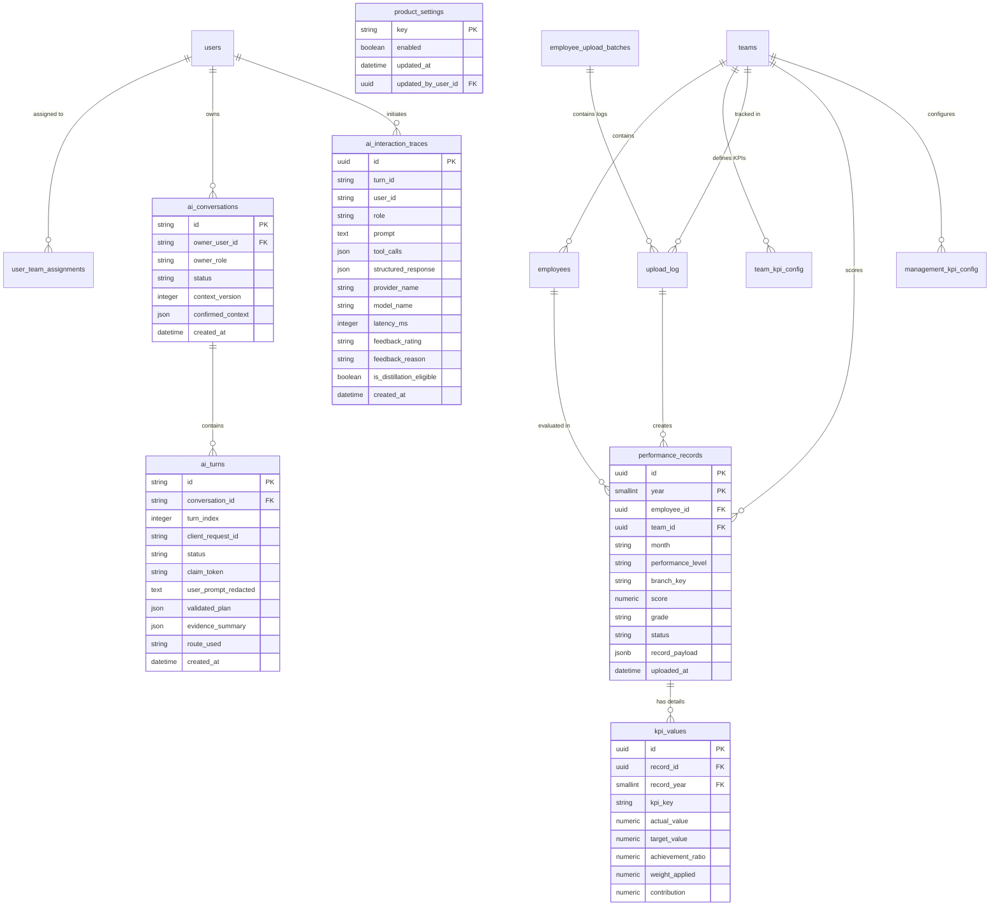

# Phase 2: Data Relationships & Evidence Semantics

**Document Version:** 1.0
**Date:** 10 November 2026
**Status:** Data Model & Semantics Verified
**Scope:** Phase 2 Deliverable for PMS AI Evidence-First Upgrade ([Implementation Plan](file:///D:/Projects/PMS_Dashboard/docs/plans/PMS_AI_EVIDENCE_FIRST_IMPLEMENTATION_PLAN.md))

---

## 1. Evidence Semantics & State Distinctions

To ensure analytical integrity, the PMS AI platform strictly differentiates four distinct data states:

```
Data State Taxonomy
├── 1. True Factual Zero (Measured value = 0)
├── 2. Missing / Unmeasured (Metric not tracked for this entity)
├── 3. Unpublished Period (No workbook uploaded for this month)
└── 4. Access Denied / Unscoped (User lacks RBAC permission)
```

### 1.1 True Zero vs Missing vs Unpublished
- **True Zero (`0` / `0.0%`):**
  - Meaning: The metric was actively measured, and the recorded result is numerically zero.
  - Examples: 0 abandoned calls (positive compliance); 0 bookings created in Sharjah (zero volume); 0.0% quality score (agent audited and failed all compliance questions).
  - Rule: Output must explicitly present zero as a factual measurement.
- **Missing / Unmeasured (`null` / `"Not measured"`):**
  - Meaning: The metric is not part of this position's scorecard or was omitted from the evaluation workbook.
  - Examples: AHT requested for a Medical Coder; Quality Score for an employee on leave.
  - Rule: **Never substitute `0` or `0.0%` for a missing value.** The system must state that the metric was not measured or tracked.
- **Unpublished Period:**
  - Meaning: No upload batch exists in `upload_log` or `performance_records` for the specified month and year.
  - Rule: **Never display zero or copy historical data to fill gaps.** The system must return an honest empty state:
    > *"No performance data was uploaded for [Team] in [Month Year]. Published records are available for: [List of available months]."*
- **Sample Demonstration Data:**
  - Meaning: When UI operates in demo/fallback mode (`is_fallback_data == True`).
  - Rule: Analytical computations are blocked with an explicit notice; mock numbers are never presented as real business facts.

---

## 2. Ambiguity Resolution & Identity Matching

1. **Employee Disambiguation:**
   - If a prompt specifies a common first name (e.g. *"How did Ahmed perform?"*) and multiple authorized employees share that name in the scope, the system **must refuse to pick arbitrarily**.
   - Required Response: Ask a clarification question presenting exact options:
     > *"There are 2 employees named Ahmed in Inbound (September 2026): Ahmed Hassan (ID: 70112) and Ahmed Mansour (ID: 70145). Which employee would you like to review?"*
2. **Team & Country Disambiguation:**
   - If a user asks *"How did Coding perform?"* without specifying a country, the query router checks the user's authorized scope.
   - If the user has access to both Egypt and UAE, the assistant clarifies: *"Would you like to review Coding EGY (Offshore Egypt) or Coding (UAE)?"*.
3. **Handling Ties in Rankings:**
   - When ranking performers or identifying top/bottom cohorts, the system must evaluate exact numerical values.
   - If two or more agents share the lowest score (e.g. both at 76.7%), **both agents must be named as tied**. Arbitrarily picking the first row in the database is strictly prohibited.
4. **Duplicate Record Precedence:**
   - In cases where an employee has records uploaded under multiple aliases (e.g. `Resubmission` vs `Re-Submission EGY`), the record linked to the **latest successful upload batch** (`upload_log.uploaded_at DESC`) is chosen.
   - The choice and conflict resolution are logged in the audit trace.

---

## 3. Branch Attribution Semantics

- **Canonical Branch Keys:** Defined in [`Backend/utils/branch_scope.py`](file:///D:/Projects/PMS_Dashboard/Backend/utils/branch_scope.py): `dubai`, `ajman`, `sharjah`, `clinics`.
- **Relational Column:** `performance_records.branch_key`.
- **Legacy Row Guard:** Legacy rows with `branch_key IS NULL` remain hidden from specific branch filters to prevent cross-facility pollution.
- **Operational Breakdown:** Multi-branch booking volumes reside in `performance_records.record_payload['geo']['bookings']`. Comparing branches requires all requested branches to be present; missing branches are noted explicitly as having zero recorded bookings.

---

## 4. Current-State Entity-Relationship Diagram (ERD)

Derived directly from the verified SQLAlchemy models in [`Backend/models/models.py`](file:///D:/Projects/PMS_Dashboard/Backend/models/models.py):



---

## 5. Composite Key & Partitioning Considerations

- **Partition Key Integrity:**
  In PostgreSQL, `performance_records` is partitioned by `year`. Consequently:
  - Primary Key is composite: `(id, year)`.
  - Foreign key reference from `kpi_values` is composite: `(record_id, record_year)` referencing `(performance_records.id, performance_records.year)` with `ON DELETE CASCADE`.
  - Queries must include `year` whenever filtering by ID to ensure optimal partition pruning.
