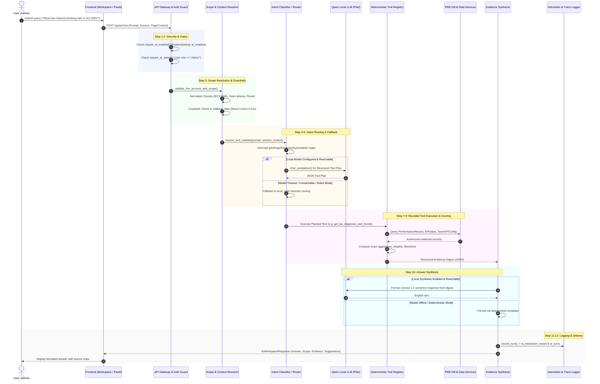

# Phase 1: End-to-End Request Flow Architecture

**Document Version:** 1.0  
**Date:** 10 November 2026  
**Status:** Architecture Map Verified  
**Scope:** Phase 1 Deliverable for PMS AI Evidence-First Upgrade ([Implementation Plan](file:///D:/Projects/PMS_Dashboard/docs/plans/PMS_AI_EVIDENCE_FIRST_IMPLEMENTATION_PLAN.md))

---

## 1. Overview and Entry Points

The PMS AI system exposes two user interfaces connecting to a shared backend pipeline:
1. **Dedicated PMS AI Workspace:**
   - **Frontend File:** [`Frontend/src/features/pmsAi/PmsAiWorkspaceView.tsx`](file:///D:/Projects/PMS_Dashboard/Frontend/src/features/pmsAi/PmsAiWorkspaceView.tsx)
   - **Route:** `/ai`
   - **Interaction:** Multi-turn conversational interface with scope filters (Country, Function, Team, Level, Period), suggested prompts, and evidence inspection panels.
2. **Contextual Assistant Panel:**
   - **Frontend File:** [`Frontend/src/features/contextualAssistant/ContextualAssistantPanel.tsx`](file:///D:/Projects/PMS_Dashboard/Frontend/src/features/contextualAssistant/ContextualAssistantPanel.tsx)
   - **Component:** Embedded drawer available on operational dashboard pages (Monthly Review, Team Deep Dive, Employee Scorecard, etc.).
   - **Interaction:** Single-turn or quick-action queries bound to the active page context (`page_route`, `selected_team`, `selected_month`, `is_fallback_data`).

Both entry points communicate with the backend via the FastAPI router [`Backend/api/routers/ai_workspace.py`](file:///D:/Projects/PMS_Dashboard/Backend/api/routers/ai_workspace.py) through two primary endpoints:
- `POST /api/ai/chat` (Full query handling and multi-turn execution)
- `POST /api/ai/watching` (Contextual page change summarization)
- `POST /api/ai/feedback` (User rating and review logging)

---

## 2. The 12-Step Request Flow Lifecycle

---

## 3. Step-by-Step Execution Details

### Step 1: Authentication and Product Feature Gate
- **Entry:** `POST /api/ai/chat` in [`Backend/api/routers/ai_workspace.py`](file:///D:/Projects/PMS_Dashboard/Backend/api/routers/ai_workspace.py).
- **Authentication:** `get_current_user` extracts JWT claims and binds the `User` object.
- **Product Gate:** `require_ai_enabled(db)` reads `ProductSetting.key == "ai_enabled"`. If false or missing, execution halts with HTTP `403 Forbidden`.
- **Role Gate:** `require_ai_admin(current_user)` verifies `current_user.role == "Admin"`. Any other role (e.g. `Manager`, `Employee`) receives HTTP `403 Forbidden`.

### Step 2: Session & Idempotency Management
- **Handler:** `AiConversationService` in [`Backend/services/ai/conversation_service.py`](file:///D:/Projects/PMS_Dashboard/Backend/services/ai/conversation_service.py).
- **Turn Claim:** Generates or validates `client_request_id`. Attempts a compare-and-swap update on `ai_turns` using a unique `claim_token`. If an identical request is in flight, duplicate processing is prevented.

### Step 3: Scope, Country, and Period Resolution
- **Files:** [`Backend/services/ai/catalog.py`](file:///D:/Projects/PMS_Dashboard/Backend/services/ai/catalog.py) and [`Backend/utils/report_scope.py`](file:///D:/Projects/PMS_Dashboard/Backend/utils/report_scope.py).
- **Country Resolution:**
  - If prompt specifies "Egypt" / "UAE", explicit query country takes precedence.
  - If omitted, uses user's default authorized region (`accessible_regions`).
  - Cross-country leakage is prevented: Egyptian teams cannot query UAE records, and vice versa.
- **Team & Alias Resolution:**
  - Evaluated via `resolve_canonical_team_name(raw_team, region=eff_region)`.
  - Disambiguates country-specific pairs: e.g. "Resubmission" in Egypt vs "Re-Submission" in UAE.
- **Period Resolution:**
  - Extracts target month and year (e.g. "October 2026"). Defaults to the latest active published month if unspecified.
- **Sample Data Guardrail:**
  - If `page_context.is_fallback_data == True`, execution immediately halts and returns an explicit warning: `"This page is currently displaying sample demonstration data. Analytics are restricted to published production records."`

### Step 4: Intent & Policy Routing
- **File:** [`Backend/services/ai/router.py`](file:///D:/Projects/PMS_Dashboard/Backend/services/ai/router.py) (`HybridQueryRouter`).
- **Deterministic Interceptions (Pre-Model):**
  1. **Greetings / Thanks:** Regex matches (`hi`, `hello`, `thank you`) return concise canned offers of assistance without querying performance tables.
  2. **Mutation Guard:** Regex matches for write verbs (`create`, `delete`, `update`, `drop`, `insert`) return an immediate read-only policy refusal.
  3. **Prompt Injection / System Leak Guard:** Regex patterns checking for instructions to ignore rules or output system prompts return a policy refusal.

### Step 5: Planning & Model Invocation (Qwen Pilot)
- **File:** [`Backend/services/ai/llm_client.py`](file:///D:/Projects/PMS_Dashboard/Backend/services/ai/llm_client.py).
- **Model Check:** Checks `get_ai_runtime_config().local_intent_enabled`.
- **Execution:**
  - Sends a structured prompt with allowed tool schemas to `http://pms-qwen-pilot:8080/v1/chat/completions`.
  - Enforces JSON schema validation on tool arguments.
- **Fallback Path:**
  - If Qwen is unreachable, times out (5.0s deadline), or outputs invalid JSON, `router.py` automatically falls back to `local_rules` mode.
  - The fallback is recorded in the trace diagnostics (`route_used="local_rules"`, `provider_name="deterministic"`).

### Step 6: Tool Execution & Authorization Re-Check
- **File:** [`Backend/services/ai/tool_registry.py`](file:///D:/Projects/PMS_Dashboard/Backend/services/ai/tool_registry.py) (`DeterministicToolRegistry`).
- **Allowlisted Tools:**
  1. `inspect_authorized_concepts`: Catalog and metric definitions.
  2. `get_executive_and_priority_insights`: Top-level performance overview and drag analysis.
  3. `get_kpi_diagnosis_and_trends`: Metric actual vs target, MoM trend, and historical points.
  4. `compare_branches_operational_volumes`: Cross-branch volume comparisons (Dubai, Ajman, Sharjah).
  5. `get_root_cause_and_action_recommendations`: Performance gap diagnosis and draft action proposals.
- **Authorization Re-Check:**
  - Every tool call executes `user_can_access_team()` and `user_can_access_branch()`. Even if an Admin requested the data, strict scope boundaries are re-verified per record.

### Step 7: Calculations and Scoring Engine
- **Files:** [`Backend/services/calculation_service.py`](file:///D:/Projects/PMS_Dashboard/Backend/services/calculation_service.py) and [`Backend/services/performance_service.py`](file:///D:/Projects/PMS_Dashboard/Backend/services/performance_service.py).
- **Scored vs Tracking-Only KPIs:**
  - Scored KPIs (e.g. Booking Rate, Attendance Rate, Quality Score) are weighted and contribute to the 100% score total.
  - Tracking indicators (e.g. AHT, Abandoned Calls) have weight `0.0` and are strictly excluded from score calculation.
- **Aggregation Rules:**
  - Employee-level score: Weighted sum of KPI achievements.
  - Pooled team score: Department-wide ratio of sums or weighted average based on configuration.
  - Country-specific scoring: RCM Egypt scoring rules use separate weights and formulas from RCM UAE rules.

### Step 8: Evidence Digest Construction
- **Object:** `TypedMetricEvidence` and structured dictionary.
- **Guarantees:**
  - Binds subject, country, team, position, period, metric key, unit, actual value, target value, and source file.
  - Distinguishes **zero** from **missing/unmeasured** data.

### Step 9: Response Synthesis
- **File:** [`Backend/services/ai/local_evidence_synthesis.py`](file:///D:/Projects/PMS_Dashboard/Backend/services/ai/local_evidence_synthesis.py).
- **Synthesis Logic:**
  - If `local_synthesis_enabled` and model reachable: Qwen composes a concise 1–2 sentence English answer strictly grounded in the evidence digest.
  - If model offline or fallback active: Deterministic string template formats the final response from evidence fields.
  - Strict Rule: No speculative extrapolation or correlation-to-causation claims are permitted.

### Step 10: Interaction Trace Logging
- **Model:** `AiInteractionTrace` in table `ai_interaction_traces`.
- **Recorded Fields:**
  - `turn_id`, `user_id`, `role`, `sanitized_prompt`, `session_state`, `tool_calls`, `tool_digest`, `structured_response`, `provider_name`, `model_name`, `latency_ms`, `non_empty_evidence`, `guardrail_triggered`.
- **Distillation Flag:** `is_distillation_eligible = False` by default; requires explicit reviewer audit.

### Step 11: Feedback Collection
- **Endpoint:** `POST /api/ai/feedback`.
- **Behavior:**
  - Accepts `turn_id`, `rating` (`"up"` or `"down"`), and optional `reason` text.
  - Updates `ai_interaction_traces.feedback_rating` and `ai_interaction_traces.feedback_reason`.
  - Feedback is strictly an audit signal for reviewers; it never triggers automatic online retraining or cache poisoning.

### Step 12: Exploration Mode Boundaries
- **File:** [`Backend/services/ai/local_data_explorer.py`](file:///D:/Projects/PMS_Dashboard/Backend/services/ai/local_data_explorer.py).
- **Production Gate:** If `APP_ENV == "production"`, `local_exploration_enabled()` returns `False`.
- **Boundaries:** Bounded to a maximum of 3 tool iterations, with row-count and latency limits.
