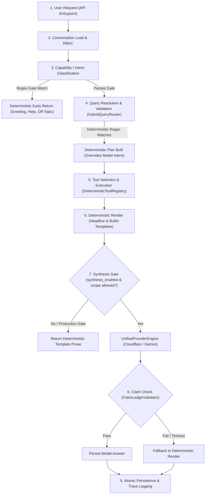

# PMS AI Request Path Audit: Rules vs. Model Execution

**Governing Specification:** [PMS AI Model-Led Implementation Plan](../PMS_AI_MODEL_LED_IMPLEMENTATION_PLAN.md)  
**Audit Baseline:** Working tree at commit `93a15cd22b3fbe63d7a1aad8b9dc3d39e3e6e625` (`fix/pre-approvals-ip-single-team`).

---

## 1. Executive Summary

This audit traces the real end-to-end request path from frontend submission to final persistence across the 9 stages defined by the authoritative architecture plan. It identifies where deterministic rules currently dictate behavior vs where the model is invoked, highlighting every condition where rules suppress, bypass, or replace model execution.

---

## 2. Stage-by-Stage Request Path Audit

### Stage 1: API Entrypoint & RBAC Isolation
- **Files:** `Backend/api/routers/ai_workspace.py` (`POST /api/ai/chat`)
- **Execution:** Purely backend / deterministic.
- **Behavior:**
  - Authenticates caller using `Depends(get_current_active_user)`.
  - Checks feature gate `read_ai_enabled(db)` (database-backed toggle, default `false`).
  - Enforces pilot access: requires Admin role if `ai_pilot_mode` is enabled.
  - Non-Admin or unauthenticated requests are rejected immediately with HTTP 401 / 403.
  - Dispatches authorized payload to `PmsAiOrchestrator(db, scope).run_chat_turn(request)`.

### Stage 2: Conversation Loading & Origin Locking
- **Files:** `Backend/services/ai/conversation_service.py`, `Backend/repositories/ai_conversation_repository.py`
- **Execution:** Purely backend / deterministic SQL.
- **Behavior:**
  - Loads or creates owned conversation record (`user_id` enforced).
  - Validates origin match: requests from `workspace` cannot silently resume `page_assistant` threads without explicit promotion (returns HTTP 409).
  - Retrieves recent turns (bounded history) and compact conversation state:
    - `last_confirmed_query`
    - `last_subject_employee_id`
    - `tied_candidates`
    - `already_confirmed_employee`

### Stage 3: Capability & Intent Classification
- **Files:** `Backend/services/ai/contextual_assistant.py` (`detect_contextual_capability`), `Backend/services/ai/local_model_router.py`
- **Execution:** **Rules-Dominant with Model Bypass**.
- **Behavior & Suppression Points:**
  - Hardcoded regexes evaluate user prompt:
    - `_GREETING_PATTERN`: Matches `"hi"`, `"hello"`, etc. -> Bypasses model; returns static greeting immediately.
    - `_THANKS_PATTERN`: Matches `"thank you"`, `"thanks"` -> Returns static response; zero provider calls.
    - `_HELP_PAGE_PATTERN`: Matches `"what can you do?"`, `"help"` -> Returns static capability guide.
    - `_OFF_TOPIC_PATTERN`: Matches non-PMS queries -> Rejects with off-topic message before model can interpret phrasing.
    - `_EXPLAIN_PREVIOUS_PATTERN`: Detects explanation requests.
  - **Where Model is Invoked:** If lexical patterns do not match and `PMS_AI_INTENT_ENABLED` is true, calls `call_suggest_intent` via `UnifiedProviderEngine` to propose a structured `RouterIntentType`.
  - **Suppression Risk:** Valid English questions using unfamiliar phrasing or colloquial language can be rejected by lexical off-topic filters before reaching the provider.

### Stage 4: Query Resolution & Validation
- **Files:** `Backend/services/ai/router.py` (`HybridQueryRouter.resolve_and_validate`), `Backend/services/ai/catalog.py`, `domain_policies.py`
- **Execution:** **Deterministic Rules Engine**.
- **Behavior & Suppression Points:**
  - `HybridQueryRouter` runs ~1,800 lines of regex patterns for:
    - Scope keywords (`team`, `function`, `country`, `branch`).
    - Metric names (`MetricRegistry` pattern scanning).
    - Period detection (`"September 2026"`, `"last month"`, relative dates).
    - Operation detection (`current_value`, `trend`, `ranking`, `comparison`).
  - **Suppression:** The model's proposed intent from Stage 3 is frequently overridden: if deterministic regexes match a specific intent pattern (e.g. ranking or bookings count), the router discards the model's intent and forces the rule-matched intent.
  - Entity validation checks catalog permissions via `CatalogService` and `domain_policies.py`. If ambiguous, produces a clarification prompt.

### Stage 5: Tool Selection & Execution
- **Files:** `Backend/services/ai/tool_registry.py` (`DeterministicToolRegistry`), `Backend/services/ai/data_access.py`
- **Execution:** Purely backend / deterministic database queries.
- **Behavior:**
  - The validated query plan maps to specific server-defined read tools:
    - `get_agent_spotlight_and_trend`
    - `get_team_comparison_and_breakdown`
    - `get_kpi_history`
    - `get_corrective_action_evidence`
  - Read-only SQLAlchemy queries fetch published `PerformanceRecord` and `TeamKpiItem` rows.
  - Returns structured typed evidence containing exact numeric values, dates, employee names, units, and publication status.
  - **Model Role:** Zero model invocation. Backend remains strictly authoritative for data retrieval and calculations.

### Stage 6: Deterministic Render
- **Files:** `Backend/services/ai/providers.py` (`DeterministicLocalProviderAdapter`)
- **Execution:** Deterministic string templating.
- **Behavior:**
  - Formats headline and bullet strings using fixed formatting templates (e.g., `"{name} recorded {value} {unit} in {period}."`).
  - This rendered text serves as the guaranteed deterministic baseline.

### Stage 7: Model Synthesis
- **Files:** `Backend/services/ai/orchestrator.py`, `Backend/services/ai/provider_engine.py`, `Backend/services/ai/local_evidence_synthesis.py`
- **Execution:** **Conditional Model Invocation**.
- **Behavior & Suppression Points:**
  - Model synthesis is evaluated under:
    - `local_synthesis_enabled()` (`PMS_AI_SYNTHESIS_ENABLED` or provider available).
    - Scope allowed for cloud (`ai_runtime_config.is_scope_allowed_for_cloud(scope)`).
    - Request not suppressed by variation seed or deterministic-only operations.
  - **Suppression Points:**
    - If `APP_ENV=production` and `exploration` is requested, it is completely blocked.
    - In the current orchestrator, only a narrow set of analytical intent types (such as branch comparisons or overall scores) invoke synthesis; single-person current value often terminates at Stage 6 deterministic render!
    - If provider call exceeds `PMS_AI_PROVIDER_TIMEOUT_SECONDS` (10.0s), network drops, or HTTP error occurs, the orchestrator silently substitutes the deterministic render.

### Stage 8: Claim Check & Verification
- **Files:** `Backend/services/ai/claim_validator.py` (`ClaimLedgerValidator`)
- **Execution:** Deterministic lexical and numeric verification.
- **Behavior:**
  - Extracts numeric tokens, entity IDs, dates, and units from the model's synthesized text.
  - Cross-references every extracted token against the authoritative evidence ledger returned in Stage 5.
  - **Suppression Point:** If a claim mismatch is detected (hallucinated number or ungrounded entity), the model's text is rejected and the system falls back to the deterministic headline and bullets.

### Stage 9: Persistence & Observability
- **Files:** `Backend/services/ai/orchestrator.py`, `Backend/services/ai/conversation_service.py`, `Backend/services/ai/trace_logger.py`
- **Execution:** Deterministic SQL transactions.
- **Behavior:**
  - Persists `user_turn` and `assistant_turn` atomically to PostgreSQL.
  - Stores turn provenance: provider used, model ID, latency, token usage, fallback reason code, and evidence IDs.
  - Updates conversation state idempotently.
  - Emits telemetry with API keys and secrets strictly redacted via `redact_secrets()`.

---

## 3. Key Findings on Rule vs. Model Balance

1. **Model Underutilization:** The current runtime behaves almost entirely as a deterministic rules engine. The external model is called only as an optional suggester in intent classification or narrow synthesis, and its results are frequently discarded in favor of regex matches.
2. **Lexical Gate Vulnerability:** Early gates in `contextual_assistant.py` and `local_model_router.py` use rigid regexes. Varied phrasing from managers can be falsely categorized as off-topic or misrouted before the model is ever consulted.
3. **Template Substitution:** When `PMS_AI_SYNTHESIS_ENABLED` is active, single-person current value queries still frequently output canned template prose from `providers.py` rather than synthesized language.
4. **Transition Mandate for Phase 2:** The model must be given ownership of:
   - Natural language comprehension.
   - Ambiguity detection and contextual follow-up clarification.
   - Structured tool selection (requesting server-defined read tools with typed parameters).
   - Evidence-grounded answer composition.
   While the backend retains 100% authority over authentication, permissions, data retrieval, calculations, and factual claim verification.
