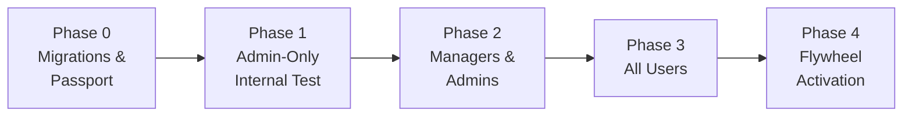

# PMS AI Milestone: User-Aware 360° Agent Coach
## KPI Rules Engine · Governed User Memory · Model Enhancement Flywheel

> **Status**: Draft — Pending User Approval  
> **Branch**: `feature/user-aware-360`  
> **Alembic Head**: `b3f7d2a9c6e1`  
> **EGM Reviews**: ✅ Design Critic · ✅ Codebase Auditor  
> **Prior Milestone**: UX/UI Redesign (Phases 1–5) — Committed `646d10ad`

---

## Executive Summary

Today the PMS AI assistant is **Admin-only** and has no concept of *who is asking*. An Agent cannot ask "What's my score?" and a Manager cannot ask "How is my team doing?" without an Admin intermediary.

This milestone delivers **four pillars** that transform the assistant from an Admin tool into a **personalized, role-aware coach** for every user:

| Pillar | What It Does |
|--------|-------------|
| **1. Staged Access & Identity** | Widens AI access from Admin → Managers → All Users via a governed rollout. Every request carries a `UserIdentityPassport` with role, scope, and employee linkage. |
| **2. Agent 360° Profile & What-If** | Agents with linked Employee records get a zero-LLM scorecard, cohort benchmarking, and a What-If simulator ("If I improve X by 5%, what grade do I reach?"). |
| **3. Governed User Memory** | Persists user preferences, goals, and coaching context across sessions with strict category schemas, RBAC validation, and hard caps. |
| **4. Model Enhancement Flywheel** | Feeds implicit friction signals, DPO rejected candidates, and persona-scoped patterns back into the training pipeline. |

> [!IMPORTANT]
> All four pillars are gated by EGM-validated mitigations for the 5 blockers and 5 majors identified during review.

---

## Table of Contents

1. [Pillar 1: Staged Access Widening & UserIdentityPassport](#pillar-1-staged-access-widening--useridentitypassport)
2. [Pillar 2: Agent 360° Profile & What-If Simulator](#pillar-2-agent-360-profile--what-if-simulator)
3. [Pillar 3: Governed User Memory](#pillar-3-governed-user-memory)
4. [Pillar 4: Model Enhancement Flywheel](#pillar-4-model-enhancement-flywheel)
5. [Database Migrations](#database-migrations)
6. [Frontend Gate Changes](#frontend-gate-changes)
7. [Security & Privacy Hardening](#security--privacy-hardening)
8. [Testing Strategy](#testing-strategy)
9. [Rollout Plan](#rollout-plan)
10. [Risk Register](#risk-register)

---

## Pillar 1: Staged Access Widening & UserIdentityPassport

### 1.1 Problem

Every AI endpoint is behind `Depends(require_ai_admin)` in `ai_workspace.py` L89-93. The Frontend gates in `access.ts` L127, `App.tsx` L56-70, `Sidebar.tsx` L328-370, and `ContextualAssistantPanel.tsx` L199 & L439 all check `isAdminRole(role)`. Non-Admin users literally cannot see or reach the AI.

### 1.2 Access Tier Model

Instead of a binary on/off, introduce a **three-stage rollout** via `ProductSetting`:

```
ai_access_tier:
  "admin_only"              → Current behavior (default)
  "managers_and_admins"     → Admins + Managers + Executives
  "all_authenticated_users" → Everyone with a valid session
```

> [!WARNING]
> **Blocker (EGM-DC-1)**: `ProductSetting` currently has only `key: String(80)` and `enabled: Boolean` — no string value column. Requires Alembic migration to add `value_str = Column(String(80), nullable=True)`.

### 1.3 Alembic Migration: `ProductSetting.value_str`

**File**: `Backend/migrations/versions/xxxx_add_product_setting_value_str.py`

```python
def upgrade():
    op.add_column('product_settings',
        sa.Column('value_str', sa.String(80), nullable=True))

def downgrade():
    op.drop_column('product_settings', 'value_str')
```

**Seed**: Insert `key='ai_access_tier', enabled=True, value_str='admin_only'` if not exists.

### 1.4 Router Split

**Blocker (EGM-DC-2)**: The single `ai_workspace.py` router applies `require_ai_admin` at the router level, blocking ALL `/api/ai/*` endpoints.

**Solution**: Split into two routers:

| Router | Prefix | Auth | Purpose |
|--------|--------|------|---------|
| `user_ai_router` | `/api/ai` | `require_ai_access` (tier-aware) | Chat, 360°, memory |
| `admin_ai_governance_router` | `/api/ai/admin` | `require_ai_admin` | Governance, patterns, traces, training export |

**`require_ai_access` logic** (new dependency in `feature_gate.py`):

```python
async def require_ai_access(user: User = Depends(get_current_user), db = Depends(get_db)):
    tier = get_product_setting_value(db, 'ai_access_tier') or 'admin_only'
    if tier == 'admin_only' and user.role != 'Admin':
        raise HTTPException(403, "AI access is currently Admin-only")
    if tier == 'managers_and_admins' and user.role not in ('Admin', 'Manager', 'Executive'):
        raise HTTPException(403, "AI access is currently limited to managers")
    # 'all_authenticated_users' → pass through (user is already authenticated)
```

### 1.5 UserIdentityPassport

A **dataclass** built once per request and injected into every AI pipeline call:

```python
@dataclass(frozen=True)
class UserIdentityPassport:
    user_id: str                        # User.id (UUID as string in current schema)
    username: str                       # User.username
    role: str                           # User.role
    persona_tier: PersonaTier           # Enum: SELF_ONLY | SCOPED_MANAGER | GLOBAL_EXEC
    employee_pk: UUID | None            # Employee.id (UUID) — for PerformanceRecord FK
    employee_code: str | None           # Employee.employee_id (String) — for User↔Employee link
    is_linked_employee: bool            # True if employee_pk is not None
    authorized_teams: list[str]         # From build_user_scope_from_db_user
    authorized_branches: list[str]      # From build_user_scope_from_db_user
    authorized_departments: list[str]   # From build_user_scope_from_db_user
```

> [!IMPORTANT]
> **Blocker (EGM-DC-3)**: `User.employee_id` is `String(50)` matching `Employee.employee_id` (String), but `PerformanceRecord.employee_id` is a UUID FK to `Employee.id` (UUID). The passport MUST carry **both** `employee_pk` (UUID) and `employee_code` (String) to safely join across tables.

**PersonaTier resolution** (from `dependencies.py` `is_self_only` logic + `settings.py` ROLES):

| Role | `is_self_only` | PersonaTier |
|------|----------------|-------------|
| Admin | No | `GLOBAL_EXEC` |
| Executive | Yes* | `GLOBAL_EXEC` (read-only broad scope) |
| Manager | No | `SCOPED_MANAGER` |
| Agent | Yes | `SELF_ONLY` |
| Employee | Yes | `SELF_ONLY` |

> *Executive `is_self_only` is inconsistent between `dependencies.py` (yes) and `auth.py /api/auth/me` (no). **Decision**: Treat Executive as `GLOBAL_EXEC` with read-only broad scope (matches Frontend behavior).

**Fail-closed for unlinked self-only users**: If `persona_tier == SELF_ONLY` and `employee_pk is None`, the passport's `is_linked_employee` is False. Any tool that queries performance data MUST return a friendly error: *"Your account isn't linked to an employee profile yet. Please contact your manager."*

### 1.6 Passport Serialization for LLM Context

**Major (EGM-DC-7)**: Bulk-injecting all KPI rules as `<AUTHORIZED_KPI_RULES>` would consume 4,000–9,000 tokens. 

**Mitigation**: The passport is serialized as a compact XML block ≤ **200 tokens** in Pass 1:

```xml
<CALLER_PASSPORT>
  role="Agent" persona="self_only" employee_code="EMP-1234"
  linked="true" teams="[Sales-North]" branches="[Cairo]"
</CALLER_PASSPORT>
```

KPI rules are **never** bulk-injected. They are retrieved on-demand via the `explain_scoring_rules_and_targets` tool (see §1.7).

### 1.7 New Tool: `explain_scoring_rules_and_targets`

**Purpose**: When a user asks "How is my score calculated?" or "What do I need for Grade A?", the LLM calls this tool instead of having rules pre-loaded.

**Implementation** (in `tool_registry.py`):

```python
def explain_scoring_rules_and_targets(
    passport: UserIdentityPassport,
    kpi_name: str | None = None,  # Optional filter
) -> dict:
    """Returns scoring rules, weights, targets, and grade thresholds
    for the caller's applicable KPIs."""
    
    # Source: scoring_rules.py GRADE_THRESHOLD_MAP (NOT legacy GradeThreshold table)
    # Source: KPIConfigurationService.list_weights() / list_targets()
    # Source: config/loader.py GLOBAL_KPI_ACHIEVEMENT_CAP
    # Source: engine.py L97-400 for formula descriptions
    
    # For SELF_ONLY: return only KPIs applicable to their team config
    # For SCOPED_MANAGER: return KPIs for their authorized teams
    # For GLOBAL_EXEC: return all KPI configurations
```

**Output** (≤ 500 tokens): Structured dict with weights, targets, formulas, grade thresholds, and cap rules — the LLM summarizes this for the user.

> [!NOTE]
> **Must use** `scoring_rules.py` L21-40 `GRADE_THRESHOLD_MAP` and `scoring.py` L230-242 `grade_for` — the `GradeThreshold` DB table is **legacy** and not the active scoring source.

---

## Pillar 2: Agent 360° Profile & What-If Simulator

### 2.1 Problem

Agents have no self-service view of their performance. They must ask an Admin to look up their data. The AI assistant doesn't know if the caller has a 360° profile.

### 2.2 Zero-LLM Agent 360° Endpoint

**Major (EGM-DC-6)**: The Agent 360° morning briefing MUST be zero-LLM-token. It's a deterministic data assembly, not a generative task.

**Endpoint**: `GET /api/ai/agent-360`

**Auth**: `require_ai_access` + passport must have `is_linked_employee == True`

**Response schema** (Pydantic):

```python
class Agent360Response(BaseModel):
    employee_code: str
    employee_name: str
    current_period: str                    # "October 2026"
    
    # From execute_agent_spotlight_and_trend (tool_registry.py L2700-3595)
    overall_score: float
    overall_grade: str                     # From scoring_rules.grade_for()
    score_trend: list[MonthScore]          # 6-month history
    grade_trend: list[MonthGrade]
    
    # Per-KPI breakdown
    kpi_scores: list[KpiScoreDetail]       # name, score, weight, target, achievement
    top_strength: str                      # Highest weighted-achievement KPI
    top_opportunity: str                   # Lowest weighted-achievement KPI
    
    # From CorrectiveActionService.get_history (L198-215)
    active_corrective_actions: int
    corrective_action_summary: str | None
    
    # From PlanningService.classify_records (L65-164)
    performance_classification: str        # "Improving" | "Stable" | "Declining" | "New"
    
    # Cohort benchmarking (privacy-safe)
    cohort: CohortBenchmark | None         # Only if cohort_size >= 5
    
    # What-If quick suggestions
    what_if_suggestions: list[WhatIfSuggestion]  # Top 2 KPIs with projected impact

class CohortBenchmark(BaseModel):
    cohort_size: int                       # Must be >= 5
    cohort_avg_score: float
    percentile_band: str                   # "Top 10%" | "Top 25%" | "Top 50%" | "Bottom 50%"
    # NO min/max/exact rank — prevents score reconstruction (EGM-DC-4)
```

**Data composition** — reuse existing services, do NOT duplicate:

| Data | Service | Location |
|------|---------|----------|
| Score + Trend | `DeterministicToolRegistry.execute_agent_spotlight_and_trend` | `tool_registry.py` L2700-3595 |
| Multi-month history | `execute_employee_multi_month_history` | `tool_registry.py` L3847-3859 |
| Corrective actions | `CorrectiveActionService.get_history` | `corrective_action_service.py` L198-215 |
| Classification | `PlanningService.classify_records` | `planning_service.py` L65-164 |
| Score lift projection | `CorrectiveActionEvidenceService._projected_score_lift` | `corrective_action_evidence.py` L361-380 |
| Employee history | `PerformanceDashboardReadService.employee_history` | L724-755 |
| Weights & targets | `KPIConfigurationService.list_weights()` / `list_targets()` | `kpi_configuration_service.py` |
| Grade thresholds | `scoring_rules.GRADE_THRESHOLD_MAP` / `grade_for()` | `scoring_rules.py` L21-40 |
| Achievement cap | `config/loader.py` `GLOBAL_KPI_ACHIEVEMENT_CAP` | `config/loader.py` |

### 2.3 Cohort Benchmarking (Privacy-Safe)

> [!CAUTION]
> **Blocker (EGM-DC-4)**: Returning min/max/exact rank when N ≤ 5 allows score reconstruction. 

**Rules**:
- `MIN_COHORT_SIZE = 5` — below this, return `cohort: null`
- Cohort = same `position` + same `branch` in same period
- Return ONLY: `{cohort_size, cohort_avg_score, percentile_band}`
- Percentile bands: "Top 10%", "Top 25%", "Top 50%", "Bottom 50%" (no exact rank)
- SQL query must include `HAVING COUNT(*) >= 5`

### 2.4 What-If Simulator

**Purpose**: "If I improve my Rejection Rate by 5%, what happens to my overall score?"

**Implementation** (new tool in `tool_registry.py`):

```python
def simulate_kpi_improvement(
    passport: UserIdentityPassport,
    kpi_name: str,
    improvement_pct: float,       # e.g., 5.0 means +5 percentage points
) -> WhatIfResult:
    """Deterministic What-If calculation."""
```

> [!WARNING]
> **Major (EGM-DC-5)**: What-If math MUST respect:
> 1. `GLOBAL_KPI_ACHIEVEMENT_CAP = 1.0` — no KPI achievement can exceed 100%
> 2. `lower_better` hyperbolic formulas (e.g., Rejection Rate: lower is better)
> 3. Pinned evaluation basis from `scoring_basis_comparison.py` L1-390
> 4. Current weights from `KPIConfigurationService`, not hardcoded

**What-If flow**:
1. Load current `PerformanceRecord` for the agent's latest period
2. Load applicable KPI weights and targets from `KPIConfigurationService`
3. Apply the hypothetical improvement to the target KPI's raw value
4. Recalculate achievement using `engine.py` formulas (respecting `lower_better`)
5. Cap achievement at `GLOBAL_KPI_ACHIEVEMENT_CAP`
6. Recalculate weighted overall score
7. Determine new grade via `scoring_rules.grade_for()`
8. Return delta: `{current_score, projected_score, current_grade, projected_grade, score_delta}`

### 2.5 Frontend: Agent 360° Scorecard

**New component**: `Frontend/src/components/ai/agent360/Agent360Scorecard.tsx`

**Behavior by persona tier**:

| Persona | View |
|---------|------|
| `SELF_ONLY` (Agent/Employee) | Locked to own profile. Shows "My 360° Scorecard" pill in `PmsAiWorkspaceView`. No `ScopeFilterBar`. First-person pronouns ("Your score is..."). |
| `SCOPED_MANAGER` | Can view their own 360° + any direct report's 360° |
| `GLOBAL_EXEC` | Can view any employee's 360° |

**Component structure**:

```
Agent360Scorecard
├── ScoreHeader          — Overall score, grade badge, trend sparkline
├── KpiBreakdownGrid     — Per-KPI scores with progress bars
├── CohortBenchmark      — Percentile band (or "Not enough peers" message)
├── TrendChart           — 6-month line chart (recharts)
├── WhatIfSimulator      — Interactive slider + projected outcome
├── CorrectiveActions    — Active items with status badges
└── QuickActions         — "Ask about this KPI" → opens AI chat pre-filled
```

**States**:
- **Loading**: Skeleton loader (shimmer cards matching layout)
- **Empty**: "Your account isn't linked to an employee profile. Contact your manager."
- **Error**: Retry button with friendly message
- **Success**: Full scorecard

**PmsAiWorkspaceView changes** (for `SELF_ONLY` users):
- Replace `ScopeFilterBar` with a locked "My 360° Scorecard" pill
- Default home view = `Agent360Scorecard` instead of `AiMorningBriefingHome`
- Chat input auto-binds first-person pronouns: "What's my score?" → passport's employee

---

## Pillar 3: Governed User Memory

### 3.1 Problem

The AI assistant has no memory between sessions. Every conversation starts from zero. Users must re-explain their context, goals, and preferences.

### 3.2 AiUserMemory Model

**Alembic migration**: New table `ai_user_memory`

```python
class AiUserMemory(Base):
    __tablename__ = 'ai_user_memory'
    
    id = Column(UUID_TYPE, primary_key=True, default=uuid4)
    owner_user_id = Column(UUID_TYPE, ForeignKey('users.id', ondelete='CASCADE'), nullable=False)
    category = Column(String(30), nullable=False)      # Enum-validated
    memory_key = Column(String(80), nullable=False)     # Scoped key within category
    value_json = Column(JSON_COMPAT_TYPE, nullable=False)  # Strict Pydantic per category
    created_at = Column(DateTime, default=func.now())
    updated_at = Column(DateTime, default=func.now(), onupdate=func.now())
    
    __table_args__ = (
        UniqueConstraint('owner_user_id', 'category', 'memory_key'),
        Index('ix_ai_user_memory_owner', 'owner_user_id'),
    )
```

> [!IMPORTANT]
> **Blocker (EGM-DC-9)**:
> - `owner_user_id` MUST be UUID FK to `users.id` with `ON DELETE CASCADE` — NOT a loose String like `AiConversation.owner_user_id`
> - Use `JSON_COMPAT_TYPE` for SQLite test compatibility
> - Register in `ensure_trace_schema_once` for SQLite tests
> - UUID PK for `AuditLog.record_id` compatibility

### 3.3 Memory Categories (Strict Pydantic Schemas)

No free-text injection. Each category has a fixed Pydantic schema:

```python
class MemoryCategory(str, Enum):
    PREFERENCE = "preference"           # UI preferences, communication style
    GOAL = "goal"                       # Performance goals, improvement targets
    COACHING_CONTEXT = "coaching"       # Recent coaching notes, action items
    FOCUS_AREA = "focus"               # KPIs the user wants to track closely
```

**Per-category schemas**:

```python
class PreferenceMemory(BaseModel):
    key: Literal["language", "detail_level", "chart_type", "notification"]
    value: str = Field(max_length=100)

class GoalMemory(BaseModel):
    kpi_name: str = Field(max_length=50)
    target_value: float
    target_grade: str | None = Field(pattern=r'^[A-D]$')
    deadline_month: str | None = Field(pattern=r'^\d{4}-\d{2}$')

class CoachingMemory(BaseModel):
    topic: str = Field(max_length=100)
    notes: str = Field(max_length=300)
    action_items: list[str] = Field(max_items=5)

class FocusAreaMemory(BaseModel):
    kpi_name: str = Field(max_length=50)
    reason: str = Field(max_length=200)
```

### 3.4 Hard Caps

| Constraint | Limit | Rationale |
|-----------|-------|-----------|
| Max items per user | 12 | Prevent unbounded growth |
| Max token budget for LLM context | 300 tokens | Combined with passport ≤ 500 total |
| Max `value_json` size | 1 KB | Per-item storage cap |
| Max categories | 4 (enum) | Fixed set, no dynamic expansion |

### 3.5 Memory Extraction (Zero Extra LLM Calls)

**Deterministic post-turn extraction** — no additional LLM calls:

1. After the LLM response is generated, a **regex + keyword matcher** scans the response for memory-worthy signals:
   - User explicitly says "Remember that I..." or "My goal is..."
   - LLM response includes coaching recommendations
   - User sets a preference ("Show me charts" / "Keep it brief")

2. Matched signals are queued as `MemoryUpsertCommand` objects

3. Memory writes happen **OUTSIDE** the `ReadOnlySessionGuard`:
   - The AI tool execution runs inside `ReadOnlySessionGuard` (no DB writes)
   - After tool execution completes, the orchestrator applies memory upserts in a separate DB session

> [!NOTE]
> **Critical constraint** (EGM-CB): `ReadOnlySessionGuard` blocks all DB writes inside AI tools. Memory persistence MUST happen in the post-turn phase of `orchestrator.py:_handle_model_led_turn`, after the tool session closes.

### 3.6 Memory CRUD API

| Endpoint | Method | Auth | Purpose |
|----------|--------|------|---------|
| `/api/ai/memory` | GET | `require_ai_access` | List user's own memories (RBAC: own only) |
| `/api/ai/memory` | PUT | `require_ai_access` | Upsert a memory item (atomic `ON CONFLICT DO UPDATE`) |
| `/api/ai/memory/{id}` | DELETE | `require_ai_access` | Delete a specific memory |
| `/api/ai/memory/purge` | DELETE | `require_ai_access` | Purge all memories (chat reset) |

**RBAC re-validation**: Every read re-validates that the requesting user owns the memory. No cross-user access even for Admins (privacy boundary).

### 3.7 Memory Serialization for LLM Context

Serialized as a compact XML block ≤ **300 tokens** in Pass 1:

```xml
<VERIFIED_USER_MEMORY>
  goals: [{"kpi": "Booking CR", "target": "35%", "grade": "A"}]
  focus: ["Rejection Rate", "Resubmission"]
  prefs: {"detail": "brief", "charts": true}
</VERIFIED_USER_MEMORY>
```

Combined with `<CALLER_PASSPORT>` (≤ 200 tokens), total identity context ≤ **500 tokens**.

### 3.8 Frontend: "My Profile & Memory" Drawer

**New component**: `Frontend/src/components/ai/memory/UserMemoryDrawer.tsx`

- Accessible from user avatar menu or AI workspace settings
- Shows all stored memories grouped by category
- Edit/delete individual items
- "Clear All" with confirmation dialog
- Visual token budget indicator (12/12 items used)

---

## Pillar 4: Model Enhancement Flywheel

### 4.1 Problem

The current training pipeline (`TrainingTraceLogger`, `FeedbackGovernanceService`, `ApprovedPatternMatcher`) works but has blind spots: rejected DPO candidates are discarded, implicit friction is unrecorded, and patterns don't account for persona tiers.

### 4.2 Implicit Friction Signals

Record these automatically in `AiInteractionTrace.structured_response`:

| Signal | Detection | Storage |
|--------|-----------|---------|
| Rephrase within 45s | Indexed SQL on `AiTurn.created_at` (NOT runtime timers) | `{"friction": "rephrase", "gap_seconds": 12}` |
| "Not helpful" click | Existing feedback button | Already stored via `FeedbackGovernanceService` |
| Abandoned conversation | No follow-up turn within 5 min | `{"friction": "abandoned"}` |
| Scope escalation | User asks same question at broader scope | `{"friction": "scope_escalation"}` |

**Rephrase detection** (EGM-DC recommendation):
```sql
-- Detect rephrase: same conversation, next turn within 45s, similar intent
SELECT t2.id FROM ai_turns t1
JOIN ai_turns t2 ON t1.conversation_id = t2.conversation_id
  AND t2.turn_number = t1.turn_number + 1
  AND EXTRACT(EPOCH FROM (t2.created_at - t1.created_at)) <= 45
WHERE t1.id = :current_turn_id
```

### 4.3 DPO Rejected Candidate Persistence

> [!WARNING]
> **Major (EGM-DC-10)**: Currently when `validate_claims` rejects a response, the rejected candidate is discarded. This loses valuable DPO training signal.

**Fix**: When a response is rejected by validation, persist the rejected response in `AiInteractionTrace.structured_response`:

```python
# In orchestrator.py, after validate_claims rejects:
trace_logger.record_turn(
    ...,
    structured_response={
        "accepted": accepted_response,
        "rejected": rejected_response[:1024],  # Cap at 1KB
        "rejection_reason": reason,
        "dpo_pair": True,
    }
)
```

### 4.4 Persona-Scoped Approved Patterns

**Problem**: `AiApprovedPattern` has no concept of persona tier. A pattern approved for an Admin could be surfaced to an Agent, leaking scope.

**Fix**: Add `persona_tier` column to `AiApprovedPattern`:

```python
# Alembic migration
op.add_column('ai_approved_patterns',
    sa.Column('persona_tier', sa.String(20), nullable=True))
# NULL = universal pattern, non-NULL = only for that tier
```

**Matching logic** in `ApprovedPatternMatcher`:
```python
def find_matching_patterns(self, query, passport):
    patterns = self._get_patterns()
    return [p for p in patterns 
            if p.persona_tier is None or p.persona_tier == passport.persona_tier.value]
```

### 4.5 Privacy & Deidentification Hardening

| Fix | Location | Detail |
|-----|----------|--------|
| Extend `redact_nested_payload` | `trace_logger.py` | Add `employee_code`, `employee_pk`, `username` to redaction list |
| `assess_pii_quarantine` | New function | For first-person self-scoped prompts, flag PII in user message before logging |
| `MIN_EXPORT_COHORT_SIZE = 5` | `export_distillation_dataset` | Apply to ALL deidentified exports, fix `_compute_cohort_size` to include position+branch |
| Escape XML in evidence | `fence_untrusted_evidence` | Strip `<`, `>`, backticks from untrusted data before `<untrusted_evidence>` wrapping (EGM-DC-8) |

### 4.6 Bounded Queries

**Fix** (EGM-CB): Replace unbounded `.all()` calls:

| Current | Fix |
|---------|-----|
| `cluster_failures` loads all traces | Add `LIMIT 1000` + date filter (last 30 days) |
| `purge_expired_feedback` loads all | Batch delete with `LIMIT 500` per iteration |
| `export_distillation_dataset` loads all | Paginated export with `offset`/`limit` |

### 4.7 Usage Budget Tiers

When `ai_access_tier != 'admin_only'`, non-Admin users need usage limits:

```python
# usage_budget.py
TIER_BUDGETS = {
    PersonaTier.GLOBAL_EXEC: {"daily_turns": 100, "daily_tokens": 50_000},
    PersonaTier.SCOPED_MANAGER: {"daily_turns": 50, "daily_tokens": 25_000},
    PersonaTier.SELF_ONLY: {"daily_turns": 20, "daily_tokens": 10_000},
}
```

Enforced via `check_usage_budget(passport)` dependency on `user_ai_router`.

---

## Database Migrations

All in a single Alembic migration file: `Backend/migrations/versions/xxxx_user_aware_360.py`

| Change | Table | Type |
|--------|-------|------|
| Add `value_str` column | `product_settings` | ALTER |
| Create `ai_user_memory` table | `ai_user_memory` | CREATE |
| Add `persona_tier` column | `ai_approved_patterns` | ALTER |
| Seed `ai_access_tier` setting | `product_settings` | INSERT |

**Rollback**: Full `downgrade()` that drops added columns and table.

---

## Frontend Gate Changes

Every gate that currently checks `isAdminRole(role)` or `role === 'Admin'` must be updated:

| File | Line(s) | Current | New |
|------|---------|---------|-----|
| `access.ts` | L127 | `ROUTE_ROLES.pmsAi: ['Admin']` | `ROUTE_ROLES.pmsAi: ['Admin', 'Manager', 'Executive', 'Agent', 'Employee']` (gate by API tier) |
| `App.tsx` | L56-70 | Agent/Employee early `<Routes>` switch drops `/ai` | Include `/ai` route for all roles |
| `ContextualAssistantPanel.tsx` | L199 | `isAdminRole(role)` | `hasAiAccess(role, aiTier)` |
| `ContextualAssistantPanel.tsx` | L439 | `isAdminRole(role)` | `hasAiAccess(role, aiTier)` |
| `Sidebar.tsx` | L328-370 | Self-only branch omits `/ai` | Add `/ai` link for all roles when tier permits |
| `FunctionViewerNav.tsx` | — | No `/ai` link | Add conditional `/ai` link |
| `Header.tsx` | L367 | Admin check | Tier-aware check |
| `AiFeatureSwitch.tsx` | L80-82 | Admin check | Tier-aware check |

**New utility**: `Frontend/src/utils/aiAccess.ts`

```typescript
export function hasAiAccess(role: string, aiTier: AiAccessTier): boolean {
  if (aiTier === 'admin_only') return role === 'Admin';
  if (aiTier === 'managers_and_admins') return ['Admin', 'Manager', 'Executive'].includes(role);
  return true; // all_authenticated_users
}
```

**AI tier fetching**: Add `ai_access_tier` to the `/api/auth/me` response payload. Cache in `AuthContext`.

---

## Security & Privacy Hardening

### 7.1 XML Tag Breakout Prevention

> [!CAUTION]
> **Blocker (EGM-DC-8)**: Current `sanitize_untrusted_text` doesn't escape `<` and `>`. Malicious data in `<untrusted_evidence>` could break out of XML fencing.

**Fix**: New `fence_untrusted_evidence(text: str) -> str`:
```python
def fence_untrusted_evidence(text: str) -> str:
    """Escape XML-sensitive chars before wrapping in <untrusted_evidence>."""
    text = text.replace('&', '&amp;')
    text = text.replace('<', '&lt;')
    text = text.replace('>', '&gt;')
    text = text.replace('`', '&#96;')
    return f'<untrusted_evidence>{text}</untrusted_evidence>'
```

### 7.2 Memory Injection Prevention

- All memory values are validated through strict Pydantic schemas per category
- `value_json` is serialized by Pydantic, NOT by string concatenation
- Memory is wrapped in `<VERIFIED_USER_MEMORY>` tags (agent cannot modify)
- Memory content is escaped with `fence_untrusted_evidence` before injection

### 7.3 Scope Enforcement

- `SELF_ONLY` users can ONLY query their own `employee_pk` — enforced at tool level
- `SCOPED_MANAGER` users can ONLY query employees in their `authorized_teams/branches/departments`
- Scope is re-validated on every tool call, not just at request entry
- `entity_resolver.py` respects passport scope when resolving employee references

---

## Testing Strategy

### 8.1 Backend Tests

| Test File | Coverage |
|-----------|----------|
| `test_user_identity_passport.py` | Passport construction from all role types, edge cases (unlinked agent, Executive scope) |
| `test_ai_access_tier.py` | All 3 tiers × all roles = 15 combinations, default fallback |
| `test_agent_360_endpoint.py` | Full 360° response assembly, cohort privacy (N<5 → null), unlinked user error |
| `test_what_if_simulator.py` | Cap enforcement, `lower_better` formulas, basis pinning, weight changes |
| `test_ai_user_memory.py` | CRUD operations, cap enforcement (13th item rejected), cascade delete, category validation |
| `test_memory_extraction.py` | Keyword matching, signal detection, post-turn upsert outside ReadOnlySessionGuard |
| `test_scoring_rules_tool.py` | Rule explanation accuracy, scope filtering, token budget compliance |
| `test_dpo_persistence.py` | Rejected candidate storage, 1KB cap, export inclusion |
| `test_xml_escaping.py` | `fence_untrusted_evidence` with `<script>`, backticks, nested XML |
| `test_usage_budget.py` | Tier limits enforcement, budget exhaustion response |

### 8.2 Frontend Tests

| Test File | Coverage |
|-----------|----------|
| `Agent360Scorecard.test.tsx` | All 4 states (loading/empty/error/success), persona-tier visibility |
| `UserMemoryDrawer.test.tsx` | CRUD interactions, cap indicator, clear-all confirmation |
| `aiAccess.test.ts` | `hasAiAccess` for all tier × role combinations |
| `PmsAiWorkspaceView.test.tsx` | Self-only mode (locked pill), manager mode (scope bar) |

### 8.3 E2E Tests (Playwright)

| Test | Scenario |
|------|----------|
| `agent_360_self_service.spec.ts` | Agent logs in → sees 360° scorecard → uses What-If → asks AI about score |
| `manager_views_report.spec.ts` | Manager logs in → views own 360° → switches to direct report's 360° |
| `memory_persistence.spec.ts` | User sets goal → new session → AI remembers goal |
| `access_tier_rollout.spec.ts` | Admin changes tier → Manager gains access → Agent gains access |

---

## Rollout Plan



### Phase 0: Infrastructure (Week 1)
- Alembic migration (all schema changes)
- `UserIdentityPassport` dataclass + builder
- Router split (`user_ai_router` + `admin_ai_governance_router`)
- `require_ai_access` dependency
- `fence_untrusted_evidence` hardening
- Backend tests for passport, tier, escaping

### Phase 1: Admin-Only Internal Test (Week 2)
- `ai_access_tier = 'admin_only'` (no behavior change for end users)
- `explain_scoring_rules_and_targets` tool
- Agent 360° endpoint (`GET /api/ai/agent-360`)
- What-If simulator tool
- `AiUserMemory` CRUD + extraction
- All backend tests passing
- Internal testing by Admin users

### Phase 2: Managers & Admins (Week 3)
- Set `ai_access_tier = 'managers_and_admins'`
- Frontend gate changes (all files in §6)
- `Agent360Scorecard` component
- `UserMemoryDrawer` component
- `hasAiAccess` utility
- Usage budget enforcement
- Frontend tests + E2E tests
- Manager UAT

### Phase 3: All Users (Week 4)
- Set `ai_access_tier = 'all_authenticated_users'`
- Self-only mode in `PmsAiWorkspaceView` (locked pill, no scope bar)
- First-person pronoun auto-binding
- Agent onboarding flow (first-time 360° walkthrough)
- Full E2E test suite
- Agent UAT

### Phase 4: Flywheel Activation (Week 5)
- DPO rejected candidate persistence
- Persona-scoped approved patterns
- Implicit friction signal recording
- `redact_nested_payload` extensions
- Bounded query fixes
- Deidentification hardening
- Training pipeline integration tests

---

## Risk Register

| # | Risk | Impact | Mitigation | Owner |
|---|------|--------|------------|-------|
| R1 | Unlinked Agent accounts (no `employee_id`) | Agent sees "not linked" error, no 360° | Fail-closed with friendly message + Admin notification | Backend |
| R2 | Cloudflare 10K Neurons/day exhausted with more users | AI unavailable | Usage budget tiers (§4.7) + graceful degradation message | Backend |
| R3 | Memory injection via crafted goals | LLM prompt manipulation | Strict Pydantic schemas + `fence_untrusted_evidence` | Backend |
| R4 | Cohort size < 5 in small teams | No benchmarking available | Return `null` with explanation, never approximate | Backend |
| R5 | Executive `is_self_only` inconsistency | Wrong scope assignment | Treat as `GLOBAL_EXEC` read-only (matches Frontend) | Backend |
| R6 | `ReadOnlySessionGuard` blocks memory writes | Memory not persisted | Post-turn extraction OUTSIDE guard session | Backend |
| R7 | Token budget exceeded with passport + memory | Input truncation | Hard caps: 200 (passport) + 300 (memory) = 500 | Backend |
| R8 | Legacy `GradeThreshold` table used instead of `scoring_rules.py` | Wrong grade calculation | Code review gate: grep for `GradeThreshold` in new code | QA |

---

## Appendix A: Files to Create

| File | Purpose |
|------|---------|
| `Backend/migrations/versions/xxxx_user_aware_360.py` | Alembic migration |
| `Backend/models/ai_user_memory.py` | SQLAlchemy model |
| `Backend/schemas/ai_identity.py` | `UserIdentityPassport`, `PersonaTier`, `Agent360Response` |
| `Backend/schemas/ai_memory.py` | Memory category schemas (Pydantic) |
| `Backend/api/user_ai_router.py` | User-facing AI endpoints |
| `Backend/api/admin_ai_governance_router.py` | Admin governance endpoints (moved from `ai_workspace.py`) |
| `Backend/services/ai/identity_service.py` | Passport builder |
| `Backend/services/ai/memory_service.py` | Memory CRUD + extraction |
| `Backend/services/ai/agent_360_service.py` | 360° data assembly |
| `Backend/services/ai/what_if_service.py` | What-If simulator |
| `Backend/services/ai/usage_budget.py` | Tier-based usage limits |
| `Frontend/src/components/ai/agent360/Agent360Scorecard.tsx` | 360° scorecard component |
| `Frontend/src/components/ai/agent360/WhatIfSimulator.tsx` | Interactive What-If UI |
| `Frontend/src/components/ai/memory/UserMemoryDrawer.tsx` | Memory management drawer |
| `Frontend/src/utils/aiAccess.ts` | Access tier utility |

## Appendix B: Files to Modify

| File | Change |
|------|--------|
| `Backend/models/models.py` | Register `AiUserMemory`, add `persona_tier` to `AiApprovedPattern` |
| `Backend/api/ai_workspace.py` | Split into two routers, update dependencies |
| `Backend/services/ai/feature_gate.py` | Add `require_ai_access`, `ai_access_tier` logic |
| `Backend/services/ai/tool_registry.py` | Add `explain_scoring_rules_and_targets`, `simulate_kpi_improvement` |
| `Backend/services/ai/orchestrator.py` | Inject passport + memory in Pass 1, post-turn memory extraction |
| `Backend/services/ai/trace_logger.py` | Extend `redact_nested_payload`, DPO persistence |
| `Backend/services/ai/approved_patterns.py` | Persona-tier filtering |
| `Backend/services/ai/feedback_service.py` | Bounded queries |
| `Backend/config/settings.py` | `TIER_BUDGETS` config |
| `Frontend/src/utils/access.ts` | Widen `ROUTE_ROLES.pmsAi` |
| `Frontend/src/App.tsx` | Remove Agent/Employee early switch for `/ai` |
| `Frontend/src/components/ai/ContextualAssistantPanel.tsx` | Replace 2× `isAdminRole` checks |
| `Frontend/src/components/layout/Sidebar.tsx` | Add `/ai` for all roles |
| `Frontend/src/components/ai/PmsAiWorkspaceView.tsx` | Self-only mode, locked pill |
| `Frontend/src/components/layout/Header.tsx` | Tier-aware check |
| `Frontend/src/components/ai/AiFeatureSwitch.tsx` | Tier-aware check |

---

> **Next Step**: After approval, run `/to-tickets` to break this spec into implementation tickets following the Phase 0 → Phase 4 rollout sequence.
